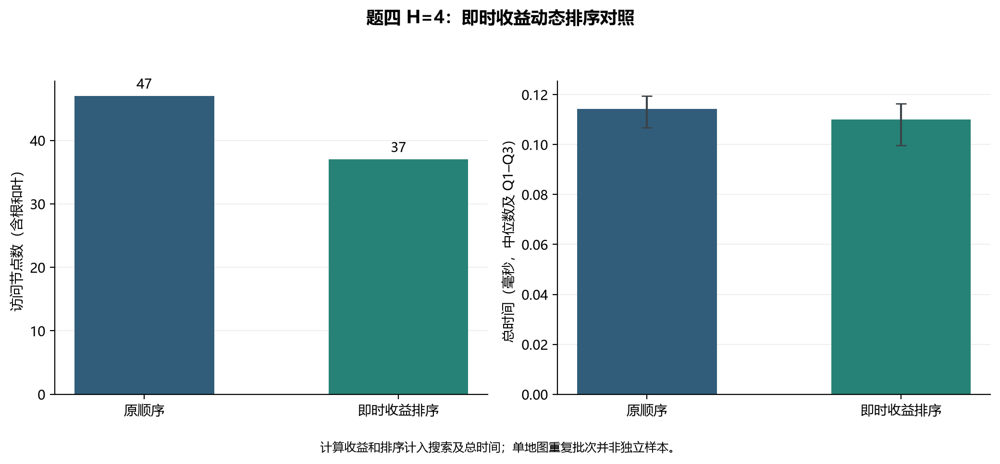

# 搜索算法与对照实验

当代人工智能实验二。手写 A*、Minimax 和 Alpha-Beta，完成迷宫寻路、加权地形、博弈树求值与竞争环境下的宝藏分配，并比较启发函数、搜索深度和访问顺序。

四题实现和10轮对照实验均已完成。仓库同时保存实际输入、独立正确性参考、原始批次、统计结果、图表及运行时源码快照。

## 先选择要做的事

| 目的 | 操作 | 是否需要绘图库 |
| --- | --- | --- |
| 检查四题正确性与测试 | 按下方快速开始执行 | 不需要 |
| 阅读已有结果与图表 | 打开报告、各轮分析或 `results/*/figures/` | 不需要 |
| 重新汇总和绘图 | 先复制整轮结果，再运行分析器 | 需要 |
| 重新采集对照数据 | 使用保存的输入，输出到新的 `runs/` 目录 | 默认需要；加 `--no-analysis` 可暂时跳过绘图 |

完整操作、10轮命令和常见错误见 [复现指南](docs/复现指南.md)。

## 环境要求

| 范围 | 要求与记录 |
| --- | --- |
| 核心算法及139项测试 | Python 3.10及以上，仅标准库 |
| 完整实验及绘图 | Python 3.11及以上；`requirements-experiments.txt` 固定 Matplotlib 3.11.2 |
| 正式性能数据采集环境 | Windows 11、Python 3.13.9、Matplotlib 3.11.2 |

建议用 Python 3.13 接近原环境。绘图版本的 Python 下限来自其包元数据；不能把“核心支持3.10”理解为固定绘图依赖也支持3.10。依赖文件只固定绘图库的直接版本，不是完整环境锁文件。

## 快速开始

### 1 进入项目根目录

实验二位于本仓库的 `lab2` 分支，可直接克隆该分支：

```bash
git clone --branch lab2 --single-branch https://github.com/mj20050127/CAI.git
cd CAI
```

也可以在GitHub切换至 `lab2` 后下载ZIP并解压。在同时包含 `README.md`、`src/`、`cases/`、`tests/` 的目录打开终端。所有命令均从这个目录执行，使用 `python -m`，不要直接双击或运行 `src/main.py`。

确认解释器：

```bash
python --version
python -c "import sys; print(sys.executable)"
```

虚拟环境的 Windows、macOS、Linux 建立方法见 [环境准备](docs/复现指南.md#一-环境准备)。后文的 `python` 始终应指向同一个解释器。

### 2 运行四题官方输入

```bash
python -m src.main --case all
```

成功时输出JSON并以退出码0结束，主要结果应为：

| 题目 | 正确结果 |
| --- | --- |
| 题一 | 最短7步，含起终点共8个坐标 |
| 题二 | 最小移动代价7，终点进入费用为0 |
| 题三 | Minimax与Alpha-Beta均为5 |
| 题四 H=2 | `best_target=T2`，`best_value=-1` |
| 题四 H=4 | `best_target=T3`，`best_value=3` |

题四的JSON还输出完整6×6距离矩阵。A/B/T格的进入费用均为1，包括移动目标，与题二免费终点不同。其他合法等长路径可同样正确，比较时不要只比较坐标字符串。

### 3 执行正确性测试

```bash
python -m unittest discover -s tests -v
```

当前版本应出现 `Ran 139 tests` 和 `OK`。测试覆盖独立BFS、Bellman-Ford、Dijkstra或完整博弈参考、边界输入、等值优化、统计与实验流程；少量小输入流程测试产生的临时数据会自动清理，不会重跑全部正式基准。

### 4 按需查看单题和轨迹

```bash
python -m src.main --problem 1
python -m src.main --problem 2 --input cases/problem2.json
python -m src.main --problem 3 --algorithm both --stats
python -m src.main --problem 4 --depth 4 --algorithm both --stats
python -m src.main --problem 3 --trace --output runs/problem3_trace.json
```

`--stats` 的时间是单次调用记录，不能替代配对性能实验；`--trace` 另有记录开销。题二默认使用安全修正曼哈顿，前瞻和动态排序优化在 `experiments/` 中对照实现。

### 5 需要重新绘图时安装依赖

仅运行前四步无需安装Matplotlib。使用 Python 3.11及以上执行：

```bash
python -m pip install -r requirements-experiments.txt
python -c "import matplotlib; print(matplotlib.__version__)"
```

版本应为 `3.11.2`。随后按复现指南选择“小规模流程检查”“复制后重绘”或“正式规模复测”。三者目的不同，不需要为了查看结果先把10轮全部重跑。

## 阅读报告和正式结果


- [实验报告 Markdown](docs/report/实验二_搜索算法实验报告_原图整合版.md)
- [实验报告 Word](docs/report/实验二_搜索算法实验报告_原图整合版.docx)
- [实验操作与统计口径](experiments/README.md)
- [上传文件范围](上传清单.md)

报告保留匿名姓名、学号栏。个人填写版与课程原始PDF不包含在此副本中。

| 对照主题 | 正式结果与分析 |
| --- | --- |
| 题一 零启发与曼哈顿 | [problem1_heuristics](results/problem1_heuristics/题一_对照实验分析.md) |
| 题二 零启发、原始与安全修正 | [problem2_heuristics](results/problem2_heuristics/题二_对照实验分析.md) |
| 题二 一步与两步前瞻 | [problem2_lookahead](results/problem2_lookahead/题二_前瞻修正曼哈顿实验分析.md) |
| 题二 一步前瞻等值优化 | [problem2_lookahead_optimized](results/problem2_lookahead_optimized/题二_一步前瞻实现优化分析.md) |
| 题二 两步前瞻等值优化 | [problem2_two_step_optimized](results/problem2_two_step_optimized/题二_两步前瞻实现优化分析.md) |
| 题三 Minimax与Alpha-Beta | [problem3_minimax_alpha_beta](results/problem3_minimax_alpha_beta/题三_Minimax与AlphaBeta基础对照分析.md) |
| 题三 原序、随机序与真值序 | [problem3_visit_order](results/problem3_visit_order/题三_访问顺序对照分析.md) |
| 题四 距离核验与深度 | [problem4_depths](results/problem4_depths/题四_距离验证与深度对照分析.md) |
| 题四 24种固定优先级 | [problem4_order](results/problem4_order/题四_固定优先级访问顺序对照分析.md) |
| 题四 动态Gain排序 | [problem4_gain](results/problem4_gain/题四_即时收益动态排序对照分析.md) |

## 复现实验的顺序

1. 先运行官方输入和139项测试，确认环境与代码可用。
2. 可先运行一个 [小规模流程检查](docs/复现指南.md#二-小规模检查采集与审计流程)，确认实验文件能正常生成。
3. 只需重绘已有数据时，按 [复制后重绘](docs/复现指南.md#三-复制已有结果后重新汇总绘图) 操作。分析器会重写目标目录的汇总、图表及配置，不能当作只读命令。
4. 需要重新测量时，执行 [10轮正式规模命令](docs/复现指南.md#四-复用保存输入进行正式规模复测)，输出到新的 `runs/` 子目录。仓库已提供全部输入，各轮可独立复测。
5. 对比输入哈希、官方结果与确定性节点数，再分析新计时；时间、校准循环数、运行标识和图像字节不要求与旧记录相同。

已有 `results/` 是保留的正式证据。测量器拒绝覆盖非空输出目录；第二次执行同一示例时，应换一个新的 `--out` 名称。仅复用相同种子不如直接复用仓库中的实际输入可靠。

## 主要观察


- 题一90张可达迷宫上，曼哈顿的逐图出队节省率中位数为80.95%至90.50%；堆峰值更高，不能据此推断内存更少。
- 题二先依据终点免费规则构造可采纳下界，再优化前瞻的等值实现。快速两步相对旧两步的API耗时节省率中位数为25.58%；相对快速一步虽更少出队，完整耗时却典型增加30.45%。
- 题三深度8的Alpha-Beta较Minimax节省78.23%节点；真值排序进一步改善剪枝，但本实验每次复制、预计算和排序的完整成本抵消了搜索收益。
- 题四完整深度选T3，浅层选T2在完整博弈评价下有2分首步遗憾。动态Gain排序少21.28%节点，同轮总时中位数仅下降3.62%；单图重复计时不足以保证跨地图加速。



各组比例在对应输入内计算后汇总，不能用组中位数随意相除；各轮绝对时间不混用。具体样本、计时范围与局限以各轮分析为准。

## 数据与文件结构

随机迷宫、加权地图和博弈树由本项目生成并保存，不依赖外部数据下载或sklearn；官方输入在 `cases/`。数据来源、分布、种子和独立参考见 [实验索引](experiments/README.md)。

```text
src/                         四题算法与命令行入口
cases/                       四题官方输入
tests/                       正确性、边界与实验流程测试
experiments/                 实验运行器、独立参考与分析器
results/                     10轮完整正式数据、原图、输入与源码快照
docs/复现指南.md             环境、流程、10轮命令、验证标准和排错
docs/report/                 匿名报告及配套图片
requirements-experiments.txt  绘图依赖
.gitignore                   排除缓存、本机配置和新产生的runs/
上传清单.md                  副本范围
.gitattributes               禁止Git自动转换换行，保留哈希所需原字节
MANIFEST.sha256              发布副本中各文件的SHA-256
```

`.gitattributes` 的 `* -text` 禁止Git自动转换换行，避免上传/检出时改变已记录的源码与数据哈希。请与项目一起上传，不要对源码批量格式化后再沿用旧哈希。

`MANIFEST.sha256` 校验保存的发布文件；重新绘图会改变目标文件的校验值，所以指南默认只操作副本。源码快照及原始输入必须一起保留，不能只上传最终PNG。

## 已完成的复现检查

2026年11月4日，在本上传副本中验证了四题官方结果及全部139项测试；核对10轮正式结果与原文件一致。README中21个命令入口的 `--help` 均已检查。小规模采集和复制后重绘的实测范围见 [指南末尾](docs/复现指南.md#八-本次说明的验证范围)。

Python源码、官方输入、依赖文件和正式结果均保持原字节。本轮完善说明文档、发布校验清单，并加入保留原字节换行的Git属性。
