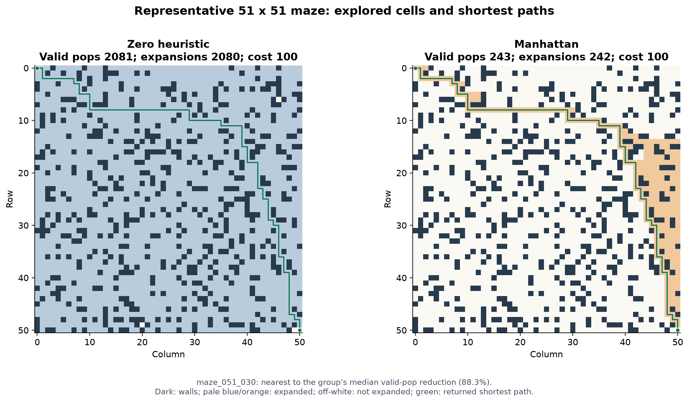
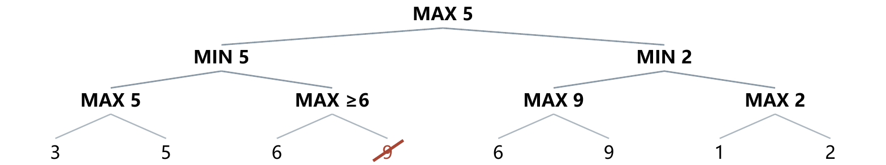
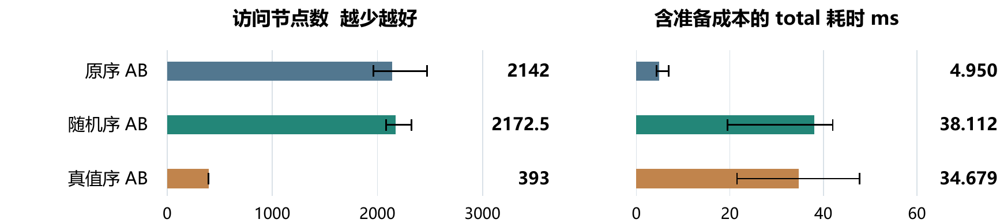
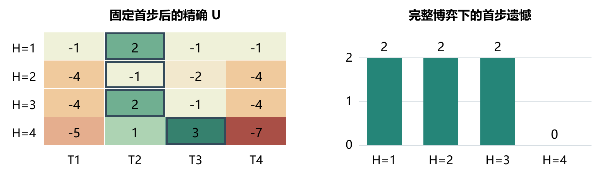
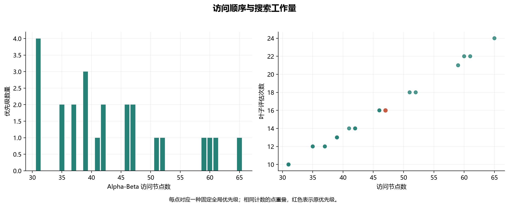
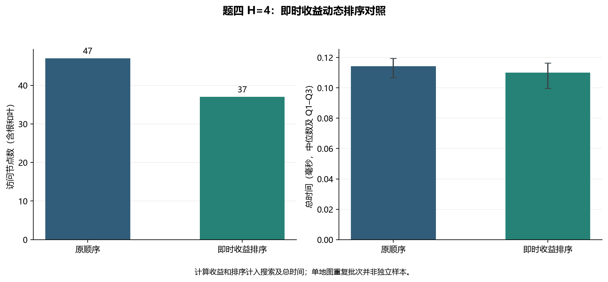

# 搜索算法实验报告

当代人工智能实验二　姓名：________　学号：________　修订日期：2026年11月4日

<b>摘要</b>　本文以固定输入对照启发函数、搜索深度和访问顺序，并依次检验正确性、搜索工作量与完整调用成本。曼哈顿在90张迷宫上节省80.95%至90.50%的出队；加权地形的安全修正消除原启发高估，等值实现优化降低前瞻求值成本；深度8随机树的Alpha-Beta节省78.23%节点。更少节点未必带来整体加速：两步前瞻慢于快速一步，真值排序的准备成本抵消剪枝收益。题四进一步以完整博弈评价首步，区分决策质量与搜索效率。

## 一 总体设计与对照方法

<b>A*实现：</b>状态为坐标(r,c)，f=g+h，堆按(f,h,入堆序号)取最小值。初始g(S)=0、其余为∞；对合法邻居v，若g(u)+c(u,v)<g(v)，同时更新g(v)与父指针并入堆。旧条目跳过，更优g允许重新扩展；目标有效出队后沿父指针回溯并逆序恢复路径。

<b>博弈递归：</b>叶节点或达到深度上限时返回评价U；内部MAX取子值最大值，MIN取最小值。AB从(α,β)=(-∞,+∞)开始，MAX更新α=max(α,best)，MIN更新β=min(β,best)；α≥β时停止访问剩余后继，因为它们已不能改变祖先选择。题三基线从左到右，题四根层各候选持续复用α。

表1 各题对照因素与独立正确性参考

| 固定输入 | 比较因素 | 独立参考与核查 |
| --- | --- | --- |
| 题一 90张随机迷宫 | 零启发／曼哈顿 | BFS最短步数、路径合法性 |
| 题二 30张31×31地形 | 零／原始／修正；一步／两步 | 反向Dijkstra真值、逐格与逐边性质 |
| 题三 三叉树每深度30棵 | MM／AB；原序／随机／真值序 | 独立自底向上回传、完整MM |
| 题四 官方图与四宝藏 | H=1至4；固定序／动态Gain | 独立Dijkstra、完整行动排列博弈 |

<b>控制与测量</b>：Windows 11、Python 3.13.9；题一主种子20261021，题二、三20261022，保存实际输入与哈希。除题四动态排序测10批外，各组预热2次、校准2次、正式5批；同输入使用相同批内调用数，交替或均衡执行次序。官方输入单列，不并入随机样本。出队含起终点，博弈访问含根和叶；时间先按输入取批均值的中位数，再跨输入汇总，比率先在同输入内计算。

<b>时间边界</b>：search只计搜索及启发求值；API还含输入准备、校验和结果收集；排序实验的total再计复制、排序或真值预计算。独立参考、审计、I/O与绘图在计时外；各轮绝对时间只作同轮比较。

## 二 题目一 曼哈顿能减少多少搜索工作

<b>规则与官方解</b>：输入起终点及二维迷宫，四邻接、每步1；输出最短坐标序列，无路返回[]。d=|r-rE|+|c-cE|是不越过障碍限制的步数下界。父指针给出(0,0)→(0,1)→(0,2)→(1,2)→(1,3)→(1,4)→(2,4)→(3,4)，g由0累加到7。零启发与曼哈顿均得7步，有效出队为16与8。

<b>对照设置</b>：21、51、101边长各30张，普通格以0.2概率为障碍，两角为端点；BFS拒绝不可达图，不挖通道路。两组共用同一A*与队列规则，只改变h。全部90图均返回BFS最优步数。

表2 零启发与曼哈顿的配对结果

| 规模 | 零启发出队 | 曼哈顿出队 | 出队节省 | 堆峰值比 | API加速 |
| --- | --- | --- | --- | --- | --- |
| 21×21 | 353.5 | 67 | 80.95% | 2.25 | 3.66 |
| 51×51 | 2067.5 | 232 | 88.88% | 3.05 | 5.84 |
| 101×101 | 8149.5 | 775 | 90.50% | 4.95 | 6.48 |

表2：出队为跨图中位数；节省率、堆峰值比及倍率均先逐图计算再取中位数。峰值比=曼哈顿／零启发；加速比=零启发时间／曼哈顿时间，大于1表示加速。

<b>原因与边界</b>：曼哈顿使队列优先沿目标方向处理候选，图1显示探索范围明显收缩；纯搜索加速4.29／7.56／8.51倍，高于表2的API倍率，因为全图校验与转换不会随节点数减少。与此同时90图堆峰值都更高，待扩展候选留在开放表，不能据少出队推断总内存更低。88/90图最短路恰等于d，其余2图只多2步；这些数据支持当前分布下的收益，尚不能外推到长墙回退迷宫。

图1 51×51代表图maze_051_030：零启发出队2081、曼哈顿243，代价均100。
蓝／橙为扩展范围，绿色为路径；节省88.32%，接近该组中位数88.88%，不是按最佳收益选图。

## 三 题目二 正确的下界是否一定更快

<b>规则与代价累计</b>：费用是进入格的权值，初始S不收费，按题意E的进入代价为0；无路输出-1。官方路线为下3、右2、下1、右2，8次移动的累计g依次为0→1→2→3→4→5→6→7→7，最优总代价7，最后免费一步必须保留。

<b>可采纳性对照</b>：原始h=d在紧邻E时为1，但真实剩余费用为0，故不可采纳。令m为非终点可通行格的最小进入费用，则 <b>h</b><b>0</b><b>(n)=m·max(0,d(n,E)-1)</b>：任意到达目标的路径至少有d-1个普通收费步骤。若普通格允许0权，m=0时基础下界安全退化为0。

固定30张31×31无障碍图，地形1／3／8概率0.7／0.2／0.1、端点两角。独立反向Dijkstra审计28,830状态与111,600条有向边：原始曼哈顿高估6,188状态、最大高估1，一致性违例60条；h0两项均为0。三法仍在30/30图输出最优解。原始与修正有23图出队相同、7图修正多1次：本域m=1，非目标处原始h=h0+1，许多排序关系不变。<b>样本输出正确不能代替下界证明，性质审计与求解结果要分别检查。</b>

<b>前瞻与等值优化</b>：为利用相邻地形，令N(n)为合法邻居，递推 <b>h</b><b>k+1</b><b>(n)=min</b><b>v∈N(n)</b><b>[c(n,v)+h</b><b>k</b><b>(v)]</b>，取k=0、1得到一步h1与两步h2；每层目标值为0，孤立格回退上一层。逐格、逐边核对h0≤h1≤h2≤h*和一致性，无违例；h1、h2分别在2,911、4,754个状态严格强于h0。

快速一步利用四邻接使d只变化±1的结构，代数化简求值，并在达到安全下界时提前退出；快速两步复用这个内层。每次查询新建按需缓存，不跨查询复用。表3四策略在<b>同一轮</b>对同30张图重新测量，只改变启发或等值求值实现。

表3 前瞻强度与实现成本的四策略对照

| 方法 | 有效出队 | 搜索时间／ms | 完整API／ms |
| --- | --- | --- | --- |
| 基础修正 h0 | 168.5 | 1.1643 | 1.8399 |
| 快速一步 h1 | 149 | 1.1306 | 1.8013 |
| 旧两步 h2 | 137 | 2.4451 | 3.1336 |
| 快速两步 h2 | 137 | 1.5915 | 2.2204 |

表3各列为跨图中位数；下文5.57%、25.58%、30.45%先逐图配对再汇总，不能由表中两列中位数直接相除。

<b>结论</b>：新旧两步在含官方图的28,855状态上启发值0差异，路径、扩展顺序和计数均相同；快速版在30/30图更快，API节省中位数25.58%，证据指向等值求值成本降低。相对快速一步，两步虽再少5.57%出队，API却典型增加30.45%；额外邻居求值和缓存访问抵消了搜索收益。当前单次查询宜优先基础修正或快速一步，不能因下界更强就宣称整体更快。

## 四 题目三 剪枝收益如何随深度与顺序变化

<b>官方回传与剪枝</b>：输入MAX／MIN交替树，输出根的最佳分数。底层MAX值为5、9、9、2，两个MIN回传5、2，根取5。左MIN已有β=5时，第二个MAX先读到6，因α≥β跳过后面的9，见图2；MM访问15节点、8叶，AB为14节点、7叶。

图2 左MIN取得5后，其第二个MAX看见6即可跳过9；“≥6”是截断回传下界，不是精确子树值。

<b>基础对照</b>：三叉满树深度4／6／8各30棵，叶值均匀取整数[-50,50]，同树比较MM与原序AB。<b>顺序对照</b>复用这些树，每树比较原序、10个固定随机序、1个精确子树值排序，共1,092个含官方的树与顺序组合，根值全部正确。只改变是否剪枝或访问顺序，不改变叶值和评价。

表4 题三两轮对照的节点与时间效应

| 深度 | MM节点 | 原序AB节点 | AB节省 | 随机序节省 | 理想序节省 | 基础轮搜索／API倍率 |
| --- | --- | --- | --- | --- | --- | --- |
| 4 | 121 | 82.5 | 31.82% | 4.80% | 55.15% | 1.112／1.035 |
| 6 | 1093 | 413.5 | 62.17% | -5.10% | 69.77% | 1.953／1.291 |
| 8 | 9841 | 2142 | 78.23% | -1.43% | 81.64% | 3.351／1.514 |

表4节点为中位数；AB节省以MM为分母，随机／理想序节省以同树原序AB为分母。随机10序先在树内汇总，独立样本仍每深度30棵。比率先逐树计算，基础轮与排序轮绝对时间不混用。

<b>原因</b>：深树有更多大子树可被剪去，节点相对节省增加，但绝对访问量仍增长。接口校验会遍历输入全树，所以深度8纯搜索加速3.351倍，API仅1.514倍；深度4虽所有树节点更少，仍有7/30棵搜索更慢。随机序节省率跨过0，没有稳定收益，不能把“换序”本身当成优化。

理想序在MAX优先高值、MIN优先低值，较早收紧边界，排序轮搜索加速1.758／2.776／5.188倍。但它事先计算全部子树真值；每次为保护输入而复制树、重算真值和排序的成本均计入。深度8总时中位数反而从原序4.950 ms增至34.679 ms（随机序38.112 ms）。这是本实验单次处理流程的结果；不能推断预排序长期复用的收益，也不能把复制成本全部算作剪枝本身的开销。

图3 深度8同30棵树的顺序对照。柱为中位数，横线为Q1至Q3；随机10序先在树内汇总。真值序访问仅393节点，但每次复制、真值预计算与排序后，总时仍明显高于原序。

<b>复杂度与瓶颈：</b>分支数b、深度H的满树，MM访问量为O(b^H)，AB最坏仍相同，充分有利的顺序下可接近O(b^(H/2))。本实验理想序只作有信息的参照；它提前遍历全树求真值，已支付完整求解代价，不能把剪枝阶段的节省当成免费收益。

## 五 题目四 决策质量与访问效率分别评价

<b>建模与规则</b>：官方7×7图、宝藏价值(T1,T2,T3,T4)=(9,6,7,7)，A→B→A→B轮流取宝。A*执行30次有向查询，36项矩阵与独立Dijkstra一致，30条路径均核验。A／B／T进入费用均1（含目标），不能套用题二免费E。完整矩阵见表5；本例端点等权所以恰好对称，一般输入不预设对称。

表5 官方输入的6×6最小移动代价矩阵

| 起点／终点 | A | B | T1 | T2 | T3 | T4 |
| --- | --- | --- | --- | --- | --- | --- |
| A | 0 | 12 | 10 | 4 | 8 | 8 |
| B | 12 | 0 | 8 | 8 | 4 | 10 |
| T1 | 10 | 8 | 0 | 6 | 6 | 12 |
| T2 | 4 | 8 | 6 | 0 | 6 | 6 |
| T3 | 8 | 4 | 6 | 6 | 0 | 6 |
| T4 | 8 | 10 | 12 | 6 | 6 | 0 |

状态(pA,pB,R,sA,sB,turn)记录双方位置、剩余宝藏、累计收益和当前玩家。选Ti仅更新行动者位置、收益Vi-d(p,Ti)，移除Ti并换手；经过其他宝藏不收集，已取宝藏格可通行，双方不挡路，负收益亦合法。A最大化U=sA-sB，B最小化U；一行动一层，到深度或取完宝藏返回当前U。

表6 同深度根值一致与完整博弈首步评价

| H | 首步 | 截断U | 该首步完整值 | 首步遗憾 | MM节点 | AB节点 |
| --- | --- | --- | --- | --- | --- | --- |
| 1 | T2 | 2 | 1 | 2 | 5 | 5 |
| 2 | T2 | -1 | 1 | 2 | 17 | 13 |
| 3 | T2 | 2 | 1 | 2 | 41 | 26 |
| 4 | T3 | 3 | 3 | 0 | 65 | 47 |

<b>深度对照</b>：两算法在H=2均输出{T2,-1}，H=4均为{T3,3}。H=2只见A取T2得2、B取T3得3，故U=-1。完整最优响应可为T3→T1→T2→T4，Gain依次-1、+1、0、-5，最终A=-1、B=-4、U=3。A接受眼前负收益，换取后续位置与对手选择约束。

图4 深度改变首步判断。左图框选各深度最佳首步；右图把所选首步放回H=4，由双方最优续行评价。

H=1至3都选T2，放回完整博弈仅得1，比完整最优3少2；H=4选T3，遗憾为0（表6、图4）。遗憾定义为“完整最优U减固定该首步的完整U”，不同深度的截断值2、-1、2、3不能直接相减评价质量。增加深度改变了决策依据，剪枝则在保持同深度决策正确的前提下减少工作，两者作用不同。

<b>顺序对照</b>：固定H=4，枚举24种全局优先级，各层依优先级过滤剩余宝藏，均返回T3、U=3。节点范围31至65，均值43.5；16种优于原序47、2种相同、6种更差，最差无有效剪枝。31是<b>这24个配置内的最小实测值</b>，依赖事后挑序，没有证明为任意逐节点排列的理论下界。

图5 24种固定优先级的节点与叶子分布，红点为原序；同计数点重叠，配置并非独立地图。

表7 固定优先级与可计算动态排序的证据

| 配置 | 访问节点 | 叶子评估 | 搜索时间／ms | 总时间／ms |
| --- | --- | --- | --- | --- |
| MM基线 | 65 | 24 | — | — |
| 原序AB | 47 | 16 | 0.07726 | 0.11426 |
| 24固定序中最少节点 | 31 | 10 | — | — |
| 动态Gain排序AB | 37 | 12 | 0.07203 | 0.11013 |

表7时间仅来自动态排序同一轮、同一递归实现，均复用距离矩阵；“—”表示本轮未测该配置时间，不能拿前轮时间补列。固定序最少节点示例为T3→T1→T2→T4，这表示搜索优先级，不是实际行动路线。

动态排序在每个局面按行动者Gain降序搜索，同值保留原序，A、B均先考察自身收益高的行动；根先搜T2，最终仍选T3。计算Gain及排序全计入：10批交替、每组每批128次，少21.28%节点、25%叶子。两组总时中位数比较，耗时仅降低3.62%；逐批先计算原序／动态时间比，再取中位数为1.084，7/10批更快。总时Q1至Q3为原序0.10686至0.11944 ms、动态0.09975至0.11639 ms，有重叠。两种统计口径不同，小样例不能据此保证稳定加速。

图6 动态Gain排序同轮原图。固定官方图H=4并复用矩阵，排序成本计入；少21.28%节点，总时中位数仅下降3.62%。误差线为10批计时的Q1至Q3，重复批次并非独立地图。

<b>完整流程的瓶颈：</b>距离与深度实验同一轮H=4中，复用矩阵的MM／AB总时为0.10941／0.10677 ms；从内存地图重新做30次A*后为2.15301／2.10728 ms。AB少27.69%节点，端到端中位数仅少约2.12%，距离构建本身的中位数为1.99194 ms。剪枝不会减少这30次寻路；优化博弈前应识别主要成本。这些数字来自深度轮，不能与表7的Gain轮跨轮比较，各分量中位数也不能直接相加。

## 六 结论与可复现性

<b>改进的证据链</b>：题二从终点费用出发构造安全下界，再以等值化简降低求值成本；题四用便宜的即时收益作局部排序，并用完整博弈遗憾诊断决策。已有数据共同说明，正确性是先决条件，节点数解释搜索过程，完整成本决定当前流程是否值得采用。前瞻更深、排序信息更准均不能自动推出净时间收益。

<b>适用范围</b>：结论限于题一条件可达且多为单调最短路的迷宫、题二无障碍给定费用分布、题三三叉满树及题四单张官方图。重复批次和同输入的不同顺序不是新增独立样本，Q1至Q3不是置信区间，未作显著性推断。

<b>复现</b>：根目录运行 python -m src.main --case all；python -m unittest discover -s tests（2026-10-29，139项通过）。资料[1]《实验二要求_new.pdf》第3至17页。正式数据位于results/：[2]problem1_heuristics；[3]problem2_heuristics、problem2_two_step_optimized；[4]problem3_minimax_alpha_beta、problem3_visit_order；[5]problem4_depths、problem4_order、problem4_gain。各轮config、raw与源码归档可核对。
