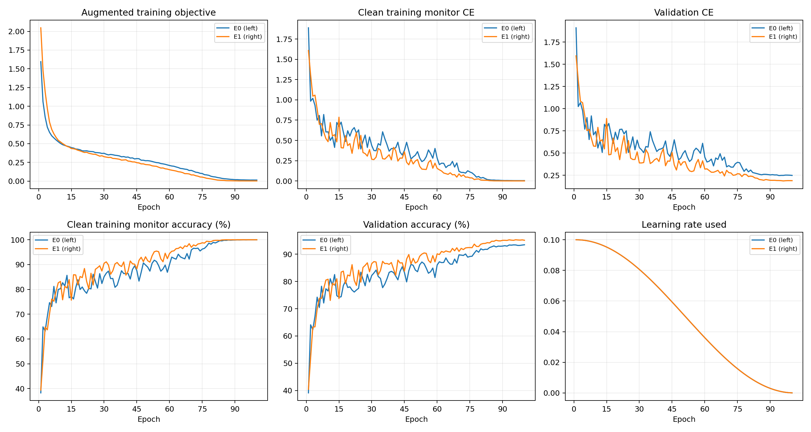

**E0 / E1 架构对照：100 轮训练结果分析**

分析日期：2026-11-16。范围：固定 CIFAR-10 数据划分、训练种子 42、5,000 张验证图片。E0 与 E1 均完成正式 100 轮训练；本文使用各自按验证表现选择的 best.pt。这里报告的是验证集结果，官方测试集尚未评估。

本次 E1（CIFAR ResNet-18）达到 **95.30%** 验证准确率，比 E0 自建 CNN 的 **93.46%** 提高 **1.84 个百分点**，验证错误从 327 个降至 235 个，减少 **28.13%**。代价是参数量增加到约 9.73 倍，记录的训练与评估累计耗时约为 1.56 倍，同设备推理也更慢。E1 可以作为后续单因素实验的共同参考，但本次单种子结果不能代表跨种子的稳定优势。

**一、训练完成情况与权重选择**

| 项目 | E0：自建 CNN | E1：CIFAR ResNet-18 |
|---|---:|---:|
| 正式训练轮数 | 100 / 100 | 100 / 100 |
| 最佳验证轮次 | 100 | **96** |
| 最佳验证准确率 | 93.46% | **95.30%** |
| 最佳轮验证交叉熵 | 0.248785 | **0.186615** |
| 最佳轮 Macro-F1 | 93.4735% | **95.2946%** |
| 验证正确 / 总数 | 4,673 / 5,000 | **4,765 / 5,000** |
| 验证错误数 | 327 | **235** |
| 第 100 轮验证准确率 | 93.46% | 95.12% |
| 最佳轮干净训练监测准确率 | 99.98% | 100.00% |
| 最佳轮监测准确率减验证准确率 | 6.52 个百分点 | **4.70 个百分点** |

E1 的 best.pt 来自第 96 轮，last.pt 来自第 100 轮。第 100 轮比最佳轮少识别正确 9 张图片，低 0.18 个百分点。训练完成后应继续保留这两个文件，后续正式模型比较和解释性分析使用 best.pt。第 96 轮也是本次验证交叉熵最低的一轮。

本次重新加载 E1 的 best.pt，对完整 5,000 张验证图片独立前向，复算得到准确率 95.30%、交叉熵 0.1866148575，与训练记录一致。E0 的完整验证结果为 93.46%。配对比较工具核对了两次评估的图片索引、真实标签和数据清单；不存在用不同验证子集直接比较的问题。

核验还覆盖正式日志 1–100 轮连续性、数值有限性、initial.pt / best.pt / last.pt 的模型标识和初始状态记录。E1 初始权重哈希与初始状态文件一致，正式训练源代码快照与当前对应代码一致，E0/E1 复用相同的数据清单。

**二、这次比较控制了哪些条件**

两组使用同一训练集 45,000 张、验证集 5,000 张和固定训练监测子集 5,000 张；每个验证类别均为 500 张。划分种子为 2026，监测子集种子为 2027，训练种子为 42。归一化统计仅由训练部分计算。

训练方案均为：32×32 输入，随机裁剪 padding=4、水平翻转，普通交叉熵，SGD，batch=128，初始学习率 0.1，momentum=0.9，weight decay=0.0005，100 轮余弦衰减、最低学习率 0.00001，Dropout=0.3，AMP，num_workers=0。实际记录的逐轮学习率一致。E1 从随机初始化开始，没有使用预训练权重或 E0 的训练权重。

这里比较的是两个完整架构方案。E1 同时改变了深度、通道数、下采样结构、参数量并引入残差连接，因此不能把 1.84 个百分点全部归因为残差连接。相同训练轮数也不等于相同计算预算；同一种子与增强策略不保证不同架构的每张图片逐次取得完全相同的随机增强。

**三、曲线说明：更早达到目标轮次，后期表现稳定**

| 首次达到的验证准确率 | E0 轮次 | E1 轮次 |
|---|---:|---:|
| 90% | 73 | **53** |
| 92% | 84 | **67** |
| 93% | 86 | **77** |

E1 用更少的数据遍历轮数达到这些准确率，但每轮更耗时。按各自历史日志累加，达到 90% 时 E0 约 38.89 分钟，E1 约 47.06 分钟；达到 93% 时分别约 47.79 和 68.63 分钟。因此应表述为“按轮次更早达到目标”，不能笼统称为“训练更省时”。这些历史耗时还受到运行负载影响。

E1 最后 10 轮的验证准确率均值为 **95.178%**，范围 **95.06%–95.30%**；E0 对应为 93.288%，范围 92.96%–93.46%。E1 的提升持续出现在后期多轮中，并非只有一次孤立峰值。这个轮次窗口内的平稳表现不能替代多随机种子重复实验。

两模型早中期验证指标都有波动，后期随共同的余弦学习率下降而稳定。该观察没有固定学习率对照，不能据此单独量化调度的贡献；这个问题由计划中的 E6 研究。

E1 在最佳轮的干净训练监测准确率为 100%，验证准确率仍为 95.30%，说明仍有泛化差距，但比 E0 的 6.52 个百分点缩小。这里的 100% 只对应固定的 5,000 张训练监测图片，并不代表已经逐张核验全部 45,000 张训练图片。训练末期没有出现验证损失持续上升、准确率持续崩落的走势；没有证据表明当前应仅因第 100 轮小幅回落而加长训练。



**四、哪些类别改善，哪些问题保留**

下表的每类准确率定义为“该真实类别正确识别数 / 该类别总数”，在这里等于该类 recall；每类分母都是 500。

| 类别 | E0 每类准确率 | E1 每类准确率 | 变化（百分点） |
|---|---:|---:|---:|
| 飞机 airplane | 94.0% | 96.0% | +2.0 |
| 汽车 automobile | 96.2% | 96.8% | +0.6 |
| 鸟 bird | 91.8% | 93.6% | +1.8 |
| 猫 cat | 88.6% | **88.8%** | **+0.2** |
| 鹿 deer | 92.6% | **96.8%** | **+4.2** |
| 狗 dog | 89.0% | **92.0%** | **+3.0** |
| 青蛙 frog | 95.8% | 97.6% | +1.8 |
| 马 horse | 94.6% | 96.2% | +1.6 |
| 船 ship | 96.2% | 98.4% | +2.2 |
| 卡车 truck | 95.8% | 96.8% | +1.0 |

十类 recall 和 F1 都提高，改善最大的 recall 来自鹿和狗。不能把这句话扩大为“所有分类指标均提高”：船的 precision 从约 96.98% 略降到 96.85%。完整 precision / recall / F1 见 per_class_comparison.csv。

猫仍是 E1 的最低 recall 和最低 F1 类别。猫的 precision 从 **86.19% 提升到 90.61%**，F1 从 **87.38% 提升到 89.70%**；其他类别被误判为猫的数量从 71 降到 46。预测为猫的总量从 514 降到 490，而真实猫为 500。这表明误报为猫的情况改善，但真实猫的召回仅多正确 1 张，不能认为漏识别问题已经解决。逐张看，猫类有 30 张由错变对，同时 29 张由对变错。

E1 主要的有方向混淆如下；第五位有三个并列项。

| 真实 → 预测 | 数量 | 占该真实类别的比例 |
|---|---:|---:|
| 猫 → 狗 | 28 | 5.6% |
| 狗 → 猫 | 24 | 4.8% |
| 飞机 → 鸟 | 9 | 1.8% |
| 鸟 → 猫 | 9 | 1.8% |
| 汽车 → 卡车 | 8 | 1.6% |
| 猫 → 鹿 | 8 | 1.6% |
| 狗 → 马 | 8 | 1.6% |

猫狗双向混淆从 E0 的 60 个降至 E1 的 52 个，但占剩余错误的比例由 18.35% 升到 22.13%。猫类 56 个错误中有一半被判成狗；狗类 40 个错误中有 60% 被判成猫。后续错误样例和 Grad-CAM 可优先分析这组问题，仅凭混淆数量还不能确定背景、纹理或姿态等原因。

**五、逐张配对：总体提升伴随局部退化**

| 同一张验证图片的结果 | 图片数 |
|---|---:|
| E0、E1 都正确 | 4,581 |
| E0 错、E1 对 | **184** |
| E0 对、E1 错 | **92** |
| E0、E1 都错误 | 143 |
| 合计 | 5,000 |

准确表述是：“E1 纠正了 E0 的 184 个错误，同时引入 92 个新错误，净增加 92 个正确预测。”更复杂的网络没有逐张覆盖 E0 的全部优势。配对记录保存在 paired_predictions.csv，可用于选择两模型都错、E1 纠正、E1 退化的相同样本进行解释性对照。

**六、性能提升对应的成本**

| 项目 | E0 | E1 | E1 / E0 |
|---|---:|---:|---:|
| 参数量 | 1,148,874 | 11,173,962 | **9.73 倍** |
| 累计逐轮记录耗时 | 57 分 26.6 秒 | 89 分 22.6 秒 | **1.56 倍** |
| batch=1 模型前向延迟 | 2.891 ms | 8.264 ms | **2.86 倍** |
| batch=128 整批模型前向延迟 | 5.782 ms | 19.852 ms | **3.43 倍** |
| batch=128 吞吐 | 22,137 张/秒 | 6,448 张/秒 | 约 29.1% |

训练耗时来自日志，包含当轮数据加载、训练、监测和验证，不包含权重写盘、启动或暂停，不能直接视为严格的架构速度基准。E1 总记录时间比 E0 多约 31 分 56 秒。

推理计时是本次在同一 RTX 4060 Laptop GPU 上独立完成的统一比较：使用最佳权重、相同的合成输入、float32 张量、每种 batch 预热 10 次，每次重复计时 50 次，共重复 3 轮并交替模型顺序，CUDA 同步后取各轮平均延迟的中位数。cuDNN 的 allow_tf32=True，CUDA matmul 的 allow_tf32=False；它不代表禁用 TF32 的严格 FP32 内核计时。结果不包含图片预处理、数据加载或 CPU→GPU 传输，不代表端到端应用速度。batch=128 的逐图摊销时间也不等于 batch=1 的单图延迟。

E1 训练记录的 PyTorch 峰值 allocated 显存约 487.53 MiB，E0 没有相同口径记录，不能做显存倍数对照。这个数值不包含所有驱动、缓存和其他进程占用，不能当作整个 GPU 的显存占用。

如果目标是本次验证表现，E1 更合适作为后续参考；如果目标强调小模型和快速推理，E0 仍有明显的成本优势。本次没有给两模型分别做超参数搜索，因此不是其性能上限比较。

**七、小规模 smoke 记录中的异常**

真实数据 smoke 的两轮都执行完成，但验证准确率均为 10%，验证交叉熵约为 5,794.30 和 3,783.08。这是数值有限但预测表现严重不稳的记录，不能描述成“smoke 已证明正常收敛”。小数据量、高学习率和 BN 统计等是可能的排查方向，当前记录不足以确定原因。

正式实验使用独立目录、独立的 100 轮方案，从保存的初始状态开始；其初始状态哈希为 0d7d998dce998061a1710cdb2cf553a5fe77a7636a59d29e66d0acc38beba0ad，与 smoke 记录的初始化一致，没有接着 smoke 的训练后权重继续。正式首轮验证准确率 40.44%、交叉熵约 1.59476，后续完整轨迹及最佳权重复算均与本文结果一致。因此应分别记录这次 smoke 的不稳定现象和正式训练的有效结果。

**八、下一步与结论边界**

按原实施计划，下一项建议是 **E2：去掉随机裁剪和水平翻转，与 E1 比较基础增强的作用**。保留 E1 为共同参考，固定数据划分、模型、优化器、学习率策略、损失和 100 轮预算；为减少增强对照中的初始化差异，实施时应复用 E1 保存的初始模型状态。E2 的结果无论提高还是降低都应记录；不能预设一定优于 E1。随后再进行 E3 MixUp、E4 CutMix、E5 CBAM 等单因素对照。

目前只有种子 42。按完整计划补充关键组的种子 43、44 后，才能报告多次运行的均值和波动；最后 10 轮之间的平稳不等于独立重复的稳定。也不能仅依据当前一次验证结果断言猫类或其他细分类别有可靠提升。

全部实验方案和权重选择冻结后，再进行官方测试集评估。当前的 95.30% 不能写成“测试准确率”。本次分析没有更改训练代码或参数，没有新增训练，也没有评估测试集。

本次可写入报告的结论为：**在固定数据划分、训练种子 42 和共享 100 轮训练方案下，CIFAR ResNet-18 的验证准确率与 Macro-F1 高于自建 CNN，错误数减少 28.13%；收益伴随更多参数和更高的推理成本。猫狗混淆仍是主要剩余问题。**

**九、结果文件与复查入口**

| 文件 | 内容 |
|---|---|
| results/E0_vs_E1/comparison.json、comparison.csv | 总体指标、共同训练条件、配对计数 |
| results/E0_vs_E1/per_class_comparison.csv | 十类 precision / recall / F1 及增量 |
| results/E0_vs_E1/paired_predictions.csv | 对齐同一验证图片的两模型预测 |
| results/E0_vs_E1/curves.png | 六项训练、验证、学习率曲线 |
| results/E0_vs_E1/inference_benchmark.json | 统一推理计时及测量口径 |
| runs/E1/seed42/evaluation_validation_epoch96/ | E1 完整验证指标、预测、混淆矩阵和错误图片 |
| runs/E1/seed42/curves_epoch100.png | E1 独立训练曲线 |
| runs/E1/seed42/initial.pt、best.pt、last.pt | 起点、第 96 轮最佳、第 100 轮末次状态 |

以下命令仅用于需要时复查已有结果，不需要重跑 100 轮训练：

```powershell
# 在项目根目录打开 PowerShell
.\.venv\Scripts\python.exe evaluate.py --checkpoint runs/E1/seed42/best.pt
.\.venv\Scripts\python.exe compare_runs.py --run-dirs runs/E0/seed42 runs/E1/seed42
```
