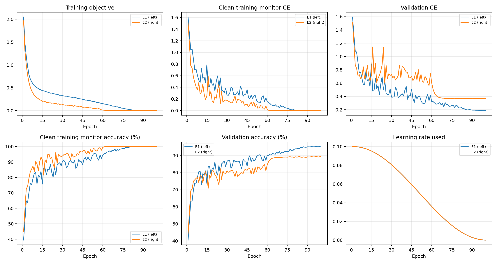

**E1 / E2 增强消融：关闭随机裁剪和水平翻转后的结果**

分析日期：2026-11-17。两组均完成正式 100 轮，使用固定数据划分与训练种子 42。本文报告完整 5,000 张验证图片的结果，使用各组按验证准确率选出的最佳权重；官方测试集尚未评估。

**主要结论：本次基础增强有明显帮助。** 保留随机裁剪和水平翻转的 E1 验证准确率为 **95.30%**；关闭两种增强的 E2 为 **89.52%**，降低 **5.78 个百分点**，每 5,000 张验证图片多错 **289 张**。E2 对训练数据拟合得更快、更充分，但验证表现明显较差，符合泛化能力受损、过拟合倾向更强的表现。E2 已完成作为无增强对照的目的，应保留这份实际结果。

**一、完成状态、独立复算与模型选择**

| 指标 | E1：基础增强 | E2：无随机裁剪、翻转 | E2 − E1 |
|---|---:|---:|---:|
| 正式训练轮数 | 100 / 100 | 100 / 100 | 相同 |
| 最佳轮次 | 96 | **84** | — |
| 最佳验证准确率 | **95.30%** | **89.52%** | **−5.78 个百分点** |
| 验证正确数 / 总数 | 4,765 / 5,000 | 4,476 / 5,000 | −289 张 |
| 验证错误数 | 235 | **524** | +289 张 |
| Macro-F1 | **95.2946%** | 89.5375% | −5.7571 个百分点 |
| 最佳准确率轮的验证交叉熵 | **0.186615** | 0.368076 | +0.181461 |
| 第 100 轮验证准确率 | 95.12% | 89.34% | −5.78 个百分点 |
| 最佳轮干净训练监测准确率 | 100.00% | 100.00% | 相同 |
| 最佳轮监测准确率减验证准确率 | **4.70 个百分点** | **10.48 个百分点** | +5.78 个百分点 |

本次已重新加载 E2 的 best.pt，在完整验证集独立前向，得到准确率 89.52%、交叉熵 0.36807625598907473，与训练日志及摘要一致。权重中的轮次为 84；last.pt 为第 100 轮。两份权重的模型参数均为有限数值。

后续分析 E2 应使用第 84 轮 best.pt。第 100 轮比最佳轮低 0.18 个百分点，少正确 9 张。程序先按验证准确率选最佳，准确率平局时再比较 loss；E2 全程最低验证 loss 出现在第 77 轮，并不在第 84 轮，因此不能把“准确率最佳”与“loss 最低”混为一谈。

E2 的错误数比 E1 增加约 **122.98%**，验证交叉熵增加约 **97.24%**。从保留增强的方向描述，E1 相对于 E2 减少约 **55.15%** 的验证错误。两种百分比的分母不同，报告中应明确方向。

**二、这是一组受控的增强对照**

核验确认以下条件一致：

- CIFAR ResNet-18、11,173,962 个参数，输入 32×32；Dropout=0.3，BN 保持原设计。
- 训练 45,000 张、验证 5,000 张、训练监测 5,000 张；验证每类 500 张；训练与验证无交集，monitor 属于训练集。
- 数据划分、类别顺序、训练统计量 mean/std 和归一化完全相同。
- 训练种子 42、划分种子 2026、监测种子 2027；训练 shuffle 开启。
- 100 轮、batch=128、SGD lr=0.1、momentum=0.9、weight decay=0.0005、普通交叉熵、AMP、num_workers=0。
- 100 轮余弦调度、最低学习率 0.00001；实际日志的逐轮学习率轨迹一致。

E1/E2 的 initial.pt 实际张量内容哈希均为：

```text
0d7d998dce998061a1710cdb2cf553a5fe77a7636a59d29e66d0acc38beba0ad
```

两份初始状态的轮次均为 0；E2 记录的来源文件哈希与当前 E1 initial.pt 一致。E2 没有接着 E1 训练后的权重继续。配置归一化后的差异仅为实验名、输出位置、增强开关及起点来源路径，其他训练设置一致。

E2 的 train_augmentation=false。训练源代码快照及环境中记录的 17 个源文件哈希均核对一致，当前对应代码也一致；训练路径在关闭开关后只做 ToTensor、Normalize，保留 shuffle。E0/E1 已冻结的权重、日志、配置和摘要没有改动。

因此，这组结果可用于研究基础增强的作用。它没有分别隔离随机裁剪和水平翻转的贡献，也没有比较“无增强模型单独充分调参后的最优结果”。改变输入增强会改变训练中的随机事件，不能把同一初始状态等同于之后所有随机过程完全一致。

**三、为什么训练拟合更快，验证反而更差**

| 曲线观察 | E1 | E2 |
|---|---:|---:|
| 干净训练监测首次达到 100% | 第 86 轮 | **第 63 轮** |
| 首次验证准确率达到 90% | 第 53 轮 | 100 轮内未达到 |
| 最后 10 轮验证准确率均值 | **95.178%** | 89.268% |
| 最后 10 轮验证准确率范围 | 95.06%–95.30% | 89.14%–89.38% |
| 最后 20 轮验证准确率均值 | **94.878%** | 89.212% |

关闭增强后，模型反复看到同样构图和朝向的训练输入，训练拟合任务更容易。与这一机制相符，E2 的训练目标下降更快，干净训练监测也更早达到 100%；但验证准确率后期停在约 89%，与训练监测的差距仍超过 10 个百分点。基础增强增加了训练视图的变化，本次对应更好的验证表现。

这里的干净训练监测只覆盖固定的 5,000 张训练子集，不能把它写成“完整 45,000 张训练集的独立干净评估”。history 中沿用列名 train_aug_accuracy，它在 E2 中代表没有图片增强的当前训练输入准确率；该列也在第 63 轮首次达到 100%，但它是训练模式、更新过程中累计的指标，与独立干净监测的计算口径不同。

E2 后期曲线稳定在较低水平，表明差距持续存在，不只是第 84 轮与第 96 轮各自峰值造成。记录没有显示后期继续训练能够补齐约 5.8 个百分点的差距，目前没有必要为改变这份消融结论而单独给 E2 延长轮数或修改学习率。若另行调参，应作为新的实验记录。

这些现象支持更强的过拟合倾向，但没有进一步的解释性证据来断言模型具体记住了某种背景、纹理或位置线索；也不能仅凭验证交叉熵判断概率校准好坏。



**四、下降发生在哪些类别**

每类准确率定义为该真实类别正确识别数 / 500，在这里等于 recall。

| 类别 | E1 | E2 | 变化（百分点） |
|---|---:|---:|---:|
| 飞机 airplane | 96.0% | 92.2% | −3.8 |
| 汽车 automobile | 96.8% | 94.8% | −2.0 |
| 鸟 bird | 93.6% | **83.8%** | **−9.8** |
| 猫 cat | 88.8% | 82.8% | −6.0 |
| 鹿 deer | 96.8% | **88.4%** | **−8.4** |
| 狗 dog | 92.0% | **81.8%** | **−10.2** |
| 青蛙 frog | 97.6% | 91.0% | −6.6 |
| 马 horse | 96.2% | 91.0% | −5.2 |
| 船 ship | 98.4% | 95.2% | −3.2 |
| 卡车 truck | 96.8% | 94.2% | −2.6 |

十类 precision、recall 和 F1 全部下降。recall 降幅最大的是狗、鸟、鹿；狗是 E2 recall 最低的类别。猫的 F1 最低，约 **79.85%**；其 precision 从 90.61% 降到 **77.09%**，其他类别误判为猫的数量由 **46 增至 123**，预测为猫的总数从 490 增至 537，真实猫数量始终为 500。

部分重要的有方向混淆变化如下：

| 真实 → 预测 | E1 数量 | E2 数量 |
|---|---:|---:|
| 狗 → 猫 | 24 | **53** |
| 猫 → 狗 | 28 | 29 |
| 鸟 → 飞机 | 5 | **22** |
| 猫 → 青蛙 | 7 | **19** |
| 鸟 → 猫 | 9 | **19** |
| 鹿 → 猫 | 1 | **18** |

猫狗双向混淆从 52 增到 82，但占全部错误的比例从 22.13% 降到约 15.65%，因为错误也扩展到了更多其他类别。应描述为“猫狗混淆绝对数量增加，同时整体错误分布扩大”，不能说 E2 的错误更集中在猫狗。

**五、同一张图片的配对比较**

| 结果 | 图片数 |
|---|---:|
| E1、E2 都正确 | 4,408 |
| E1 错、E2 对 | **68** |
| E1 对、E2 错 | **357** |
| 两者都错 | 167 |
| 合计 | 5,000 |

E2 纠正了 E1 的 68 个错误，同时引入 357 个新错误，净少正确 289 张。尽管整体下降，两个模型仍各有少量独特的正确样本，不能表述成“无增强模型逐张都更差”。paired_predictions.csv 保存了按原始图片索引对齐的记录，后续可挑选相同样本进行解释性比较。

**六、时间与模型成本**

| 指标 | E1 | E2 |
|---|---:|---:|
| 模型参数量 | 11,173,962 | 11,173,962 |
| 累计逐轮记录耗时 | 89 分 22.6 秒 | 82 分 06.1 秒 |
| PyTorch 峰值 allocated 显存 | 487.53 MiB | 487.53 MiB |

E2 历史记录比 E1 少约 **7 分 16 秒**，相对 E1 节省约 **8.14%**，但验证准确率低 5.78 个百分点。逐轮计时包含数据加载、训练、监测和验证，不含权重写盘、启动和暂停；两个运行的系统负载可能不同，不能把全部时间差严格归因于增强操作，也不能用它替代统一性能基准。

图片增强只在训练输入阶段使用，E1/E2 的验证与推理预处理原本相同，模型结构和输入形状也相同。保留这两种基础增强不会增加模型参数，也没有增加模型推理结构的开销。本次没有重复推理计时；显存数值仅为 PyTorch allocated 口径，并非整张 GPU 的总显存占用。

在本次条件下，为追求验证表现应保留 E1 的基础增强。E2 的较低结果提供了增强作用的对照证据，不需要把它调整成另一个混合配置来追分。

**七、怎样写入报告，下一步怎么做**

可写入报告的结论为：**在固定数据划分、种子 42、相同初始模型和共享 100 轮训练方案下，随机裁剪与水平翻转的组合使验证准确率由无增强的 89.52% 提升到 95.30%，提高 5.78 个百分点；最佳轮训练监测与验证准确率差距由 10.48 缩小到 4.70 个百分点，十类 precision / recall / F1 均改善。本次结果支持基础增强有助于泛化。**

当前结论来自单种子，不能据此报告跨种子的稳定优势或严格统计显著性。E2 同时移除了两种增强，不能分别计算裁剪与翻转的独立贡献；若要研究各自作用，需要额外的单项消融。

原计划的下一项为 **E3：在 E1 的基础增强之上加入 MixUp，初始 alpha=0.2**。继续保持 E1 为共同参考、使用对应初始状态并固定其余训练条件。E2 保留为无增强对照。当前尚未修改 E3 代码或启动任何新增训练。

E0 已有的 93.46% 是“自建 CNN + 基础增强”，虽然高于 E2，但不能直接用 E0/E2 的差值判断架构优劣，因为同时改变了架构和增强策略。架构问题仍以 E0/E1 为对照，增强问题以 E1/E2 为对照。

全部计划配置与模型选择规则冻结后，再使用官方测试集。89.52% 和 95.30% 都是验证准确率。本次只完成结果核验、验证集复算和文档整理，没有改动训练代码、参数或原始权重，也没有评估测试集。

**结果文件**

- [comparison.json](comparison.json)：共同训练条件、受控增强差异、总体指标与配对计数。
- [per_class_comparison.csv](per_class_comparison.csv)：十类指标与 E2−E1 增量。
- [paired_predictions.csv](paired_predictions.csv)：逐图配对结果。
- [analysis_checks.json](analysis_checks.json)：初始状态、数据清单、源文件和输入记录完整性核验。
- E2 验证指标（`runs/E2/seed42/evaluation_validation_epoch84/metrics.json`）：最佳权重完整验证复算；同目录包含混淆矩阵和错误图片。
