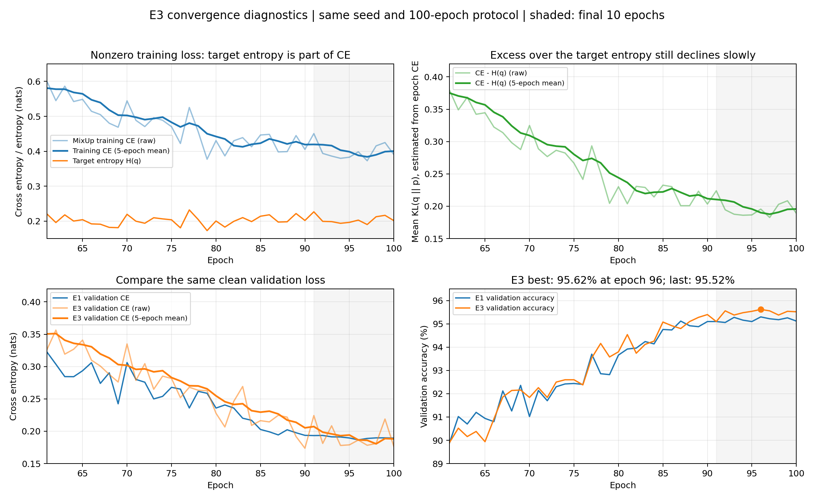

**E3 MixUp 结果与收敛诊断：100 轮之后怎样理解 loss**

分析日期：2026-11-17。正式 E3 已完成 100 轮，训练种子为 42。本文使用完整 5,000 张验证图片，官方测试集尚未评估。

**判断：你的观察有依据，后期仍有缓慢改善，不能断言已经充分收敛；同时，MixUp 的训练 loss 不接近 0 并不能单独说明训练失败或没有收敛。** 最后 10 轮训练目标约为 0.400，其中约 0.204 是实际混合标签本身的熵，另约 0.196 是模型预测与目标分布的差异。需要结合后者的趋势及统一的验证指标判断。

E3 最佳验证准确率为 **95.62%（第 96 轮）**，独立重新加载 best.pt 复算完全一致；E1 为 **95.30%**。本次 MixUp 的提升是 **0.32 个百分点、净多正确 16 张**，属于单种子下的小幅改善，尚不能认为稳定优于 E1。

**一、先分清图中的三种损失**

| 指标 | 输入与目标 | 应怎样看 |
|---|---|---|
| train_objective | 基础增强后的混合图片、混合标签；训练模式 | MixUp 训练目标，有非零软标签熵，随机混合会改变每轮难度 |
| train_clean_loss | 固定 5,000 张训练监测图片、真实单一标签；评估模式 | 与 E1 相同口径，监测干净训练数据拟合情况 |
| val_loss | 固定 5,000 张验证图片、真实单一标签；评估模式 | 与 E1 相同口径，用于判断泛化走势 |

MixUp 的训练目标不能直接与 E1 的普通训练交叉熵比较，也不能要求它像 E1 一样逼近 0。准确率只看最大概率类别，而交叉熵还取决于正确类别的概率，所以干净训练监测准确率都是 100% 时，loss 仍可能有变化。

按 [PyTorch 的交叉熵定义](https://docs.pytorch.org/docs/2.8/generated/torch.nn.CrossEntropyLoss.html)，对一个目标为“猫 50%、狗 50%”的样本，即使预测概率完全匹配，损失仍为：

```text
−0.5 × ln(0.5) − 0.5 × ln(0.5) ≈ 0.693
```

这是目标本身的不确定性，不是分类错误。实际 E3 使用 Beta(0.2,0.2) 的随机比例，也可能配到同类，因此整体下界不是固定的 0.693；必须按本次真实配对计算。MixUp 同时混合输入与标签的定义见 [原论文](https://arxiv.org/abs/1710.09412)。

**二、用保存的实际混合记录，分离目标熵与剩余误差**

本次从 E3 initial.pt 保存的 NumPy 与训练 DataLoader 随机状态开始，仅重放训练标签和配对，没有重新训练，也没有执行模型前向。核验结果为：

- **35,200 批 lambda 与 mixup_batches.csv 逐条精确一致**。
- 重放结束的 NumPy 与训练 DataLoader 随机状态均与 last.pt 完全一致。
- 每轮 45,000 个训练样本，352 个 batch，末批 72 张；按实际样本数加权。
- 配对标签相同时目标熵为 0；异类标签时为 lambda 的二元熵，没有用“约九成异类”代替实际统计。

对于实际软目标 q 和模型概率 p，交叉熵可以分解为：

```text
CE(q,p) = H(q) + KL(q || p)
训练目标 = 标签本身的熵 + 预测与目标分布的差异
```

这一定义下，最后一项仍有优化空间，不能把全部剩余 loss 都解释成不可下降部分。下表是每个 10 轮窗口的均值，损失单位为自然对数 nats。

| 轮次 | MixUp 训练 CE | 目标熵 H(q) | 剩余 CE−H(q) | 验证 CE | 验证准确率 |
|---|---:|---:|---:|---:|---:|
| 61–70 | 0.533536 | 0.200449 | 0.333087 | 0.317907 | 90.982% |
| 71–80 | 0.462597 | 0.200414 | 0.262184 | 0.268883 | 92.926% |
| 81–90 | 0.421115 | 0.204190 | 0.216925 | 0.217386 | 94.724% |
| **91–100** | **0.399558** | **0.203824** | **0.195734** | **0.191164** | **95.468%** |

可以同时得出两点：

1. loss 约 0.4 不意味着还差 0.4 才学好，因为其中约 0.204 来自标签本身的熵。
2. 剩余差异仍在降低，验证均值也仍有改善，因此不能证明已经达到优化终点。

最后 10 轮训练 CE 在 **0.372831–0.450635** 之间变化，与目标熵的相关系数约 **0.9943**。随机混合强度与尾部波动高度同步；但剩余 KL 也随混合难度变化，不能把全部波动归因于不可约熵。详细定义、每轮计算与核验记录见 mixup_entropy_diagnostics.json。

E3 最后 10 轮的加权训练准确率均值约 **89.609%**，这些实际软目标对应的理论加权正确率上限均值约 **90.908%**，差约 **1.30 个百分点**。同样不能以这个指标未达到 100% 判断模型未学好。该上限按同类配对取 1、异类配对取 max(lambda,1−lambda) 逐样本统计，并不是普通分类准确率的上限。



**三、当前验证表现处于什么阶段**

| 指标 | E1 | E3 |
|---|---:|---:|
| 计划 / 完成轮数 | 100 / 100 | 100 / 100 |
| 最佳验证准确率 | 95.30% | **95.62%** |
| 最佳准确率轮次 | 96 | **96** |
| 最佳准确率轮的验证 CE | 0.186615 | 0.186387 |
| Macro-F1 | 95.2946% | **95.6203%** |
| 验证错误数 | 235 | **219** |
| 第 100 轮验证准确率 | 95.12% | 95.52% |
| 第 100 轮验证 CE | 0.189403 | **0.176212** |
| 最后 10 轮验证准确率均值 | 95.178% | **95.468%** |
| 最后 10 轮验证准确率范围 | 95.06%–95.30% | 95.10%–95.62% |

E3 的验证表现已进入约 95.5% 的后期水平，但并未呈现所有指标完全水平的轨迹。第 81–90 轮到 91–100 轮，平均验证 CE 从 0.217386 降到 0.191164，平均验证准确率从 94.724% 升到 95.468%。改善还存在，但比早期更慢，继续训练能带来多少收益目前无法从日志确定。

全程最低验证 CE 是 **第 90 轮的 0.173670**，最佳验证准确率则是第 96 轮的 95.62%；第 100 轮 CE 为 0.176212、准确率为 95.52%。程序按准确率优先、loss 次之选择 best.pt，因此保留第 96 轮符合既定规则。不能看到第 100 轮 loss 更低就把它自动改成准确率最佳模型。

学习率第 96 轮约 0.0006255，第 100 轮约 **0.00003467**，已接近这次余弦计划的最低值 0.00001。原方案在 100 轮结束，现有日志足以进行本轮公平对照，但不是“无限训练已无收益”的证明。

**四、改善与退化发生在哪些类别**

每类准确率等于该真实类别正确数 / 500，在本实验中等于 recall。

| 类别 | E1 | E3 | 变化（百分点） |
|---|---:|---:|---:|
| 飞机 | 96.0% | 95.6% | −0.4 |
| 汽车 | 96.8% | 98.0% | +1.2 |
| 鸟 | 93.6% | **95.8%** | **+2.2** |
| 猫 | 88.8% | **90.4%** | **+1.6** |
| 鹿 | 96.8% | 95.4% | −1.4 |
| 狗 | 92.0% | 92.8% | +0.8 |
| 青蛙 | 97.6% | 97.8% | +0.2 |
| 马 | 96.2% | 96.4% | +0.2 |
| 船 | 98.4% | 97.4% | −1.0 |
| 卡车 | 96.8% | 96.6% | −0.2 |

六类 recall 提高、四类降低。鸟和猫的 recall 改善较多，但鸟的 precision 从约 94.55% 降至 92.29%，F1 略降；因此不能说 MixUp 对每一类或每一项指标都有提升。猫仍是最低 recall 和最低 F1 的类别。

猫→狗从 28 减到 21，狗→猫从 24 减到 18，双向共 **52→39**；猫→鸟还有 11 张，鹿→鸟和飞机→鸟各 9 张。混淆计数只能定位问题，尚不足以确定具体视觉原因。

同一张图片的配对比较为：两者都正确 **4,681**，E1 错而 E3 对 **100**，E1 对而 E3 错 **84**，两者都错 **135**。E3 净多正确 16 张，没有逐张覆盖 E1 的所有优势。提升较小，需要关键配置的多种子复核后再判断是否值得进入最终组合。

**五、训练代价与控制条件**

E1/E3 的模型参数量都是 **11,173,962**，模型推理结构与验证预处理相同。E1 历史逐轮记录耗时约 **89 分 22.6 秒**，E3 约 **107 分 38.5 秒**，多约 **18 分 16 秒、20.44%**。这些计时包含当轮数据加载、训练、监测和验证，不含权重写盘、启动和暂停，受系统负载影响，不能把全部时间差严格归因于 MixUp，也不能替代统一推理计时。

两组共享数据划分、归一化、基础增强、SGD 参数、Dropout、AMP、100 轮余弦方案和训练种子。E3 实际初始参数内容哈希与 E1 一致，均从第 0 轮开始；没有使用 E1 训练后的权重。E3 的 19 个训练源文件快照与环境哈希、当前对应代码一致；先前 E0/E1/E2 的冻结权重与日志保持不变。

本次另存一次完整验证复算到 validation_recheck/，准确率、loss、Macro-F1、混淆矩阵和各类指标均与原默认评估文件一致。当前 95.62% 是验证结果，不是测试结果。

**六、是否现在继续训练**

建议保留当前 **E3 / 100 轮**，作为与 E1 同预算的正式结果，并继续原计划的 E4 CutMix 对照。当前没有必要仅为了让 MixUp 训练 loss 接近 0 而追加轮次；这个目标不适合软标签训练。

如果要专门检验更长训练是否有收益，可以另开明确标记的长预算实验。比较“MixUp 在更长预算下是否有效”时，较清楚的方案是让 E1 与 E3 都采用相同的更长预算（例如 200 轮）和对应余弦调度，从同一初始模型重新开始。这样才能同时控制训练时长与调度，原有 100 轮结果保持保留。

从第 100 轮权重继续、另加一个学习率阶段也可以作为独立的继续训练实验，但需要明确新的学习率安排和额外预算，不能与从第 0 轮采用 200 轮调度混为一谈，更不能把延长后的差异全部归因于 MixUp。

现有入口会拒绝直接把原配置的总轮数从 100 改为 200 再 --resume；普通 --resume 只会提示原运行已完成。当前没有修改代码或调度、没有追加训练。若后续实施长预算，应先把具体方案定清楚，再单独实现和运行。

可写入报告的结论是：**在固定数据划分、种子 42 和共享 100 轮方案下，MixUp 将验证准确率由 95.30% 小幅提升到 95.62%，但伴随历史记录训练时间增加。末期验证指标和扣除软目标熵后的训练差异仍缓慢改善，尚不能宣称充分收敛；MixUp 训练 loss 的非零及波动本身不构成未收敛的充分证据。**

**结果文件**

- [收敛诊断图](convergence_diagnostics.png)、[完整对照曲线](curves.png)。
- [熵分解与精确重放记录](mixup_entropy_diagnostics.json)、[窗口汇总](convergence_summary.json)。
- [总体对照](comparison.json)、[每类对照](per_class_comparison.csv)、[逐图配对](paired_predictions.csv)。
- [独立验证复算](validation_recheck/metrics.json)、[完整性核验](analysis_checks.json)。
