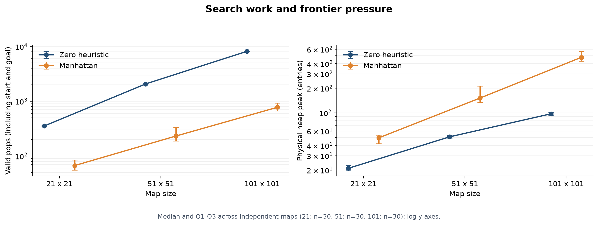
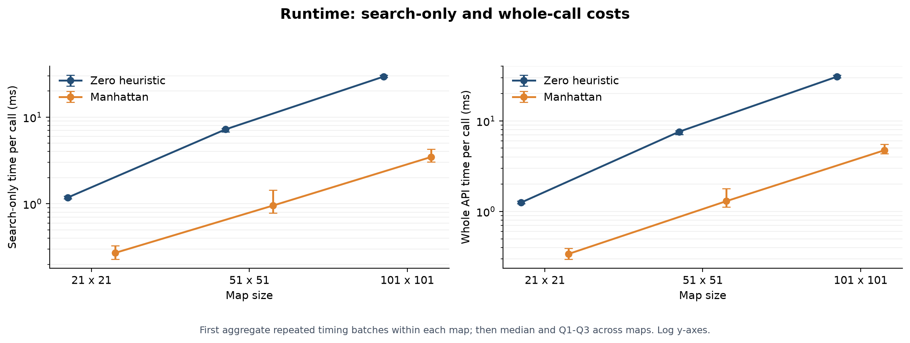
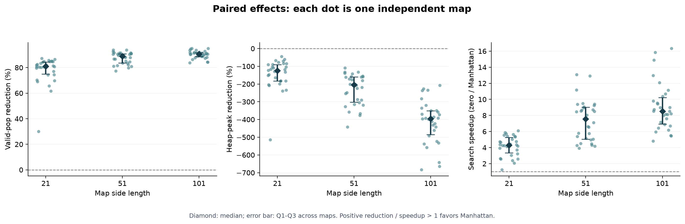
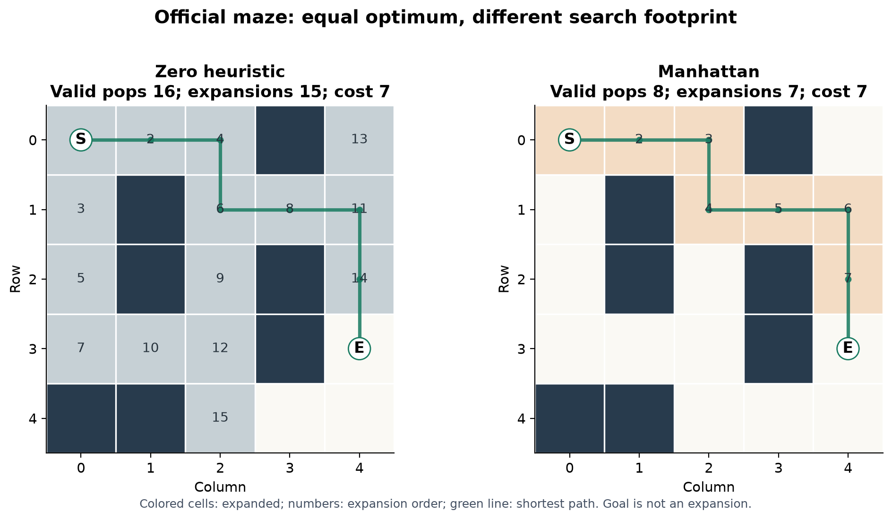
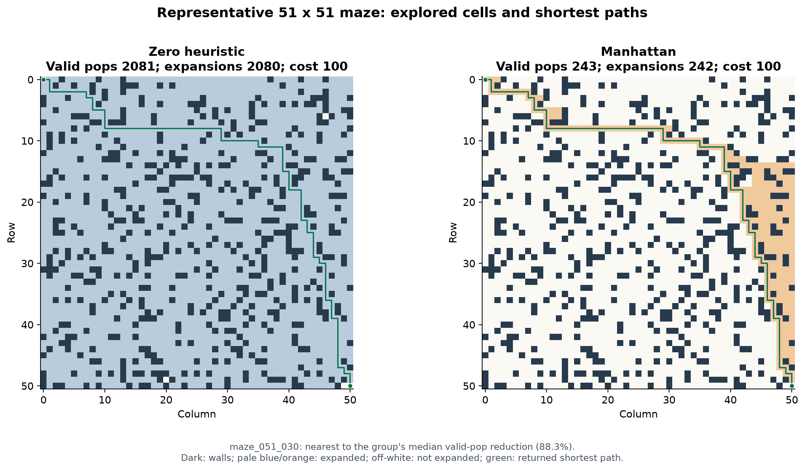

# 题一对照实验：零启发与曼哈顿

实验日期：2026-10-21。本文只分析题一，未修改 A* 核心算法，也未引入加权 A*、启发预处理或其他优化。数据来自本轮实际运行，不是预期结果。

## 1. 主要结论

在本次三种规模、20% 障碍概率、两角起终点、条件可达的 90 张随机地图上，两种策略的全部结果都与独立 BFS 的最短步数一致。曼哈顿在每张图上均减少了有效出队数，并降低了五批中位搜索时间与 API 均摊时间。

| 地图规模 | 独立地图数 | 零启发有效出队中位数 | 曼哈顿有效出队中位数 | 配对出队节省率中位数 | 配对搜索加速中位数 | 配对 API 加速中位数 |
|---|---:|---:|---:|---:|---:|---:|
| 21×21 | 30 | 353.5 | 67.0 | 80.95% | 4.29 倍 | 3.66 倍 |
| 51×51 | 30 | 2067.5 | 232.0 | 88.88% | 7.56 倍 | 5.84 倍 |
| 101×101 | 30 | 8149.5 | 775.0 | 90.50% | 8.51 倍 | 6.48 倍 |

表中的节省率、倍率均先逐图计算再取中位数，不是把两列中位数相除。每组有 30 张图，偶数个整数的中位数可以出现 0.5。

收益伴随堆压力上升：曼哈顿的物理堆峰值在 90 张图上均更高；逐图堆峰值比值的中位数分别是零启发的 **2.25、3.05、4.95 倍**。因此，本实验支持“更少搜索工作、更低本机耗时”，不支持“所有资源都更省”。堆条目数也不能直接等同于总内存占用。

## 2. 研究问题与控制变量

研究问题：同一张单位代价迷宫上，从 `h=0` 改成曼哈顿距离，是否在保持最优路径的同时减少搜索工作和实际耗时？

| 项目 | 约定 |
|---|---|
| 对照组 | `search_maze(..., heuristic="zero")`，使用堆的 A*/Dijkstra |
| 实验组 | `search_maze(..., heuristic="manhattan")` |
| 可移动方向 | 上、右、下、左，均为单位代价 |
| 优先队列 | `(f, h, 插入序号)`；两组使用相同规则 |
| 重复状态 | 保存最佳 g；跳过旧堆条目；发现更优 g 可再次扩展 |
| 终止条件 | 目标通过旧条目检查后有效出队，随即返回 |
| 地图、起终点 | 每张地图及其坐标在两组间完全相同 |
| 正确性参考 | 独立队列 BFS；不调用 A* 的邻居或启发函数 |
| 计时轨迹 | 关闭，不将轨迹输出混入正式性能数据 |

BFS 仅作为正确性参考，本实验没有测量 BFS 的运行时间。不能把零启发组的时间推广成所有无启发搜索的速度。

## 3. 地图来源、抽样与复现

官方地图来自工作区 `cases/problem1.json`，是课程提供的 5×5 输入，单独分析，不混入随机地图的样本统计。

随机地图在本地生成：边长为 21、51、101；起点在 (0,0)，终点在 (n-1,n-1)，两格强制可通行；其余每格独立以 0.2 概率设为 X。这里的 20% 是生成概率，不是强制每张图恰好有 20% 障碍。

主种子是 **20261021**。每个规模用 `Random(f'{master_seed}:{size}')` 依次抽取 64 位候选种子，再由候选种子生成一张完整地图。随后 BFS 检查可达性，不可达则拒绝，不会挖通道路。

| 规模 | 尝试数 | 接受且参与性能统计 | 拒绝且另行保存 |
|---|---:|---:|---:|
| 21×21 | 33 | 30 | 3 |
| 51×51 | 38 | 30 | 8 |
| 101×101 | 32 | 30 | 2 |
| 合计 | 103 | 90 | 13 |

这是一份以“可达”为条件的数据集。表中拒绝数是本轮抽样记录；由于在收集到固定成功数时停止，不把这些比例当作精确的总体可达率。

接受与拒绝的实际网格均保存在 `dataset/maps/`，清单在 [manifest.json](dataset/manifest.json)。每张地图有候选种子、尝试序号、实际障碍比例、BFS 最短步数和输入 SHA-256。可直接读取保存网格复现，不必依赖随机生成器未来版本是否变化。

## 4. 测量与统计方法

运行环境：Windows 11，Python 3.13.9，32 个逻辑处理器；图表使用 Matplotlib 3.11.2。环境详情、实际执行路径与源码哈希见 [config.json](config.json)。

每张图每种算法先预热 2 次，再通过 2 次调用估计批内重复数。较快配置以约 25 ms 为软目标，同时限制较慢配置的估计批时约 200 ms、最多 128 次。同图两算法使用相同循环数，避免重复工作量不一致。正式共测 5 批，批内每次调用都建立新的搜索状态。

本轮循环数范围为 3～128；12/91 张图受软限制影响，较快配置的估计批时不足 25 ms，因此不声称每批都保证超过该时长。实际校准数据见 [calibration.csv](calibration.csv)。

地图测量顺序以固定种子打乱；同一张图的每个批次交替两算法先后顺序。计时中不进行路径检查、CSV 写盘、绘图或进度打印。批次完成后再逐一校验所有返回路径。

两种计时口径分别是：

- **搜索内部时间**：A* 内部计时，包括启发计算、堆操作、统计和路径回溯，不含网格校验与转换。
- **API 均摊时间**：批量调用 `search_maze` 的总时间除以调用数，包括网格准备、循环与结果收集，不含批外正确性校验。这不是精确隔离的单次纯函数时间。

先对同一张地图、同一算法的 5 批平均单次时间取中位数，再跨每组 30 张独立地图汇总。5 批用于降低测量噪声，不把独立地图数扩成 150。

本轮总计 **91 个输入、910 行批次记录、29,870 次正式计时调用**。所有正式计时输出的路径均通过合法性和最短性检查。预热、校准不计入正式调用总数。

分位数采用排序后的线性插值，图中误差条是地图间 Q1～Q3，不是 95% 置信区间。本实验未进行显著性检验，也不作超出这些样本的统计显著性声称。

## 5. 性能结果

### 5.1 搜索量与堆峰值



有效出队包含起点和成功目标；真正扩展不包含成功目标。因此每次成功搜索的扩展次数比有效出队少 1。图中纵轴为对数坐标，线段用于展示规模分组之间的变化，不代表已拟合复杂度模型。

逐图有效出队节省率中位数及 Q1～Q3：

| 规模 | 节省率中位数 | Q1～Q3 | 零启发堆峰值中位数 | 曼哈顿堆峰值中位数 |
|---|---:|---|---:|---:|
| 21×21 | 80.95% | 74.98%～84.44% | 21.0 | 49.5 |
| 51×51 | 88.88% | 83.70%～90.83% | 51.0 | 152.0 |
| 101×101 | 90.50% | 88.64%～91.75% | 97.5 | 478.5 |

曼哈顿沿着更接近目标的方向推进，沿途生成但暂不扩展的候选节点可持续留在开放表；零启发则按代价层次展开。这能解释“扩展更少、堆峰值反而更大”的现象。该解释是结合搜索过程和实现机制给出的分析，并未把堆峰值推断为进程真实内存。

### 5.2 内部时间与 API 时间



下表时间均为毫秒：先每图对五批取中位数，再对 30 张图取中位数。

| 规模 | 零启发内部 | 曼哈顿内部 | 零启发 API | 曼哈顿 API |
|---|---:|---:|---:|---:|
| 21×21 | 1.1802 | 0.2713 | 1.2562 | 0.3402 |
| 51×51 | 7.2195 | 0.9537 | 7.5868 | 1.3015 |
| 101×101 | 29.2682 | 3.4592 | 30.7263 | 4.7345 |

逐图配对倍率为：

| 规模 | 内部加速中位数 [Q1,Q3] | API 加速中位数 [Q1,Q3] |
|---|---|---|
| 21×21 | 4.29 [3.33,5.24] | 3.66 [2.95,4.26] |
| 51×51 | 7.56 [5.06,9.02] | 5.84 [4.28,6.71] |
| 101×101 | 8.51 [6.93,10.21] | 6.48 [5.61,7.35] |

两种算法都需要对整张网格做转换、校验和最小代价扫描，这部分随地图面积增长，并不会因为曼哈顿少扩展节点就自动消失。因此 API 加速小于内部加速是合理的固定准备成本现象。不能只挑内部时间来代表用户实际调用的全部成本。

### 5.3 配对分布



每个点对应一张独立地图。90/90 张图的有效出队数更少，五批中位内部时间与 API 时间也更低；90/90 张图的堆峰值更高。不同地图上的节省幅度仍有差异，例如 21×21 组的有效出队节省率最低约 29.94%，所以不能把组中位数理解为每张图都能达到的固定比例。

## 6. 搜索过程：为什么会出现差异

### 6.1 官方小地图



两组均返回代价 7 的合法路径。零启发有效出队 16、扩展 15；曼哈顿有效出队 8、扩展 7。官方图能清楚显示数值与扩展顺序，但单图不足以支持总体性能结论，因此它没有混入随机图的统计样本。

### 6.2 代表性 51×51 地图



图中实例为 **maze_051_030**，并非人工挑选效果最好的地图。选择规则为：在 51×51 组中找有效出队节省率最接近该组中位数的实例，并列时按编号排序。

该实例的候选种子为 14801168255671033264，BFS 与两种 A* 的代价均为 100。零启发有效出队 2081，曼哈顿 243，节省 88.32%；堆峰值从 54 增至 166。路径可以不同，但都是最短路径。

零启发主要依据已经花费的 g，终点远在另一角时会覆盖大部分可达区域；曼哈顿加入剩余距离下界，帮助优先处理有希望到达目标的候选。当前 `(f,h,序号)` 规则在 f 相等时又优先较小 h，进一步沿目标方向推进。

## 7. 局限与可继续研究的问题

1. **并列规则影响结果。** 同一个 `(f,h,序号)` 规则，在零启发下 h 恒为 0，在曼哈顿下则参与排序。因此本轮反映当前完整优先策略的效果，不能把全部收益单独归因于下界变大，也不能推广为所有 A* 实现的固定节省比例。
2. **地图分布偏向有单调最短路的情形。** 90 张图中 88 张的真实最短步数恰好等于起终点曼哈顿距离；只有 21×21 组的 2 张图需要额外 2 步绕行。51×51 和 101×101 组均没有额外绕路。该分布对本启发较友好，不能据此声称它在长墙、陷阱或必须大幅回退的迷宫里同样有这种倍率。
3. **仅考察单一障碍概率与两角端点。** 更高障碍率、随机端点、长走廊和死胡同可能改变行为，本轮未测。
4. **时间依赖环境。** 本轮在一台机器、一次测量会话上运行；预热、重复和交替顺序只能减轻噪声，不能保证跨机器倍率一致。
5. **没有测进程总内存。** 堆峰值不包括最佳 g 表、父指针表、输入网格等空间，也可能包括旧条目。

如果继续优化，下一组适合先固定这 90 张图，比较 `(f,h,序号)` 与 `(f,序号)` 等并列规则；或者补充必须绕长墙的固定场景。这两项应分别作为单因素实验，不在一组中同时更换地图、排序和启发。

## 8. 可用于最终报告的结论段落

在三种规模、每组 30 张条件可达随机地图上，曼哈顿启发与零启发均得到与独立 BFS 一致的最短路径。按当前 `(f,h,插入序号)` 规则，曼哈顿的有效出队节省率中位数从 21×21 的 80.95% 提高到 101×101 的 90.50%，API 均摊耗时的配对加速比中位数分别为 3.66、5.84 和 6.48。与此同时，其物理堆峰值在所有随机实例上都更高，说明减少扩展节点并不必然降低开放表峰值。由于绝大多数样本的最短距离等于曼哈顿距离，结论应限定于本轮地图分布与优先规则；复杂绕路场景仍需额外对照验证。

## 9. 数据、代码与复现

- [原始批次数据 raw.csv](raw.csv)：910 行，保留两种策略、每批循环数、计数与两种耗时。
- [每实例汇总 per_instance.csv](per_instance.csv)：先消除同图重复计时的层级。
- [逐图配对 paired.csv](paired.csv)：节省率与倍率的直接依据。
- [分组汇总 summary.csv](summary.csv) 与 [summary.json](summary.json)：包含全部分位数、均值、标准差和样本计数。
- [输入清单与拒绝记录](dataset/manifest.json)、[校准记录](calibration.csv)、[路径记录](paths.json)、[运行配置](config.json)。
- [本轮源码归档 source_baseline.zip](source_baseline.zip)：保留算法、实验脚本、测试和官方输入；归档 SHA-256 记在配置中，便于后续优化后找回此轮基线。

重新采集同一批输入到新目录：

```powershell
python -m experiments.exp1_heuristic --dataset results/problem1_heuristics/dataset --out results/problem1_heuristics_repeat
```

只根据本轮原始 CSV 重新生成统计和图表：

```powershell
python -m experiments.analyze_maze_heuristics --results results/problem1_heuristics
```

分析程序会核查测量完成状态、运行编号、配对批次、输入一致性，并在重新生成轨迹前检查核心源码哈希和原始计数；不会静默用优化后的新轨迹解释旧数据。图表提供 PNG 与 SVG 两种格式，正文中的数字可追溯到逐图记录。上述分析文档是本轮结果说明，不会被绘图命令自动重写。
