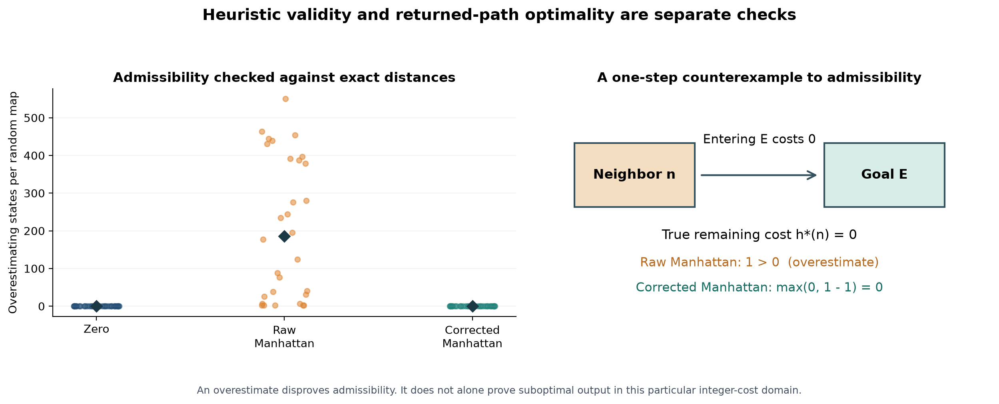
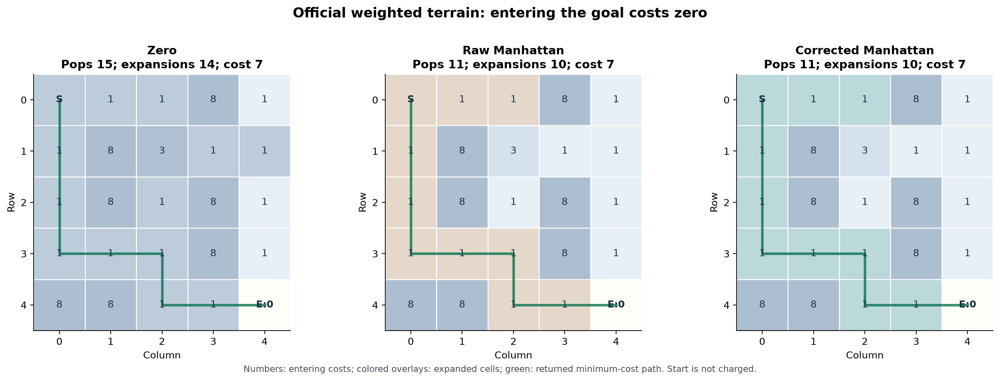
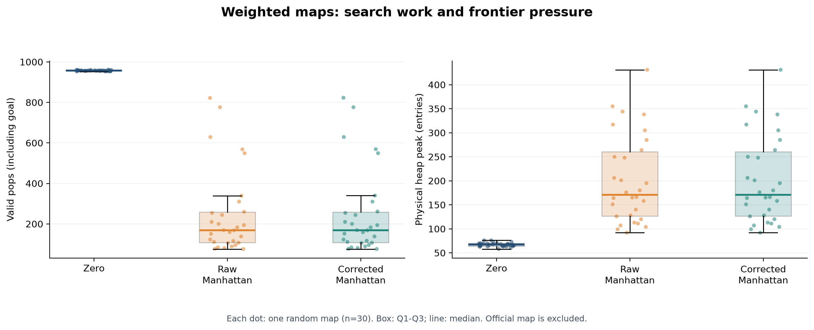
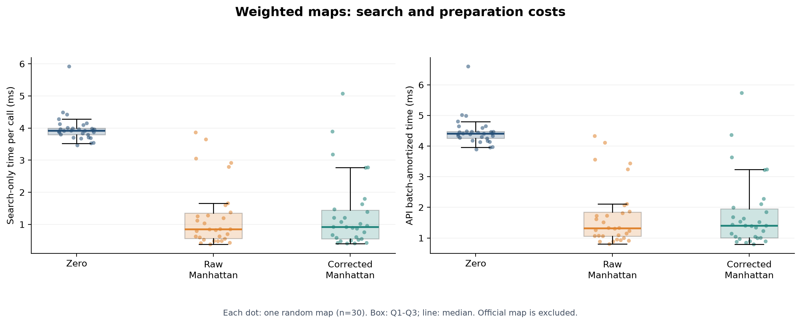
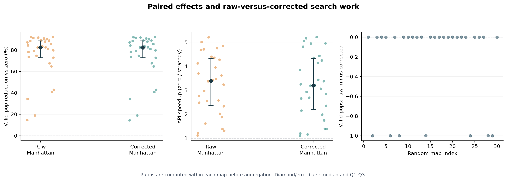

# 题二对照实验：可采纳性、最优性与三种启发的开销

实验日期：2026-10-21。主实验为 30 张 31×31 加权地图与 1 张官方地图；比较零启发、原始曼哈顿和修正曼哈顿。核心 A* 与题二默认接口未修改，题一已有数据未改动。

## 1. 主要发现

**原始曼哈顿在本题不具备可采纳性，但在本轮正整数地形上仍全部求得最优解；修正版恢复了可采纳性与一致性，搜索开销则与原始版非常接近。**

30 张随机地图上的结果如下，节点、时间均先逐图聚合，再跨地图取中位数：

| 策略 | 最优结果数 | 有效出队中位数 | 内部搜索时间/ms | API 均摊时间/ms | 对零启发的配对出队节省率 | 对零启发的配对 API 加速比 |
|---|---:|---:|---:|---:|---:|---:|
| 零启发 | 30/30 | 957.0 | 3.9154 | 4.4042 | 基线 | 基线 |
| 原始曼哈顿 | 30/30 | 168.5 | 0.8456 | 1.3140 | 82.40% | 3.39 倍 |
| 修正曼哈顿 | 30/30 | 168.5 | 0.9187 | 1.4005 | 82.40% | 3.19 倍 |

官方地图上三者均返回代价 7。有效出队分别为 15、11、11，扩展次数分别为 14、10、10。

原始与修正版在随机图上的有效出队：**23 张完全相同，7 张修正版多 1 次**；最优代价在 30 张图上全部相同。两种曼哈顿策略的物理堆峰值也在每张图上相同，但均高于零启发。

不要把上表两列中位数相除当作逐图倍率。配对倍率先在同一张地图内计算，再取中位数。原始/修正版 API 时间的逐图比值中位数约为 **0.988**，表明二者本轮直接比较的典型差异很小，不能由 3.39/3.19 推断每张图固定快多少。

## 2. 实验设计与数据来源

### 2.1 地图与规则

| 项目 | 设置 |
|---|---|
| 正式随机输入 | 30 张 31×31 地图，无障碍 |
| 普通地形权值 | 1、3、8 |
| 生成概率 | 0.7、0.2、0.1，各非端点格独立抽样 |
| 起终点 | S=(0,0)，E=(30,30)；官方图按其给定坐标 |
| 初始位置 | 初始 g=0，不支付起点格费用；重新进入 S 按 1 |
| 移动 | 仅上下左右，付进入格的地形权值 |
| 终点 | 进入 E 的代价为 0 |
| 主种子 | 20261022，是固定参数，不代表实验日期 |
| 参考算法 | 独立反向 Dijkstra，未复用 A* 的图转换、邻居或代价函数 |

所有随机地图连通且有有限非负代价，因此无需拒绝采样，不根据算法表现筛选地图或修补路径。实际普通格共 28,770 个，其中权值 1、3、8 的数量分别为 **20,159、5,737、2,874**，比例约 **70.07%、19.94%、9.99%**；不强制每张地图恰好符合概率比例。

每张地图的实际网格、种子、权值数量、参考最优代价和输入 SHA-256 均已保存。官方 5×5 地图另存为 [official_map.json](official_map.json)，不混入随机样本分布统计。

### 2.2 对照策略

设 d 为当前位置到 E 的曼哈顿距离，m 为非终点可通行格的最小进入代价。本轮 m=1。

| 策略 | 启发 | 作用 |
|---|---|---|
| zero | h=0 | 使用同一 A* 引擎的零启发基线 |
| manhattan | h=d | 检查原始提示在 E 免费时的性质与行为 |
| corrected_manhattan | h=m×max(0,d−1) | 适配最后一步免费的安全下界 |

三者均使用同一核心实现、上右下左邻居顺序与 `(f,h,插入序号)` 优先规则，只改变启发选择；目标在有效出队时返回，允许更优 g 重新打开状态。题二默认函数仍使用修正版。

## 3. 正确性参考与逐状态审计

### 3.1 为什么反向 Dijkstra 必须保留进入边权

原边 u→v 的代价是 w(v)。反转后 v→u 仍必须使用 w(v)，不能改成 w(u)。从 E 反向松弛其前驱时，加的是 w(E)=0，所以紧邻 E 的可通行格到终点的真实剩余代价为 0。

独立参考已在测试中与另一份正向 Bellman-Ford 交叉检查，覆盖进入方向、终点免费/收费、零权与障碍。它用于得到参考最优代价和 h*，不作为“精确启发”参与本轮性能计时。

每张 31×31 主地图有 961 个状态、3720 条有向邻接边；官方地图有 25 个状态、80 条边。分别核查：

- 可采纳性：每个状态满足 h(n)≤h*(n) 吗？
- 一致性：每条有向边满足 h(u)≤c(u,v)+h(v) 吗？
- 实际最优性：返回代价等于参考最优值吗？返回路径是否合法且累计代价正确？

这三项检查不能相互替代。

### 3.2 审计结果

以下只统计 30 张随机地图，不把 5 批计时重复计算成新的性质证据：

| 策略 | 存在高估的地图数 | 高估状态总数/28,830 | 最大高估 | 一致性违例边总数 | 主实验次优输出 |
|---|---:|---:|---:|---:|---:|
| 零启发 | 0 | 0 | 0 | 0 | 0 |
| 原始曼哈顿 | 30 | 6188 | 1 | 60 | 0 |
| 修正曼哈顿 | 0 | 0 | 0 | 0 | 0 |

原始曼哈顿每张地图的高估状态数为 2～550，中位数 186。每张地图都恰好有 2 条一致性违例边，即进入角落终点 E 的两条边。

官方地图的原始曼哈顿在 **20/25 个状态**高估，最大高估也是 1；一致性违例边为 2。零启发和修正版没有这两类违例。

高估并不只发生在 E 邻居：如果某状态能沿一条长度恰为 d、除 E 外均付 1 的路径到达 E，真实剩余代价是 d−1，原始曼哈顿 d 就会高估 1。本轮有 9 张随机图的最优代价为 59，起点原始曼哈顿为 60，所以这些图连起点也存在高估，但仍返回了最优结果。



## 4. 为什么“不可采纳”没有让这批输入算错

这是根据本题结构的推导，不是把一般 A* 定理反过来使用。

在四邻接、普通格进入代价至少为 1、仅 E 进入代价为 0 的条件下，修正版 h_fix=max(0,d−1) 可采纳且一致。对所有非目标状态，原始 h_raw=h_fix+1，相应 f_raw=f_fix+1。

因此，第一次生成目标前，两种启发对非目标节点的排序关系相同：不仅 f 同时加 1，第二关键字 h 也同时加 1，不会改变并列顺序。

生成目标的前驱 p 与 E 相邻，有 h_fix(p)=0，进入 E 又免费，所以此刻目标路径代价 C=g(p)。如果 C 大于最优 C*，开放表中最优路径的前沿必有 f_fix≤C*<C，p 就不应先被取出，产生矛盾。因此第一次生成目标已是最优的。原始曼哈顿使目标的 f 比前驱低 1，接下来立即弹出这个最优目标。

修正版在前驱和目标处的 h 都可能为 0，另一个 E 邻居若已在开放表中且与目标同 f、同 h，就可能按插入先后先被访问。在本轮角落终点只有两个邻居，所以出现“修正版多 1 次出队”很自然。实际正是 23 张相同、7 张多 1 次。

结论是：**可采纳性是常用的充分保证，不是“某个特定问题能算对”的必要条件。** 不能从“不可采纳”直接预写“这些输入必然会出现次优结果”，也不能从“这批全算对”反推原始曼哈顿可采纳。

## 5. 官方路径代价与搜索过程

三种策略本轮都返回同一条代价 7 的路径，逐格累计为：

| 步骤 | 位置 | 进入代价 | 累计代价 |
|---|---|---:|---:|
| 起点 | (0,0) | 0 | 0 |
| 1 | (1,0) | 1 | 1 |
| 2 | (2,0) | 1 | 2 |
| 3 | (3,0) | 1 | 3 |
| 4 | (3,1) | 1 | 4 |
| 5 | (3,2) | 1 | 5 |
| 6 | (4,2) | 1 | 6 |
| 7 | (4,3) | 1 | 7 |
| 8 | E=(4,4) | 0 | 7 |

共有 8 次移动，但不是代价 8。进入 E 的最后一步免费，起点初始也不收费。每种策略的原始逐格记录见 [official_cost_trace.csv](official_cost_trace.csv)。



## 6. 搜索工作、堆压力与时间

### 6.1 搜索量



随机地图上，两种曼哈顿策略均在 30/30 张图上少于零启发的有效出队。配对节省率中位数同为 82.40%；原始曼哈顿的 Q1～Q3 为 72.95%～88.68%，修正版为 72.87%～88.68%。

但差异并不总是这么大：修正版单图节省率约 14.36%～92.03%，说明不同地形会改变启发信息的有效程度，不能把中位数当成每张图的承诺。

随机最优代价范围为 59～69，中位数 61；起点的修正下界为 59。最优值接近下界时，当前策略更容易集中处理有希望的候选；最优值偏离下界时，下界区分能力相对减弱。这里只作结合样本和机制的解释，不用相关性推断普遍因果关系或复杂度结论。

堆峰值中位数从零启发的 67 增至两种曼哈顿的 171；逐图峰值比值中位数约为 2.74。定向搜索留下尚未扩展的候选、不同 g 的入堆和旧条目都会影响开放表压力；这不是整个程序峰值内存的测量。

### 6.2 两种耗时口径



内部搜索的配对加速比中位数：原始 4.76 倍、修正 4.39 倍；API 均摊时间对应为 3.39 倍、3.19 倍。API 还包含全图转换、校验和最小格权扫描，因此不能把内部加速直接代表完整调用收益。

在原始与修正版节点数几乎相同的情况下，公式求值开销、实际出队的少量差异和系统测量噪声都可能影响时间。逐图原始/修正版 API 时间比中位数 0.988；本轮不作显著性检验，不把这点差异包装为普遍的算法优劣。



右图差值为“原始−修正”：0 表示相同，−1 表示原始少一次出队。代价差在全部主样本上均为 0。

### 6.3 计时和统计细节

环境为 Windows 11、Python 3.13.9，图表使用 Matplotlib 3.11.2。所有配置保存在 [config.json](config.json)。

- 每图每策略先预热 2 次，以 2 次调用校准批内循环数，正式采集 5 批。
- 同图三策略循环数相同，较快者以约 25 ms 为软目标，受较慢者估计批时约 200 ms、最多 128 次限制。
- 实际循环数范围 7～128；2/31 张图的较快者估计批时因上限低于 25 ms，不承诺每个批次都超过目标时长。
- 随机 30 图的 150 个三策略批次，六种执行顺序各使用 25 次；官方图单独分配五批。地图测量顺序以固定种子打乱。
- 计时中不做参考求解、启发审计、路径检查、打印、CSV 写盘或绘图；所有返回路径批后逐一核查。未显式关闭垃圾回收。
- 内部时间包含启发、堆、统计和路径回溯；API 时间为批总时间除调用数，另包含网格准备、循环和结果收集。
- 每图先取五批中位数，再跨 30 张独立图统计。箱体/误差条为 Q1～Q3，不是 95% 置信区间。

总计 **31 个主输入、465 行批次记录、11,085 次正式计时调用**；全部正式结果最优性偏差为 0。预热和校准不计入正式调用数。重复计时不扩充地图样本量。

## 7. 独立边界例：何时原始曼哈顿真的可能返回次优

为说明结论的前提，另作一个不参与正式性能统计的零权例：

```text
S  1  E
0  0  0
```

S=(0,0)，E=(0,2)，进入 E 免费。它明确改变了“普通格至少为 1”的条件。

| 策略 | 返回代价 | 独立参考最优代价 | 绝对偏差 |
|---|---:|---:|---:|
| 零启发 | 0 | 0 | 0 |
| 原始曼哈顿 | 1 | 0 | 1 |
| 修正版 | 0 | 0 | 0 |

原始曼哈顿先走上方两步，付 1；下绕四步总费用为 0，虽然步数更多但代价更小。修正版取 m=0，自动退化为零启发并求得 0。完整输入和返回路径见 [boundary_demo.json](boundary_demo.json)。

此例不属于 {1,3,8} 的主实验，不混入“31 张主地图全部最优”的统计，也不是原题正权范围内的次优反例。它展示的是为什么需要保留明确的输入条件与安全的修正公式。

## 8. 局限、选择与下一步

1. **本轮范围固定。** 只测 31×31、无障碍、70%/20%/10% 权值分布与两角端点，未扫描规模、权值概率或障碍率。
2. **并列策略参与结果。** `(f,h,序号)` 的第二关键字会影响扩展，不推广为所有 A* 实现的固定节省。
3. **没有把参考预处理伪装成优化。** 反向 Dijkstra 只在正式计时前用于参考与审计，未宣称可以免费获得精确启发加速。
4. **时间只有一台机器的一轮测量。** 重复与顺序平衡减轻了噪声，不能保证跨环境倍率不变。
5. **默认保留修正版。** 修正的价值主要是符合真实代价模型、恢复形式保证；不能要求它必须比原始版少扩展，也不能因原始版本轮算对就取消修正。

进一步优化若引入反向 Dijkstra 精确启发，必须单列预处理、查询和总时间，并区分单查询与同目标多查询；若改变权值分布或加入障碍，应另建输入配置，不覆盖本轮数据。本轮尚未实施这些优化。

## 9. 可用于最终报告的结论段落

题二进入终点 E 的代价为 0，使原始曼哈顿距离在部分状态高估真实剩余代价。对 30 张随机正整数地形逐状态核查，原始启发共出现 6188 次高估、最大高估 1，而修正版没有可采纳性或一致性违例。尽管如此，三种策略在主实验中均返回与独立 Dijkstra 一致的最优代价；这与本题非目标启发统一差 1 的特殊结构相符。原始与修正版在 23 张图上有效出队数相同，其余 7 张仅相差一次；两者相对零启发的出队节省率中位数均为 82.40%。因此，应区分启发函数的形式性质、特定输入域下的最优性与实际性能，不能仅凭一次输出正确与否判断可采纳性。

## 10. 文件与复现

- [实际地图与生成配置](dataset/manifest.json)。
- [原始批次 raw.csv](raw.csv)、[校准记录](calibration.csv)、[路径记录](paths.json)。
- [每实例汇总](per_instance.csv)、[逐图配对](paired.csv)、[分组汇总 CSV](summary.csv) 与 [JSON](summary.json)。
- [逐图启发审计](heuristic_audit.csv)、[高估见证](heuristic_witnesses.json)、[官方路径累计](official_cost_trace.csv)。
- [运行配置与环境](config.json)。
- [本轮源码与测试归档](source_baseline.zip)：算法、实验脚本、测试及官方输入；归档校验值记在配置中，便于后续优化后复查此轮基线。

重用同一批实际地图，在新目录重新测量：

```powershell
python -m experiments.exp2_weighted_terrain --dataset results/problem2_heuristics/dataset --out results/problem2_heuristics_repeat
```

只从本轮原始记录重做统计与图表：

```powershell
python -m experiments.analyze_weighted_heuristics --results results/problem2_heuristics
```

分析程序核查采集完成状态、完整三策略批次、相同输入与循环数，并在生成轨迹前核查核心源码哈希和原始计数，避免用新算法解释旧数据。图表提供 PNG 与 SVG。本文为本轮分析说明，不由绘图命令自动改写。
