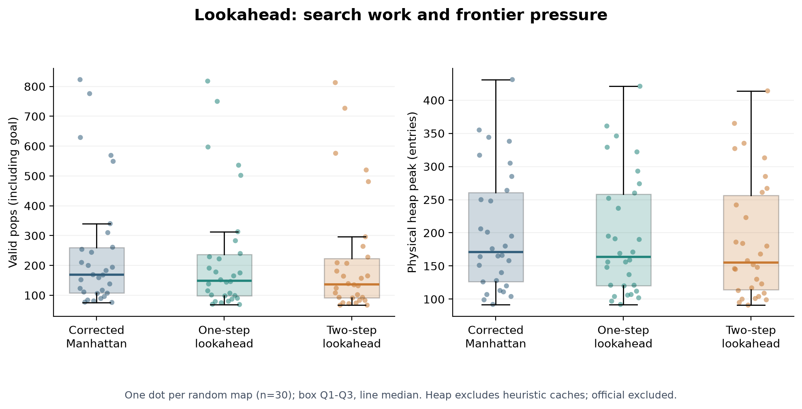
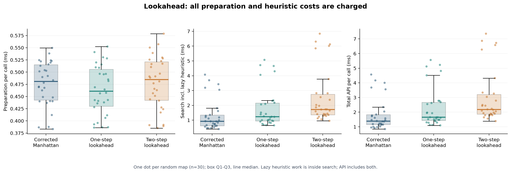
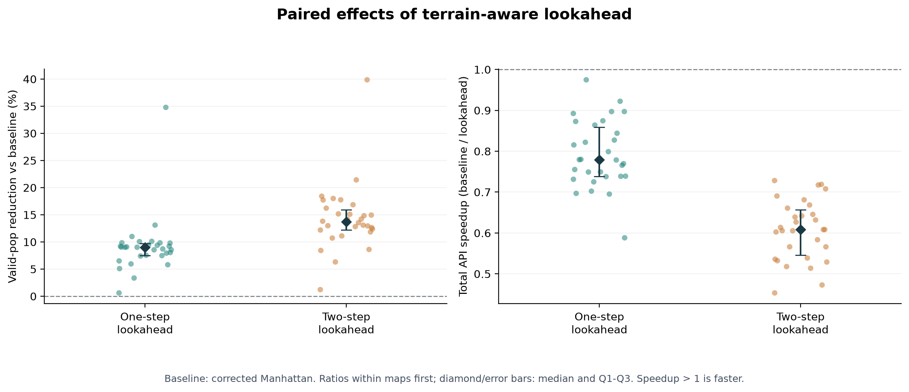
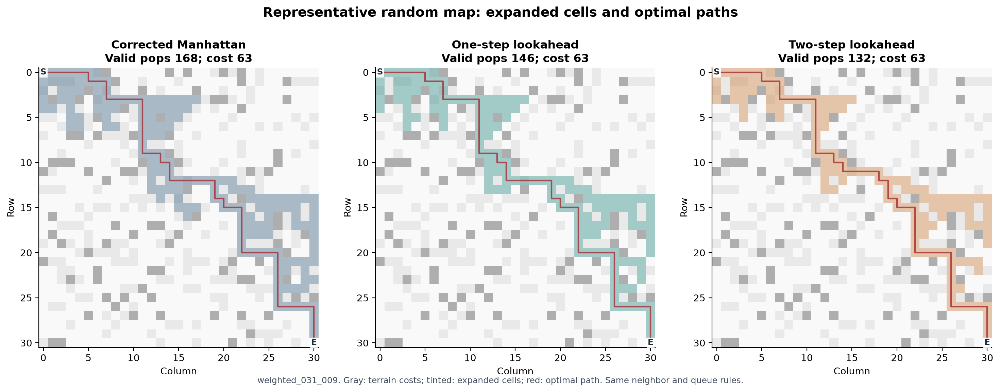
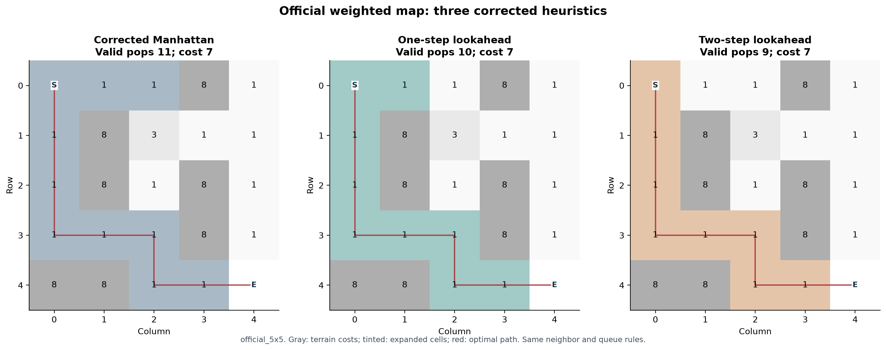

# 题二补充实验：基础修正版与一步、两步地形前瞻

实验日期：2026-10-22（Asia/Shanghai）。复用上一轮全部 30 张随机地图及官方地图，重新测量三种启发。原有 `src/`、题一结果和上一轮题二结果保持原样。

## 1. 实验回答了什么

**换一种修正公式，确实可以减少搜索节点。本轮一步、两步前瞻在全部 30 张随机地图上都减少了有效出队，但完整调用耗时也全部增加。当前按需缓存实现中，额外启发计算的成本超过了减少搜索工作的收益。**

下表先在每图内对 5 批计时取中位数，再跨 30 张独立地图取中位数。有效出队含起点和成功目标；时间单位为 ms。

| 方法 | 有效出队 | 扩展次数 | 堆峰值 | 准备耗时 | 搜索耗时 | 完整 API 耗时 |
|---|---:|---:|---:|---:|---:|---:|
| 基础修正曼哈顿 h0 | 168.5 | 167.5 | 171 | 0.4807 | 0.9199 | 1.3823 |
| 一步地形前瞻 h1 | 149.0 | 148.0 | 164 | 0.4610 | 1.2289 | 1.6491 |
| 两步地形前瞻 h2 | 137.0 | 136.0 | 155 | 0.4848 | 1.7247 | 2.1753 |

逐图计算效果后再汇总，得到：

| 相对 h0 | 出队节省率中位数 | 节省率 Q1～Q3 | API 加速比中位数 h0/新方法 | 出队更少的地图 | API 更快的地图 |
|---|---:|---:|---:|---:|---:|
| 一步前瞻 | 9.01% | 7.49%～9.70% | 0.779 | 30/30 | 0/30 |
| 两步前瞻 | 13.68% | 12.24%～15.95% | 0.608 | 30/30 | 0/30 |

加速比大于 1 才表示更快。直接计算“新方法 API 时间 / h0 API 时间”的逐图中位数，分别为 1.284 和 1.644，即本轮典型完整耗时增加约 28.4% 和 64.4%。这些是逐图配对结果，不是上表两组中位时间之比；偶数样本下，逐图比值的中位数与其倒数的中位数也不要求严格互为倒数。

三种方法在 31 张地图上的代价全部最优。总计 465 行正式批次、10,710 次正式计时调用；预热和校准不算正式调用。官方地图三种方法的代价均为 7，有效出队为 11、10、9。

因此，本次优化改善了启发下界与搜索量，当前实现尚未实现运行时间加速。题二默认接口继续使用基础修正版。

## 2. 新公式与原修正版的区别

### 2.1 基础修正版

令 d(n,E) 为曼哈顿距离，m 为非终点可通行格的最小进入费用：

\[
h_0(n)=m\max(0,d(n,E)-1).
\]

最后一步进入 E 免费，其余每一步至少花 m。这是安全下界，但没有区分当前位置周围的高价、低价格子。本轮随机图均有 m=1；原始曼哈顿与基础修正版在非终点处只差常数 1，所以两者通常具有相同的搜索顺序。

### 2.2 引入真实的局部地形费用

对非终点 n，定义：

\[
h_1(n)=\min_{v\in N(n)}[c(n,v)+h_0(v)],
\qquad
h_2(n)=\min_{v\in N(n)}[c(n,v)+h_1(v)].
\]

N(n) 是全部合法四邻接后继，c(n,v) 是进入 v 的真实费用，进入本次终点 E 时为 0。每一层都单独固定 h_k(E)=0；没有合法后继的孤立格保留上一层值。不能只枚举靠近终点的方向，绕路可能更便宜。

例如：

```text
S  8  E
1  1  1
```

从 S 到 E 的基础下界为 1。一步前瞻会比较右行 `8+0=8` 和下行 `1+2=3`，得到 h1(S)=3，恰好等于真实最优代价。只看朝向 E 的右行方向会错误估计为 8。这个小例子已纳入自动测试。

前瞻带来的增量随位置改变，因而可以改变节点之间的排序。它与“统一减去一个常数”的修正产生了不同效果；队列的并列规则在本轮保持不变。

### 2.3 为什么仍保证最优性

可采纳性：每条到 E 的路径都先走向某个后继 v，真实代价至少是 `c(n,v)+hk(v)`；再对全部合法后继取最小值，仍不会高估最优剩余代价。

一致性：基础 h0 一致。若 hk 一致，则 h{k+1}(n)≥hk(n)。对任意边 n→v，

\[
h_{k+1}(n)\le c(n,v)+h_k(v)\le c(n,v)+h_{k+1}(v).
\]

终点处固定为 0、所有费用非负，因此递推保持一致性与可采纳性。本轮既做了上述推导，也做了逐状态及逐边核查。

## 3. 实验输入、实现与操作流程

### 3.1 输入完全沿用上一轮

| 项目 | 配置 |
|---|---|
| 随机输入 | 原有 30 张 31×31 地图，不重新抽样，不按效果筛选 |
| 普通地形 | 1、3、8，生成概率 0.7、0.2、0.1，无障碍 |
| 起终点 | S=(0,0)、E=(30,30)；官方图使用原坐标 |
| 代价 | 初始 S 不收费，回到 S 按 1，进入 E 按 0 |
| 移动 | 上、右、下、左 |
| 优先队列 | 原有 A*，按 `(f,h,入队序号)` 排序 |
| 核验 | 独立反向 Dijkstra 求真值，独立路径检查；真值不传入启发函数 |

随机数据 manifest 的 SHA-256 与上一轮相同，为 `40c5d316b6d81f6332fa124aec01ffd57f6def02f6ad07e24ce7962ed0e14fb3`。所用地图和 manifest 均复制到本轮目录的 `dataset/`，官方输入另存为 `official_map.json`。

三种方法共享新增的统一实验适配器：相同网格校验、最小权扫描、邻居生成和原有 A* 引擎。深度 0 在全部正式地图上的路径、扩展顺序和六项确定性计数，均与原题二接口完全一致。新适配器引入的调用形式可能影响绝对时间，因此本轮三种时间都重新测量，未拼接上一轮时间。

### 3.2 按需计算，每次查询重新准备

基础层直接计算。前瞻层通过 Python 按需记忆化保存已经算过的状态值；h2 的计算会查询 h1。每次完整调用都新建地形准备对象与空缓存，预热、校准、正式重复调用之间不共享缓存。没有在计时前免费预计算前瞻表或精确距离。

操作顺序为：

1. 读取并复制实际输入，检查输入哈希、参考代价和基础接口等价性。
2. 在计时外核查全部状态的可采纳性、各层支配关系，以及全部合法有向边的一致性。
3. 冻结源码；每图每策略预热 2 次，再用 2 次完整调用校准批内循环数。
4. 正式测 5 批；同一地图的三种方法使用相同循环数，六种方法顺序在 30 张随机图上各用 25 次。
5. 每批计时结束后逐一检查所有返回路径的合法性和最优代价。
6. 每图先汇总五批，再对地图配对、跨地图统计和绘图。官方地图单独汇总。

以较快方法约 25 ms 为校准软目标，受较慢方法估计批时 200 ms、最多 128 次调用限制。本轮每批循环数为 5～128；官方图因达到循环上限，估计最快批时不足 25 ms，不能把软目标当作每批保证。未显式关闭垃圾回收。

### 3.3 三种时间口径

| 字段 | 范围 |
|---|---|
| prepare_ms_mean | 网格校验、转换、最小权扫描、启发对象与空缓存建立 |
| search_ms_mean | A*、按需前瞻计算、缓存查询、堆操作、计数与路径回溯 |
| api_ms_mean | 批总时间/调用数，包含上述准备与搜索，以及计时封装、对象释放、循环和结果收集 |

准备时间不代表全部启发计算成本：前瞻值主要在搜索中求出。三个时间字段分别聚合中位数，列与列之间不要求精确相加。参考算法、性质审计、路径校验、写盘和绘图均不在正式计时内。

环境为 Windows 11、Python 3.13.9、Matplotlib 3.11.2，详细配置见 `config.json`。五批重复用于缓解计时噪声，样本量仍为 30 张随机地图。Q1～Q3 为地图间差异，不是置信区间。

## 4. 正确性与下界强度

30 张随机地图每种启发核查 28,830 个状态和 111,600 条有向边；官方地图另外核查 25 个状态、80 条边。

| 启发 | 可采纳性违例 | 一致性违例 | 小于上一层的状态 | 严格大于上一层的状态 |
|---|---:|---:|---:|---:|
| h0 | 0 | 0 | 0 | 基础层 |
| h1 | 0 | 0 | 0 | 2911 |
| h2 | 0 | 0 | 0 | 1931 |

表中为随机地图统计；h2 的 1931 表示相对 h1 的进一步提高，不能与 2911 相加当作不同状态总数。官方 h1、h2 分别有 3、1 个状态相对上一层严格提高，所有性质检查均无违例。各方法终点启发均为 0。

所有 93 个“地图×方法”结果及 10,710 次正式计时调用都通过独立代价与路径核验。60 项 unittest 全部通过，其中新增 15 项覆盖：便宜绕路、零权、障碍、不可达、相同起终点、缓存隔离、独立 Bellman-Ford、配对统计、哈希和完整批次检查。

## 5. 图表与结果解释

### 5.1 搜索工作与堆峰值



有效出队中位数从 168.5 降为 149、137；一步、两步前瞻相对基础版都在 30/30 张随机图上更少。逐图节省幅度存在差异：一步为 0.61%～34.78%，两步为 1.22%～39.86%，不能将中位数理解为每张图的固定收益。

堆峰值中位数从 171 降至 164、155，但一步有 5 张图、两步有 3 张图的堆峰值反而增加；一步另有 1 张持平。堆峰值只表示物理堆条目，不包含新增启发缓存和其他对象，尚未测量程序总内存。

### 5.2 节点减少与实际耗时



前瞻增加了邻居枚举、函数调用和缓存访问。尽管 A* 扩展更少节点，启发本身也在做额外图操作，所以不能只用扩展次数代表全部工作。当前 Python 实现的内部搜索与完整 API 时间都高于基础版。

准备耗时大体相近，因为三者都做相同网格转换与最小权扫描，仅增加少量空缓存建立；主要前瞻费用落在内部搜索时间。准备时间的少量差别受计时波动影响，不将 h1 的较小准备中位数解释为该方法准备更高效。



左图所有点都在 0 以上，表示搜索量全部降低；右图所有点都在 1 以下，表示总耗时全部增加。这是本轮完整结论。其适用范围是当前地图分布、31×31 规模、单次查询重新准备，以及当前 Python 按需缓存实现。

### 5.3 查看一张代表地图的搜索过程



代表图为 `weighted_031_009`，选择规则是“基础有效出队最接近随机图中位数，并列按实例编号”。基础图中位数为 168.5，该图为 168；没有按最大优化收益挑图。

三种方法在该图有效出队为 168、146、132，路径代价均为 63。灰度表示地形费用，彩色覆盖表示扩展区域，红线是返回的最优路径。图表生成时重新核查输入哈希及全部确定性计数，避免用不同版本的轨迹解释本轮数据。

### 5.4 官方小图



三种方法均返回同一条代价 7 的路径。基础、一步、两步分别有效出队 11、10、9 次，扩展 10、9、8 次。两步前瞻在该图只扩展最终路径上的非终点格，但启发计算仍有开销，其完整调用时间也高于基础版。逐格累计记录在 `official_cost_trace.csv`，进入 E 的最后一步费用为 0。

## 6. 如何使用结果与继续优化

本轮已经验证：更强且安全的局部地形启发能减少搜索节点；更少节点未在当前实现上带来加速。若评价指标是本分布下的单次完整调用时间，当前应保留基础修正版。前瞻方法可作为后续优化的正确基线与教学对照。

下一轮优先检查并减少前瞻求值的 Python 调用和重复邻居处理开销，每次只改变一种实现因素，并保持本轮 h 值、最优代价和确定性搜索行为可复核。也可另开实验比较按需缓存与整图表预计算，后者必须把整图预处理计入单次总时间。

若研究同地图、同终点的多起点查询，可以单独测试缓存或预处理的摊销，计入一次准备成本并报告查询次数。不能把多查询复用的收益直接写成当前单查询实验的加速。改变地图规模、地形分布或障碍率也应另列数据配置，本轮没有据此作普遍结论。

可用于最终实验报告的结论段落：

> 在终点进入代价为 0 的加权网格上，基础修正曼哈顿通过减去最后免费的一步恢复了可采纳性，但仅使用全局最小地形费用。本文通过一次、两次 Bellman 前瞻引入真实邻格进入费用，保持终点启发为 0，并证明递推后仍可采纳且一致。在固定的 30 张 31×31 地图上，一步、两步前瞻均返回最优解，逐图有效出队节省率中位数分别为 9.01% 和 13.68%。计入网格准备与按需启发计算后，两者完整 API 时间均高于基础版，配对加速比中位数分别为 0.779 和 0.608。因此，启发信息量的提高与程序运行加速需要分别评价，优化时必须衡量启发求值成本与减少搜索工作的收益。

## 7. 文件、复核与复现

| 文件 | 用途 |
|---|---|
| `dataset/manifest.json`、`dataset/maps/`、`official_map.json` | 所用实际输入与哈希 |
| `raw.csv`、`calibration.csv`、`config.json` | 原始正式批次、循环校准、环境、顺序与源文件哈希 |
| `heuristic_audit.csv` | 每图每方法的可采纳性、一致性、支配关系和严格提高状态数 |
| `paths.json`、`official_cost_trace.csv` | 返回路径与官方逐步累计费用 |
| `per_instance.csv`、`paired.csv`、`summary.csv`、`summary.json` | 地图内聚合、同图配对与分组统计 |
| `figures/` | 5 组 PNG/SVG 图 |
| `source_baseline.zip` | 完整 Python 源码、测试、官方输入及依赖清单白名单归档 |
| `verification.json` | 60 项测试通过、旧文件保持不变、基础计数匹配和归档完整性记录 |

归档共有 36 个文件，SHA-256 为 `ba1df5946384580c57abf3a717b0b4042803210ac10e5c48eb444eff89110949`。已逐一核查归档内容、配置哈希和当前源文件一致。另对旧核心 10 个文件、题一结果 125 个文件、旧题二结果 56 个文件，共 191 个文件做前后哈希核查，均未改变；31 张图的基础代价和六项计数也与上一轮完全一致。

在项目根目录重用本轮保存的地图重新采集，输出目录必须为空：

```powershell
python -m experiments.exp2_lookahead --dataset results/problem2_lookahead/dataset --out results/problem2_lookahead_repeat
```

只重做本轮汇总与图表：

```powershell
python -m experiments.analyze_lookahead --results results/problem2_lookahead
```

运行正确性测试：

```powershell
python -m unittest discover -s tests -v
```

如果以后改了源码，分析程序会拒绝用新实现重新绘制旧轨迹。需要复核旧轨迹时，在单独目录解压本轮源码归档，放入本轮结果目录，再使用归档版本的命令。中文分析是人工撰写的本轮说明，重绘命令不会改写本文。
