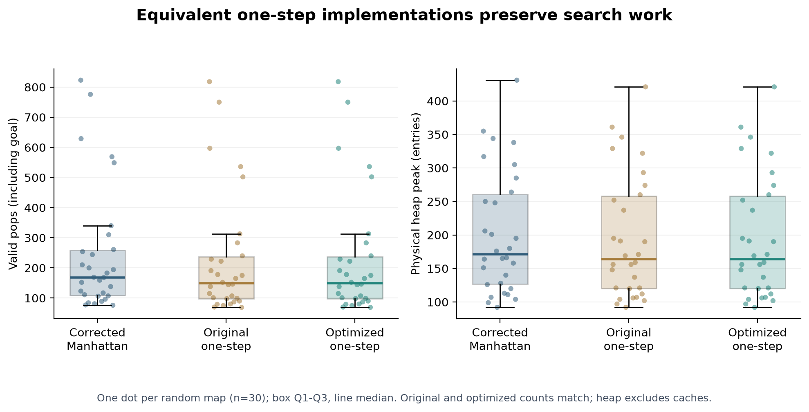
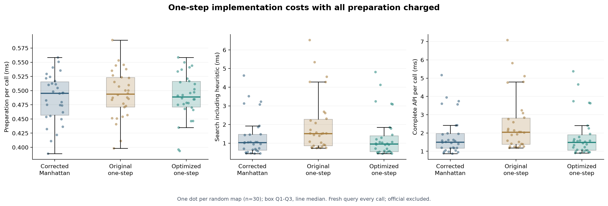
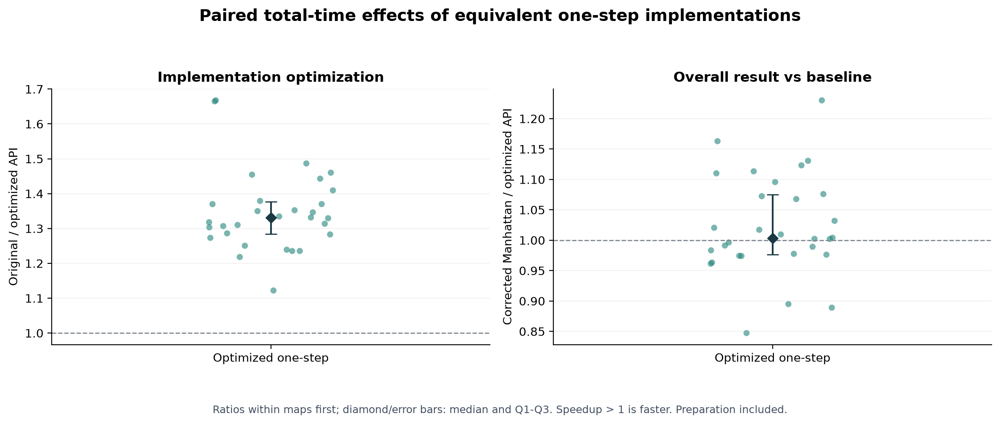
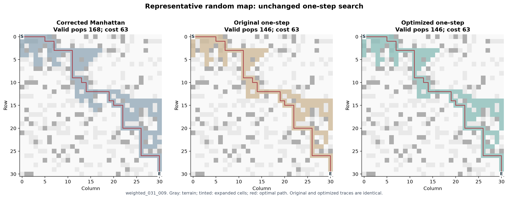
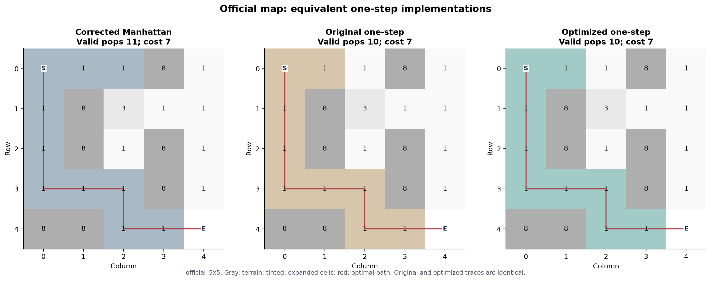

# 题二：一步前瞻的等价实现优化

实验日期：2026-10-22（Asia/Shanghai）。本轮只优化一步前瞻的求值实现，保留原启发公式、缓存范围、A* 引擎和队列规则。全部既有核心代码、实验代码与前三组结果保持原样。

## 1. 结论与正式结果

**优化有效：快速一步前瞻在全部 30 张随机地图上都比旧实现更快，逐图完整调用耗时节省率中位数为 24.84%，加速比中位数为 1.331。新旧启发值、路径、扩展顺序和全部搜索计数完全相同。**

与基础修正曼哈顿相比，快速一步前瞻保留了出队节省，但完整耗时大体持平：本轮 17 张更快、13 张更慢，配对加速比中位数只有 1.003，不能据此认定其稳定优于基础版。

30 张随机地图的结果如下。计时先对每张地图的 5 批取中位数，再跨地图取中位数；单位为 ms。

| 方法 | 有效出队 | 扩展次数 | 堆峰值 | 准备时间 | 搜索时间 | 完整 API 时间 |
|---|---:|---:|---:|---:|---:|---:|
| 基础修正版 h0 | 168.5 | 167.5 | 171 | 0.4953 | 1.0244 | 1.4976 |
| 旧一步前瞻 h1 | 149.0 | 148.0 | 164 | 0.4937 | 1.5110 | 2.0374 |
| 快速一步前瞻 h1 | 149.0 | 148.0 | 164 | 0.4887 | 0.9493 | 1.4829 |

必须区分两个比较基准：

| 同图配对比较 | API 加速比中位数 | 加速比 Q1～Q3 | 快速版耗时节省率中位数 | 快速版更快/更慢地图数 |
|---|---:|---:|---:|---:|
| 旧一步前瞻 / 快速一步前瞻 | 1.331 | 1.284～1.377 | 24.84% | 30 / 0 |
| 基础修正版 / 快速一步前瞻 | 1.003 | 0.977～1.075 | 0.32% | 17 / 13 |

倍率先在每张图内计算，再跨图取中位数，不等于第一张表中两组中位时间之比。接近 1 的基础版比较受地图差异和计时噪声影响，本文不据 0.32% 作稳定加速或显著性结论。

相对旧实现，内部搜索时间节省率中位数为 34.53%；完整 API 因仍包含约 0.49 ms 的共同准备成本，收益被摊薄为 24.84%。两种一步前瞻相对 h0 的出队节省率中位数均为 9.01%，没有因为实现优化而进一步减少节点。

本轮共 31 个输入、93 个地图与策略组合、465 行正式批次、10,305 次正式计时调用，全部返回最优路径。官方图三者代价均为 7，有效出队分别为 11、10、10。

## 2. 为什么可以更快而不改变启发

### 2.1 原始定义保持不变

\[
h_0(n)=m\max(0,d(n,E)-1),\qquad
h_1(n)=\min_{v\in N(n)}[c(n,v)+h_0(v)].
\]

m 为非终点可通行格的最小进入费用。目标每层启发为 0，进入目标的费用为 0；孤立格保留 h0。

旧实现通过通用邻居生成器逐个生成后继，对每个后继重新调用基础启发，包括曼哈顿距离和截断计算。快速版利用四邻接距离的结构，减少这些重复工作。

### 2.2 代数化简

当 d≥2 时，邻居不可能是免费终点。合法邻居分成两类：朝向目标时距离为 d−1，远离目标时距离为 d+1。因此：

\[
h_1(n)=m(d-2)+\min\left\{
  \min_{v\text{ 朝向目标}} w(v),
  \min_{v\text{ 远离目标}}[w(v)+2m]
\right\}.
\]

这里只算一次当前位置的距离，再读取相邻格费用，不再对每个邻居调用 h0。方向依据当前位置与目标坐标判断，支持内点目标、同一行和同一列；障碍不作为候选。

### 2.3 安全提前结束

所有非终点格费用至少为 m，所以：

1. 朝向目标的候选至少为 m。若发现一个费用为 m 的朝向格，已经达到所有候选的下界，可立即返回 `m(d−1)`。
2. 朝向候选检查完后，远离候选至少为 `m+2m=3m`。若当前最好值不大于 3m，剩余远离候选不可能改进结果。
3. 需要检查远离方向时，一旦发现费用为 m 的格子，就达到了该类候选的下界 3m，可停止。

这些判断依赖可证明的下界，不是任意丢弃绕路方向。发现不了足以确定答案的下界时，仍检查全部剩余合法方向。

d=0、1 时直接返回 0；距离 1 的合法位置可以直接免费进入目标。无合法后继时回退 h0。m=0 时仍需读取真实邻格，不能把整个 h1 设置为 0，例如 `S,3,3,E / 3,3,0,3` 的起点 h0=0，但 h1=3。

因此，优化前后 h1 在每个格子完全相等，可采纳性和一致性也随之保持。缓存仍为每次查询新建的按需缓存；A* 的上右下左邻居顺序与 `(f,h,入队序号)` 排序均保持原样。

## 3. 性能剖析与正式计时分开

优化前先用 cProfile 对固定的 30 张随机地图各执行一次完整新查询，查看函数调用；优化后以同一地图和顺序再诊断一次。详细记录在 `profiling.json`。

| 插桩样本中的调用 | 旧一步前瞻 | 快速一步前瞻 |
|---|---:|---:|
| 记忆化未命中的一步启发函数 | 11,098 | 11,098 |
| 基础启发包装函数 base | 43,317 | 0 |
| Profiler 记录的全部函数调用 | 1,046,632 | 666,941 |

快速版将基础距离表达式代数化后直接计算，表中的 0 不表示取消了基础下界。未命中求值次数相同，说明此项改进没有通过预热或跨查询复用缓存偷省工作。

这些调用数属于诊断样本，不是 A* 出队或后继计数。cProfile 插桩本身会改变时间，所有插桩时间均排除在正式性能表之外；嵌套累计时间也不能相加当作总时间。

## 4. 对照流程与验证

### 4.1 固定的输入与控制条件

复用上一轮 30 张 31×31 无障碍地图和官方 5×5 地图。普通费用为 1、3、8，生成概率为 0.7、0.2、0.1，随机图两角为起终点。起点初始不收费、回入按 1，进入 E 按 0。实际输入及 manifest 均复制到本轮 `dataset/`。

三种策略共享 `search_variant` 的地图转换、最小权扫描、原有 A* 和邻居生成。仅选择不同启发求值器。没有把独立 Dijkstra 的真值用于构造启发；真值只用于校验。

每图每策略预热 2 次、校准 2 次、正式 5 批，同图批内循环数相同。最快者以约 25 ms 为软目标，受最慢者估计 200 ms、最多 128 次限制。本轮循环数为 5～128，官方图达到上限后估计最快批时仍不足 25 ms。30 张随机图的六种策略顺序各使用 25 次，地图顺序按固定种子打乱。

每次计时调用重新准备地形和创建空缓存。`prepare_ms_mean` 包含输入校验、转换、最小权扫描和对象构建；`search_ms_mean` 包含按需启发求值、缓存、堆、计数及回溯；`api_ms_mean` 为批总时间除调用数，还包含调用封装、结果收集和查询对象释放。参考求解、审计、路径检查、I/O、绘图不在正式计时内。未显式关闭垃圾回收。

三种方法的时间均在本轮重新采集，不能用上一轮旧实现的时间直接减去本轮快速版时间计算收益。环境为 Windows 11、Python 3.13.9、Matplotlib 3.11.2，具体见 `config.json`。

### 4.2 先验证等价，再测量

正式采集前逐图核查，任意失败都会拒绝采集：

- 31 张地图共 28,855 个状态，快速与旧 h1 的数值不一致数为 0。
- 全部 31 张图的最优代价、完整路径、扩展序列和六项确定性搜索计数相同。
- 新实验的基础版与原题二接口相同，旧一步前瞻与上一轮接口相同。
- 所有策略可采纳性、一致性和相对 h0 的支配关系审计均无违例。
- 随机地图上旧、快 h1 都有 2911 个状态严格强于 h0；官方图均有 3 个。

结果保存在 `equivalence.csv` 和 `heuristic_audit.csv`。随机图每种启发核查 28,830 个状态、111,600 条有向边，官方图另有 25 个状态、80 条边。

全部 74 项测试通过。新增 14 项覆盖 256 张 2×3 穷举地图、90 张任意目标与正最小费用随机地图、零权、孤立、障碍、数值终点、相同起终点、查询缓存隔离、完整等价流水线和配对分母。原有独立 Bellman-Ford 及 Dijkstra 检查也全部通过。

五批计时仍只对应一张地图，不把样本量扩大为 150。Q1～Q3 描述地图间差异，不是置信区间。本轮未进行显著性检验。

## 5. 图表怎么读

### 5.1 搜索量应当相同



旧、快 h1 的有效出队和物理堆峰值逐图相同，重合的分布正是预期结果。两者相对基础 h0 的节点减少来自前瞻公式；快版相对旧版的时间收益来自求值实现。堆峰值不包含启发缓存，不是总内存测量。

### 5.2 同样搜索，求值更省



三者准备成本接近，快速版显著降低了旧一步前瞻的搜索时间。准备时间的小幅变化包含测量噪声，不把它解释成新的网格准备优化。



左图全部高于 1，说明快速版在每张随机图上均比旧一步前瞻快；完整耗时节省范围约 10.88%～40.03%。右图在 1 两侧都有点，说明相对基础修正版的效果仍依赖地图和本轮运行条件。不能只展示左图而声称已经稳定超过基础算法。

### 5.3 扩展过程也保持一致



代表图仍按“基础出队次数最接近随机图中位数，并列按实例编号”选择，为 `weighted_031_009`。三者代价均为 63，有效出队为 168、146、146，旧、快一步前瞻的完整路径和扩展序列一致。



官方图上基础、旧 h1、快 h1 的完整调用时间分别为约 0.0531、0.0847、0.0547 ms。快版比旧版明显改善，但仍略慢于基础版；三者都返回代价 7。官方图作为正确性与过程示例单列，不混入随机分布统计。

## 6. 使用优化版与继续研究

优化函数位于 `experiments/optimized_lookahead.py`，旧实现位于 `experiments/lookahead_heuristics.py`。在 Python 中使用：

```python
from experiments.optimized_lookahead import search_variant

run = search_variant(start, end, grid, heuristic="lookahead_1_optimized")
result = run.result
print(result.cost, result.path, result.stats.valid_pops)
```

`run.prepare_ms` 是准备时间，`result.stats.elapsed_ms` 是内部搜索时间。正式比较完整调用应使用实验脚本，单次打印中的耗时不能当作稳定性能结论。

本轮已实现“一步前瞻保持较少搜索节点，同时降低其原始实现开销”。当前对基础版还没有稳定的总时间优势，所以保留原题二默认接口。两步前瞻的实现和结果也保持原样；以后可单独研究把快速 h1 用作两步前瞻内层，但需要新的完整计时，不能直接推断其加速比例。

可用于最终报告的结论段落：

> 为降低一步地形前瞻的求值成本，本文依据四邻接网格中距离只改变 1 的性质进行代数化简，并利用候选费用下界安全提前结束。优化后与旧一步前瞻在全部 28,855 个正式状态上的启发值相同，完整路径、扩展顺序及搜索计数也相同。在 30 张固定随机地图上，完整调用耗时节省率中位数为 24.84%，配对加速比中位数为 1.331，全部地图均改善。相对基础修正曼哈顿，快速版保留 9.01% 的出队节省率中位数，但完整耗时配对倍率仅为 1.003，17 张更快、13 张更慢。因此，本轮证明了实现优化的收益，尚不能证明前瞻方法在当前单查询场景中稳定优于基础启发。

## 7. 复现与完整性

| 文件 | 用途 |
|---|---|
| `raw.csv`、`calibration.csv`、`config.json` | 正式批次、校准、环境与源码冻结哈希 |
| `dataset/`、`official_map.json` | 实际输入副本 |
| `equivalence.csv`、`heuristic_audit.csv` | 全状态等价、路径、扩展序列、计数与启发性质 |
| `paths.json`、`official_cost_trace.csv` | 返回路径及官方累计费用 |
| `per_instance.csv`、`paired.csv`、`summary.csv`、`summary.json` | 地图内聚合、两个基准下的配对结果 |
| `profiling.json` | 单独的插桩诊断，排除于正式计时 |
| `verification.json` | 测试、旧文件保持、独立重算与归档完整性记录 |
| `figures/` | 5 组 PNG/SVG |
| `source_baseline.zip` | 42 个 Python 源码、测试、官方输入与依赖清单白名单文件 |

归档 SHA-256 为 `b0fd8a542c28ca1cb02d901e1727a125b0832a9173482b32676cac381416f728`，与配置、归档内部文件及当前源码逐一核对一致。对旧核心、前三组实验结果和旧实验/测试代码共 267 个文件做前后哈希检查，均未改变；本轮基础版和旧 h1 的 62 个地图与策略组合的输入、代价和六项计数也与上一轮相同。

重新测量同一批实际地图，使用新的空输出目录：

```powershell
python -m experiments.exp2_lookahead_optimized --dataset results/problem2_lookahead_optimized/dataset --out results/problem2_lookahead_optimized_repeat
```

只重做本轮汇总与图表：

```powershell
python -m experiments.analyze_lookahead_optimized --results results/problem2_lookahead_optimized
```

正确性测试：

```powershell
python -m unittest discover -s tests -v
```

源码变化后，分析程序会拒绝用新实现重绘旧轨迹。可在独立目录解压本轮源码归档，放入本轮结果目录，使用归档版本复核。中文报告为人工撰写，重绘命令不会改写本文。
