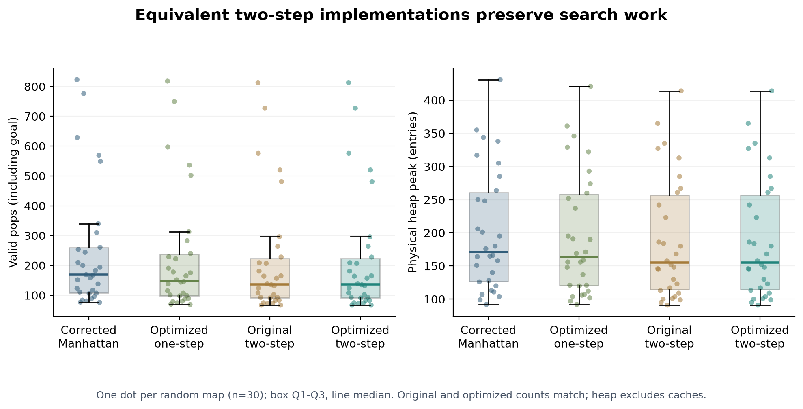
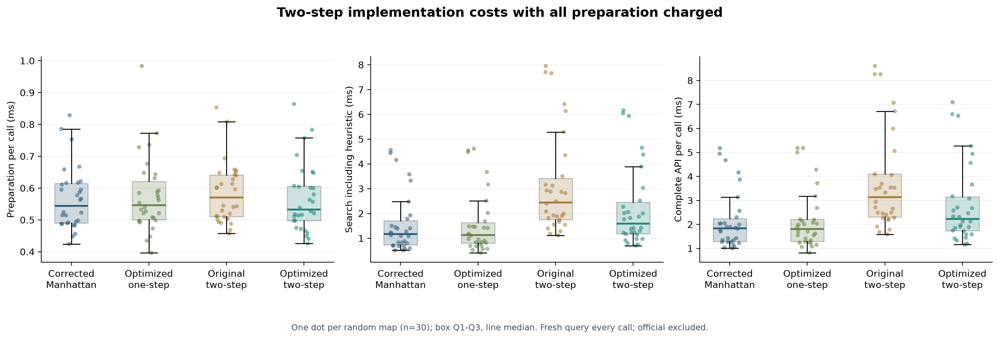
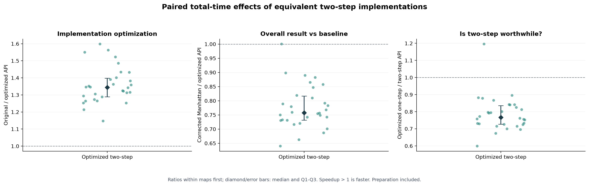
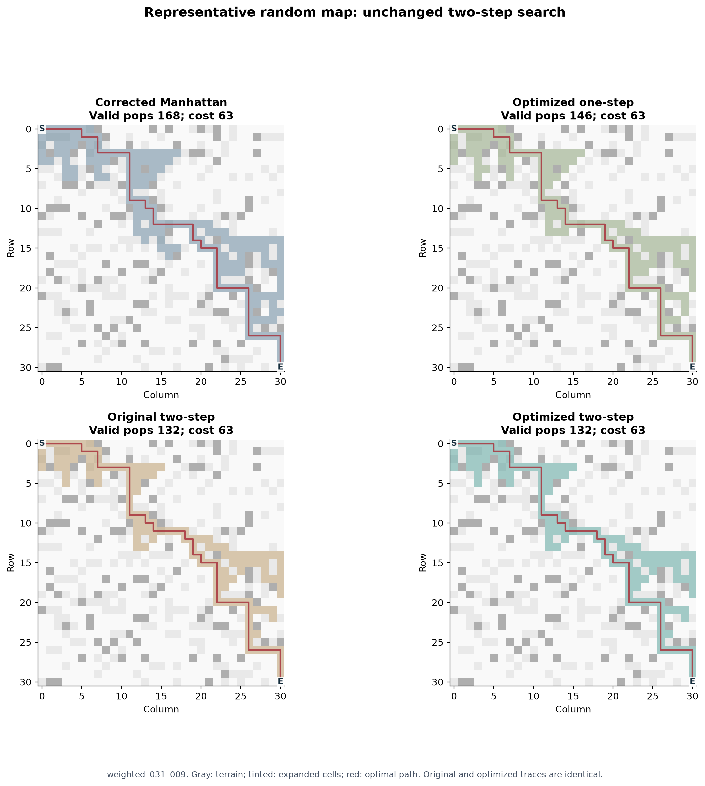
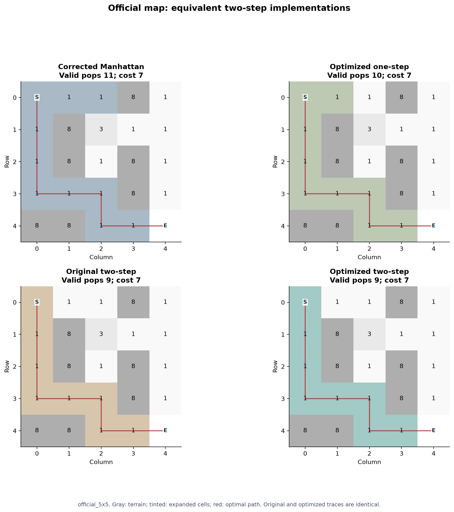

# 题二：两步前瞻替换快速内层的四策略对照

实验日期：2026-10-22（Asia/Shanghai）。本轮将快速一步前瞻用于两步前瞻的内层计算，保持外层公式、邻居顺序与缓存方式不变。复用已有地图，四种方法全部在本轮重新测量。

## 1. 主要结论

**快速两步在全部 30 张随机图上都比旧两步更快，逐图完整耗时节省率中位数为 25.58%。但与快速一步相比，它进一步减少了 5.57% 的出队次数，却典型增加约 30.45% 的完整耗时。当前地图分布和单次查询条件下，多前瞻一层仍未带来整体加速。**

所有方法均返回最优解，新旧两步的逐格启发值、路径、扩展序列和六项搜索计数完全相同。本轮共 31 张地图、124 个地图与方法组合、620 行正式批次、12,180 次正式计时调用，全部通过校验。

30 张随机地图的结果如下。时间单位为 ms，每图先对 5 批取中位数，再跨图取中位数：

| 方法 | 有效出队 | 扩展次数 | 堆峰值 | 准备时间 | 搜索时间 | 完整 API 时间 |
|---|---:|---:|---:|---:|---:|---:|
| 基础修正版 h0 | 168.5 | 167.5 | 171 | 0.5435 | 1.1643 | 1.8399 |
| 快速一步 h1 | 149.0 | 148.0 | 164 | 0.5465 | 1.1306 | 1.8013 |
| 旧两步 h2 | 137.0 | 136.0 | 155 | 0.5703 | 2.4451 | 3.1336 |
| 快速两步 h2 | 137.0 | 136.0 | 155 | 0.5326 | 1.5915 | 2.2204 |

必须分开看三个配对基准。下表中的倍率为“对照方法时间 / 快速两步时间”，大于 1 表示快速两步更快：

| 对照方法 | API 倍率中位数 | 倍率 Q1～Q3 | 快速两步的耗时变化中位数 | 快速两步更快/更慢地图 |
|---|---:|---:|---:|---:|
| 旧两步 | 1.344 | 1.289～1.398 | 减少 25.58% | 30 / 0 |
| 基础修正版 | 0.758 | 0.731～0.816 | 增加 31.98% | 1 / 29 |
| 快速一步 | 0.767 | 0.726～0.836 | 增加 30.45% | 1 / 29 |

各倍率、节省率与增幅先在同一张图内计算，再跨图取中位数，因此不能直接用第一张表中的组中位数相除替代。倍率和耗时变化也分别聚合，偶数样本下不要求中位数严格互为倒数关系。

相对基础版，旧、快两步的出队节省率中位数均为 13.68%；相对快速一步，两步进一步节省 5.57%，所有 30 张图都更少出队。相对旧两步的时间收益来自实现成本下降，节点数并未进一步改变。

## 2. 这轮具体优化了什么

基础公式为：

\[
h_0(n)=m\max(0,d(n,E)-1),
\quad
h_1(n)=\min_{v\in N(n)}[c(n,v)+h_0(v)],
\quad
h_2(n)=\min_{v\in N(n)}[c(n,v)+h_1(v)].
\]

每层的目标值固定为 0，进入目标 E 的费用为 0，孤立格回退上一层值。m 为非终点可通行格的最小进入费用。

上一轮快速 h1 已通过代数化简与安全下界提前结束，减少了邻格距离求值。本轮只改变 h2 的内层求值器：

```text
旧 h2：min_v [真实进入费用 + 旧 h1(v)]
快 h2：min_v [真实进入费用 + 快 h1(v)]
```

两步外层仍按原顺序枚举全部合法后继，没有新增外层短路。每次查询重新创建内层 h1 与外层 h2 两个按需缓存，既不跨查询共享，也不使用审计中已填满的缓存。

因为快速 h1(v) 与旧 h1(v) 逐格相同，取相同候选的最小值后，两个 h2 必然相同；目标分支和孤立回退也相同。原有可采纳性、一致性与确定性 A* 行为随之保留。新实现位于 `experiments/optimized_two_step.py`，旧实现与题二默认接口均未改动。

### 性能剖析支持的机制

用 cProfile 对固定的 30 张随机地图，各方法每图执行一次新鲜完整查询，结果另存于 `profiling.json`：

| 插桩样本中的调用 | 旧两步 | 快速两步 |
|---|---:|---:|
| 两层前瞻函数未命中求值合计 | 24,024 | 24,024 |
| 基础启发包装函数 base | 52,007 | 0 |
| Profiler 记录的全部函数调用 | 1,260,437 | 804,567 |

快速版直接使用等价距离表达式，表中的 0 不表示取消安全下界。两个前瞻层的未命中次数合计相同，符合只降低内层计算成本的设计。

Profiler 的函数调用数不是 A* 出队或生成后继计数；插桩时间也不纳入正式计时。嵌套累计时间不能相加当作总时间。

## 3. 固定输入、执行顺序与计时

### 3.1 输入与控制变量

本轮使用原有 30 张 31×31 无障碍地形和官方 5×5 地图。随机图费用 1、3、8 的生成概率为 0.7、0.2、0.1，S=(0,0)、E=(30,30)，起点初始不收费，回入 S 按 1，进入 E 按 0。实际地图和 manifest 复制到本轮 `dataset/`，没有重新抽样或挑选有利地图。

四种方法共用相同网格准备、上右下左邻居生成及原有 A*，队列按 `(f,h,入队序号)` 排序。独立反向 Dijkstra 只用于真值与性质审计，不提供启发预计算结果。

每图每方法预热 2 次、校准 2 次、正式测 5 批，同图四种方法批内循环数相同。按最快者约 25 ms 的软目标校准，受最慢者估计批时 200 ms、最多 128 次限制。本轮循环数为 5～128，官方图因达到上限，估计最快批时仍不足 25 ms。预热和校准不计入 12,180 次正式调用。

### 3.2 四种方法的顺序控制

用 A、B、C、D 分别表示基础版、快速一步、旧两步、快速两步：

```text
A B D C
B C A D
C D B A
D A C B
```

每完整四组中，各方法占每个位置一次，12 种组内有向相邻关系各出现一次。随机 30 图×5 批共 150 组，四条顺序出现次数实际为 **38、38、37、37**；各方法各位置及组内相邻关系也均为 37 或 38 次。

因此本轮是近似均衡，不能声称 150 组完全等频；平衡范围限于每个四策略组内部，不包括跨组、跨地图的边界。实际顺序、位置与相邻关系的计数均保存于 `config.json`。官方图另外记录，地图测量顺序按固定种子打乱。

### 3.3 完整查询成本

- `prepare_ms_mean`：输入校验、转换、最小权扫描，以及本次启发对象和空缓存建立。
- `search_ms_mean`：A*、按需前瞻求值、缓存访问、堆操作、计数和路径回溯。
- `api_ms_mean`：批总时间除调用数，包括准备、搜索、调用封装、对象释放、循环与结果收集。

参考求解、性质审计、路径检查、I/O 和绘图在计时之外。未显式关闭垃圾回收。环境为 Windows 11、Python 3.13.9、Matplotlib 3.11.2，详情见配置。

四种时间都在本轮重新采集，不能将前几轮的绝对时间直接拼入本表。各时间字段分别取中位数，也不要求三列之间精确相加。每图先聚合批次再跨地图统计，五批不构成五张独立地图，Q1～Q3 不是置信区间。

## 4. 正确性与等价核验

正式采集前，逐状态检查：

\[
h_0\le h_{1,fast}\le h_{2,old}=h_{2,fast}\le h^*.
\]

对所有合法有向边检查一致性，对每张地图的完整路径、扩展顺序和六项确定性搜索计数检查等价。任何失败都会停止采集。

| 核查项目 | 结果 |
|---|---|
| 新旧两步逐格启发 | 28,855 个状态，0 处不同 |
| 新旧两步路径、扩展序列、六项计数 | 全部 31 张图相同 |
| 原基础接口、上一轮快速一步与旧两步接口 | 均与本轮对应方法相同 |
| 正式结果的路径合法性和最优代价 | 124 个组合及全部正式调用均通过 |
| 可采纳性、一致性、支配关系、目标启发为 0 | 无违例 |

每种启发在随机地图上核查 28,830 个状态、111,600 条有向边，官方图另有 25 个状态、80 条边。随机图中快速一步有 2911 个状态严格强于 h0，两个两步版本均有 4754 个；这里的“严格强于”都相对 h0，不能与前轮“相对 h1”的 1931 个状态混淆。

全部 **88 项测试通过**。本轮新增 14 项，涵盖 256 张 2×3 穷举图、80 张任意数值目标随机图、零权、m>1、障碍、孤立、无路、起终点相同、缓存隔离、四策略顺序控制、完整等价流水线和三个配对分母。原有独立 Bellman-Ford 与 Dijkstra 检查也继续通过。

结果见 `equivalence.csv` 和 `heuristic_audit.csv`。原始输出保存在 `paths.json`，官方路径逐格累计费用保存在 `official_cost_trace.csv`。

## 5. 图表与解释

### 搜索量与堆压力



两步版本的搜索量逐图相同，分布重合符合预期；它们相对快速一步每张图都更少出队，逐图进一步节省率中位数为 5.57%。物理堆峰值中位数由快速一步的 164 降至两步的 155，但该指标不包括额外启发缓存，不能解释成整个程序内存降低。

### 减少内层开销后的时间



快速两步相对旧两步的内部搜索时间节省率中位数为 30.82%，完整 API 为 25.58%。准备部分仍占共同成本，会摊薄内部搜索收益；准备时间的小幅变化包含测量噪声，不把它当成新的地图准备优化。

两步的外层仍要枚举邻居和查询内层值，既有额外缓存访问，也会计算未最终展开状态的启发。A* 出队减少并不代表全部图操作减少到足以抵消额外前瞻费用。



左图全部高于 1：相对旧两步，本轮完整耗时节省范围约为 12.81%～37.43%。中图与右图大多数低于 1：快速两步在 29/30 张随机图上分别慢于基础版和快速一步。比基础版快的那张图仅略高于 1，不据此作普遍优势判断。

这些结论限于当前 31×31、无障碍、给定地形分布、每次查询新建缓存的场景；没有进行跨硬件或显著性推断。

### 代表图与官方图



代表图为 `weighted_031_009`，仍按基础出队次数最接近随机中位数、并列按编号选择。四者代价均为 63，有效出队为 168、146、132、132。两个两步版本的路径和扩展序列完全相同；选择该图未参考优化收益。



官方图四者代价均为 7，有效出队为 11、10、9、9。完整调用中位数分别约 0.0725、0.0715、0.1207、0.0899 ms。官方图单独展示，不混入随机分布统计；进入 E 的最后一步仍为 0。

## 6. 题二当前可以怎样总结

这几轮形成了完整的分析链条：终点免费要求安全修正；基础修正与原始曼哈顿在本域通常只差常数，所以搜索量接近；地形前瞻增强了下界并减少节点；求值成本可能抵消搜索收益；等价实现优化能降低成本，但更多前瞻仍需用完整调用时间评价。

本轮证明了替换快速内层的收益。若当前主要指标是单次完整耗时，基础修正版和快速一步更值得优先保留；两步方法可用于说明启发信息量与求值成本的权衡。本轮不改变题二默认接口，也不自动扩展前瞻深度。

可写入最终报告的结论段落：

> 在保持两步前瞻外层递推不变的条件下，本文将其内层替换为逐格等值的快速一步前瞻。全部 28,855 个正式状态的新旧两步启发值相同，最优路径、扩展序列和搜索计数也相同。在 30 张固定随机地图上，优化后的完整耗时节省率中位数为 25.58%，全部地图均比旧两步改善。相对快速一步，两步进一步减少出队次数的中位数为 5.57%，但完整耗时典型增加约 30.45%。因此，内层实现优化可以降低两步前瞻成本，而增加前瞻深度在当前单查询场景中仍未带来净时间收益。

直接调用新接口：

```python
from experiments.optimized_two_step import search_variant

run = search_variant(start, end, grid, heuristic="lookahead_2_optimized")
print(run.result.cost, run.result.path, run.result.stats.valid_pops)
```

单次打印耗时不能代替正式配对实验。题二可以暂时收束，下一项核心实验是题三的 Minimax 与 Alpha-Beta 对照。

## 7. 复现、数据与源码版本

| 文件 | 用途 |
|---|---|
| `dataset/`、`official_map.json` | 所用地图副本、种子与输入哈希 |
| `raw.csv`、`calibration.csv`、`config.json` | 620 行原始批次、循环校准、实际执行顺序、环境与源文件哈希 |
| `equivalence.csv`、`heuristic_audit.csv` | 完整搜索等价、逐状态与逐边性质核验 |
| `paths.json`、`official_cost_trace.csv` | 返回路径和官方逐格费用 |
| `per_instance.csv`、`paired.csv`、`summary.csv`、`summary.json` | 地图内聚合及三个基准的配对结果 |
| `profiling.json`、`verification.json` | 独立插桩诊断、测试与完整性复核 |
| `figures/` | 5 组 PNG/SVG |
| `source_baseline.zip` | 当前可复现的算法与分析版本，共 48 个白名单文件 |
| `source_measurement.zip` | 正式计时时冻结的原始源码快照，共 48 个文件 |

采集后视觉检查修正了耗时图标题中的 `One-step` 为 `Two-step`，没有修改算法、统计公式或计时数据。测量时的原始源码归档完整保留；当前归档仅有这处绘图文字差异。修订前后文件哈希、两个归档哈希和原始 CSV 不变的核验记录在配置及 `verification.json`。

当前归档 SHA-256 为 `cfc6f2b3027f414e8e8b8e8bb26c19ec870c07be5d1e17150c2732eb6bb869da`；测量快照为 `9ea5ea86903f74570b10bce2ccde47c33f65906b908354b799bb89dd34c2ca0a`。二者内容均逐一核查。对旧核心、旧实验/测试代码和前四组结果共 330 个文件的前后哈希检查均未发现变化；本轮 93 个既有地图与策略组合的输入、代价和六项计数也与前轮相同。

在项目根目录重新测量同一批实际地图，输出目录必须为空：

```powershell
python -m experiments.exp2_two_step_optimized --dataset results/problem2_two_step_optimized/dataset --out results/problem2_two_step_optimized_repeat
```

只重做统计和图表：

```powershell
python -m experiments.analyze_two_step_optimized --results results/problem2_two_step_optimized
```

正确性测试：

```powershell
python -m unittest discover -s tests -v
```

未来源码变化后，重绘当前结果应在独立目录解压 `source_baseline.zip`，放入本轮结果，再使用其中版本复核轨迹。`source_measurement.zip` 用于核对原始采集版本，其旧图题文件哈希与当前分析配置不同，不能直接混用来重绘当前图表。中文报告为人工撰写的本轮说明，重绘命令不会改写本文。
