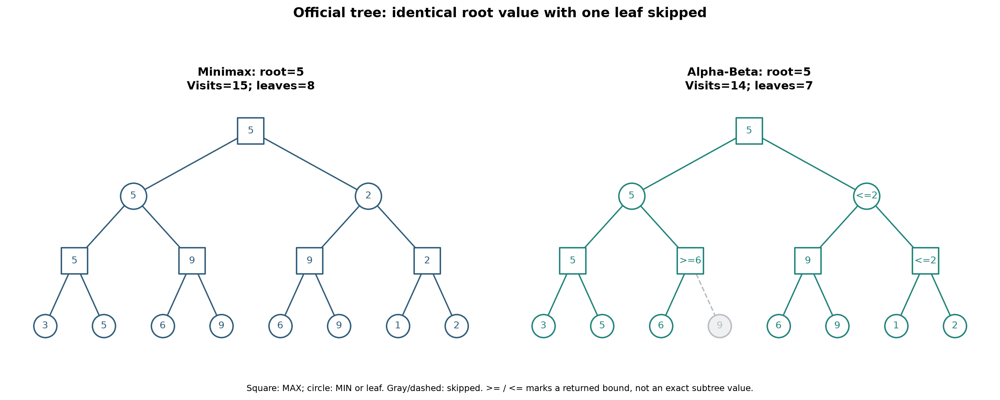
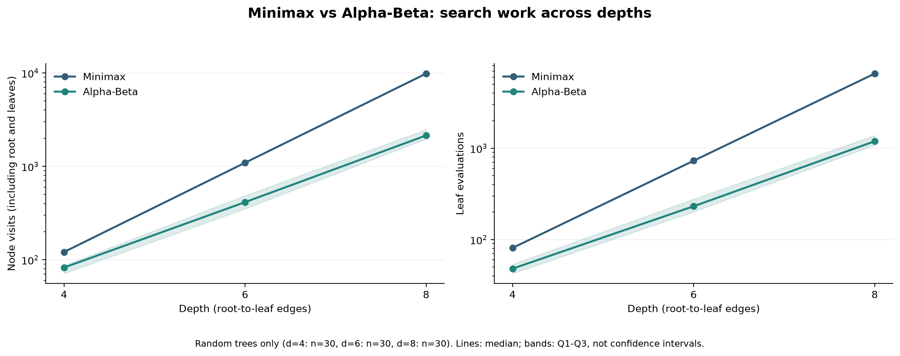
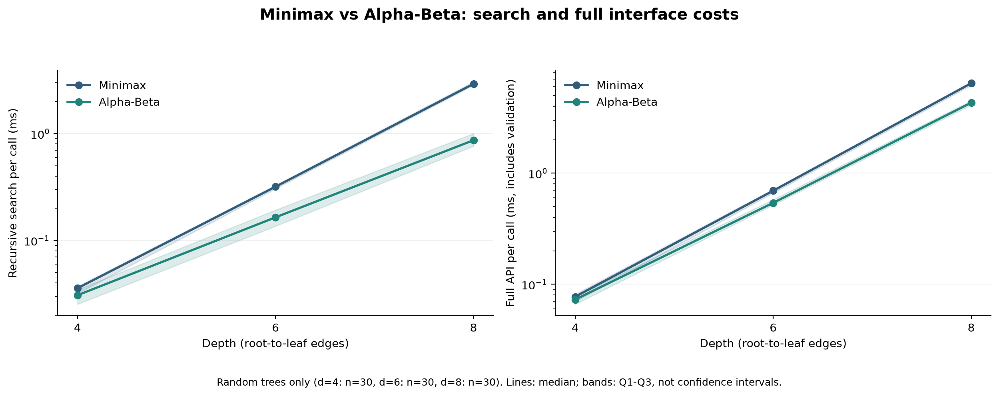
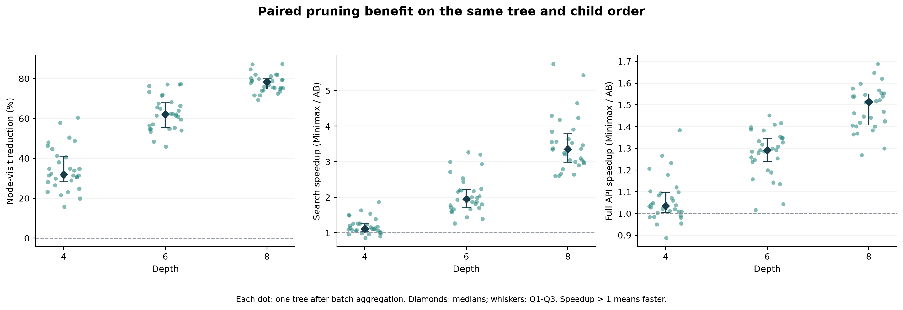

# 题三：Minimax 与 Alpha-Beta 基础对照分析

本轮保持同一棵树、同一孩子顺序和完整搜索深度，仅改变是否启用 Alpha-Beta 剪枝。90 棵随机树与官方树的两种算法根值全部等于独立参考值。在本轮三叉随机树上，深度 4、6、8 的节点访问节省率中位数为 **31.82%、62.17%、78.23%**，搜索加速比中位数为 **1.112、1.953、3.351**；包含完整输入校验的接口加速比为 **1.035、1.291、1.514**。深度 4 有 7/30 棵树耗时增加，深度 6、8 的全部样本更快。

这是固定原顺序的基础轮。排序和缓存尚未加入，后续实验可以直接复用本批实际输入。

## 1. 要验证的问题

Minimax 在 MAX 节点取孩子值的最大值，在 MIN 节点取最小值，需要完整访问树。Alpha-Beta 使用当前祖先已经获得的上下界，在 `alpha >= beta` 时跳过不会改变根节点决策的后续兄弟分支。

本轮回答三个问题：

1. 两种算法能否始终得到相同的精确根值？
2. 同树同顺序下，剪枝能减少多少节点访问和叶子评估？
3. 减少的工作量能否转化为搜索时间与完整接口时间的收益？

题三是博弈树实验，输入来自官方树和程序生成的随机树，不使用题一、题二的网格地图，也不涉及曼哈顿启发函数。

## 2. 数据从哪里来

### 2.1 随机树

| 参数 | 本轮设置 |
|---|---|
| 分支因子 | 每个内部节点恰有 3 个孩子 |
| 深度 | 4、6、8；根深度为 0，按根到叶子的边数计 |
| 每种深度数量 | 30 棵，共 90 棵 |
| 玩家 | 根为 MAX，逐层 MAX/MIN 交替 |
| 叶值 | 从闭区间 [-50,50] 的整数独立均匀抽样 |
| 孩子顺序 | 生成后保存的列表顺序，全程固定 |
| 对象结构 | 独立满树，节点不共享 |
| 缓存、排序 | 均关闭 |

满三叉树的叶子数为 `3^d`，完整节点数为 `(3^(d+1)-1)/2`：

| 深度 | 每棵树完整节点数 | 每棵树叶子数 | 实例数 |
|---|---:|---:|---:|
| 4 | 121 | 81 | 30 |
| 6 | 1,093 | 729 | 30 |
| 8 | 9,841 | 6,561 | 30 |

主种子为 `20261022`，它是固定随机参数。每棵树的种子按下面的规则派生：

```text
payload = "game_tree_dataset_v1:{master_seed}:{depth}:{index}"
instance_seed = int.from_bytes(SHA256(payload的ASCII字节)[:8], "big")
```

使用 `Random(instance_seed).randint(-50,50)`，按从左到右深度优先的叶子次序抽样。增加生成数量或增加其他深度，不会改变既有实例。实际输入保存在 [dataset/trees/](dataset/trees/)，[manifest.json](dataset/manifest.json) 保存文件字节哈希、种子、规模和参考值，因此复现不只依赖随机数生成器。

### 2.2 官方树

官方 JSON 原字节复制为 [trees/official.json](dataset/trees/official.json)，是深度 3 的二叉逻辑树，共 15 个节点、8 个叶子。它与随机树分开汇总。原题对象构造中的共享子树演示不参与本轮性能统计，避免混淆唯一对象数和递归访问次数。

91 个输入合计包含 **331,665 个节点**。正式测量前，每个深度先用 3 棵树完成试跑，连同官方树共 10 个输入，记录在相邻的 `problem3_minimax_alpha_beta_pilot/` 目录。试跑没有更改生成参数或挑选有利实例；10 个试跑输入与正式输入中对应文件的哈希完全一致。

## 3. 实验怎样执行

1. 生成实际树并保存；独立读取字典树，用显式后序栈自底向上计算参考根值、完整节点数和叶子数。
2. 转成现有 `TreeNode` 输入。两种算法调用同一个 `src/game_tree.py:evaluate_tree` 接口，只切换 `use_alpha_beta`。
3. 在计时外核对全部输入：根值等于参考值，Minimax 完整访问，Alpha-Beta 的访问与叶评次数不超过全树规模；保存 [correctness.csv](correctness.csv)。
4. 每棵树每算法预热 2 次、校准 2 次，再正式测 5 批。同树两个算法使用相同循环数，每次调用新建搜索状态和统计对象。
5. 保存每批原始时间，计时结束后逐次核对根值与确定性计数；另保存官方轨迹，最后才汇总和绘图。

随机树的测量顺序使用独立固定种子打乱；每种深度分别编号。每棵树第 b 批的顺序按 `(深度内编号*5+b)%2` 轮换。每个深度 150 对批次中，Minimax 先运行与 Alpha-Beta 先运行各 **75 对**；三个深度合计各 225 对。官方 5 对另外统计，为 3 对与 2 对。原始 CSV 已独立重算顺序，与配置一致。

校准采用较快算法每批约 25 ms 的软目标，同时限制较慢算法估计批次约 200 ms、每批最多 128 次。实际循环数为：

| 输入 | 每批调用次数范围 |
|---|---:|
| 随机深度 4 | 128 |
| 随机深度 6 | 34–67 |
| 随机深度 8 | 5–8 |
| 官方树 | 128 |

浅树达到调用数上限后，批时可以低于 25 ms；该目标不是每批必达的下限。没有根据正式结果反复调整参数或重跑到满意为止。

正式数据共 **910 行批次记录、182 个树与算法组合、56,730 次调用**。试跑、预热、校准、独立参考和轨迹采集均不计入这些正式调用数。

## 4. 指标和计时口径

| 指标 | 含义 |
|---|---|
| `node_visits` | 实际递归访问次数，含根、内部节点和叶子 |
| `leaf_evals` | 实际读取叶子值的次数 |
| `cutoff_events` | 满足 alpha>=beta 且确实跳过未访问兄弟的事件数 |
| `pruned_branches` | 被跳过的直接兄弟分支数，不是整片省略子树的节点数 |
| `search_ms_mean` | 内部搜索耗时的批内均值，包含计数和路径元组维护 |
| `api_ms_mean` | 已构建树上的完整接口耗时，包含全树校验、搜索、封装、循环与结果收集 |

搜索计时使用原接口内部的 `perf_counter`；API 批时使用外部 `perf_counter_ns`。正式调用关闭 trace，正常启用解释器垃圾回收。输入树在批次间复用，搜索统计与递归状态每次新建。树生成、文件读取、JSON 解析、树对象转换、独立参考、结果检查、详细轨迹和绘图都在这两项正式时间之外。

现有接口每次都会完整校验整棵树，包括随后可能被剪掉的子树。因此 API 时间包含一项随完整输入规模增长的成本。API 减搜索时间还包含封装、计时和结果收集开销，不能直接称为“纯校验耗时”。

先对每棵树、每算法的 5 批每次调用均值取中位数，再按深度对 30 棵树汇总。计数每棵树只统计一次；5 批测量不会将样本量从 30 变成 150。Q1/Q3 采用线性插值，表示树间分散程度，不是置信区间。

同树配对公式为：

```text
节点节省率 = 1 - node_visits_AB / node_visits_Minimax
叶子节省率 = 1 - leaf_evals_AB / leaf_evals_Minimax
耗时加速比 = time_Minimax / time_AB
耗时节省率 = 1 - time_AB / time_Minimax
```

加速比大于 1 表示 Alpha-Beta 更快。先逐树计算比率再取中位数，通常不同于直接用两组耗时中位数相除。

## 5. 正确性结果与官方剪枝过程

全部 91 个输入上，两种算法根值均等于独立参考值；正式调用的根值和四项计数也与计时外审计一致。所有随机树的 Minimax 访问数和叶评数符合第 2 节公式，90 棵随机树的 Alpha-Beta 均减少了节点和叶子访问。

官方结果如下：

| 指标 | Minimax | Alpha-Beta |
|---|---:|---:|
| 根值 | 5 | 5 |
| 总访问次数 | 15 | 14 |
| 叶子评估 | 8 | 7 |
| 有效截断事件 | 0 | 1 |
| 跳过直接兄弟 | 0 | 1 |
| 搜索时间中位数/ms | 0.004461 | 0.004996 |
| API 时间中位数/ms | 0.010685 | 0.011756 |

官方树左侧 MIN 的第一个 MAX 孩子从 3、5 得到 5，因此该 MIN 已有上界 beta=5。访问它的第二个 MAX 孩子时，第一个叶子为 6，形成 alpha=6>=beta=5，可以跳过后面的 9。左侧 MIN 仍取 5，右侧 MIN 的完整值为 2，根 MAX 的答案是 5。



灰色虚线和灰色叶子表示未访问部分。图中 >=、<= 是搜索窗口产生的返回界标识；不能把所有截断内部回传都解释成已经知道了该子树的精确值。

这个小样例虽然少访问一个叶子，本轮 Alpha-Beta 的 API 时间仍比 Minimax 高约 10.02%。它适合解释剪枝机制，不能单凭其微秒级耗时判断算法在更大树上的收益。

## 6. 随机树工作量

下表为各深度 30 棵树的中位数：

| 深度 | Minimax 访问 | Alpha-Beta 访问 | 节点节省率 | Minimax 叶评 | Alpha-Beta 叶评 | 叶评节省率 |
|---|---:|---:|---:|---:|---:|---:|
| 4 | 121 | 82.5 | 31.82% | 81 | 48 | 40.74% |
| 6 | 1,093 | 413.5 | 62.17% | 729 | 231.5 | 68.24% |
| 8 | 9,841 | 2,142 | 78.23% | 6,561 | 1,191.5 | 81.84% |

偶数个样本的中位数可以是小数，不表示一次搜索访问了半个节点。三个深度的节点节省率 Q1–Q3 分别为 **28.31%–41.12%、55.60%–67.91%、74.90%–80.06%**。



本分布中，更深的树带来了更明显的相对工作量节省。与此同时，Alpha-Beta 的绝对访问中位数仍从 82.5 增至 413.5、2,142，剪枝没有消除规模增长。三个深度是各自独立的随机样本，不能把这组趋势解释为“任意一棵树只要加深就必然获得更高节省率”。

## 7. 搜索时间与完整接口时间

### 7.1 每次调用的时间

下表为先按树汇总、再按深度统计的时间中位数，单位均为 ms：

| 深度 | Minimax 搜索 | Alpha-Beta 搜索 | Minimax API | Alpha-Beta API |
|---|---:|---:|---:|---:|
| 4 | 0.035750 | 0.030729 | 0.077363 | 0.072959 |
| 6 | 0.318354 | 0.164543 | 0.694949 | 0.540687 |
| 8 | 2.917285 | 0.866637 | 6.437479 | 4.300802 |



### 7.2 逐树配对的收益

| 深度 | 搜索加速比中位数 | 搜索耗时节省 | API 加速比中位数 | API 耗时节省 | API 更快/更慢 |
|---|---:|---:|---:|---:|---:|
| 4 | 1.112 | 10.04% | 1.035 | 3.37% | 23 / 7 |
| 6 | 1.953 | 48.80% | 1.291 | 22.56% | 30 / 0 |
| 8 | 3.351 | 70.16% | 1.514 | 33.93% | 30 / 0 |

搜索时间更快/更慢的树数同样为 23/7、30/0、30/0。深度 4 中，节点全部减少，但有 7 棵树搜索时间增加；这说明节省的访问量可能不足以抵消更新上下界、检查截断等额外成本，也可能受到计时波动影响。其 API 加速比 Q1–Q3 为 1.005–1.097，典型收益较小。

深度 6、8 的 API 加速比 Q1–Q3 分别为 1.240–1.347、1.408–1.551。本轮较深树上的时间改善更一致。



### 7.3 为什么节点少了很多，API 只快一部分

以深度 8 为例，节点访问典型减少 78.23%，搜索时间典型减少 70.16%，API 时间典型减少 33.93%。节点数与时间并非等比例：Alpha-Beta 在访问节点时还要维护上下界，而完整接口依然校验全部 9,841 个输入节点。

对深度 8 的每棵树，计算“API 时间中位数减搜索时间中位数”后再汇总，Alpha-Beta 的非搜索部分中位数约为 **3.400 ms**；按每树比例 `1-search_median/api_median` 汇总，中位数约 **80.25%**。这些都是包含校验和封装的残余量，不是对纯校验时间的独立测量。结合代码可以判断，全树校验是限制完整接口加速的一项主要成本。

本轮保留原接口，目的在于建立可比较的基础数据。以后若研究“预先验证、重复搜索”的使用方式，应另建对照、单列预处理成本，不能直接拿本轮 API 时间与省略校验后的时间混比。

## 8. 已保存的证据与复现

| 文件 | 用途 |
|---|---|
| [config.json](config.json) | 环境、算法设置、计时范围、测量顺序、源码哈希和完成状态 |
| [dataset/manifest.json](dataset/manifest.json) | 91 个实际输入的种子、哈希、规模和参考值 |
| [raw.csv](raw.csv) | 910 行正式批次记录 |
| [calibration.csv](calibration.csv) | 每树两算法校准估计与共同调用次数 |
| [correctness.csv](correctness.csv) | 182 个组合的计时外根值和计数检查 |
| [official_trace.json](official_trace.json) | 官方两种算法的完整轨迹 |
| [instances.csv](instances.csv) | 每棵树、每算法的时间中位数及 Q1/Q3 |
| [paired.csv](paired.csv) | 91 个输入逐一配对的节省率与加速比 |
| [summary.json](summary.json)、[summary.csv](summary.csv) | 按来源、深度分组的统计 |
| [source_baseline.zip](source_baseline.zip) | 正式运行时的 54 个源码、测试、用例及依赖文件 |
| [verification.json](verification.json) | 独立重算、顺序核对、输入重建、旧文件完整性和测试记录 |
| [figures/](figures/) | 4 组 PNG/SVG 图 |

本轮主测量 ID 为 `p3_baseline_20261022T065011_308312Z`，运行环境为 Windows 11、Python 3.13.9、Matplotlib 3.11.2。正式数据采集时间为 2026-10-22 06:50:11–06:50:35 UTC；该区间不包含此前的数据生成和之后的分析、绘图与本报告整理。

固定标识：

```text
dataset/manifest.json SHA-256
9eadb32a60ef6386b2711ccb234e864df00abef3ffa73680a2b033eafb2fc66d

raw.csv SHA-256
4a67def31ec962dfb753b8f56d71dfc2660ccfb55b3151497a69dd59afcd2167

source_baseline.zip SHA-256
45886a76d703011ab2759628ca21004e00c9c36df41f5e53dda2e3c62b5ccd91
```

在项目根目录运行：

```powershell
# 复用本轮输入，测量新的结果；请使用新的空输出目录
python -m experiments.exp3_minimax_alpha_beta --dataset results/problem3_minimax_alpha_beta/dataset --out results/problem3_minimax_alpha_beta_repeat

# 按默认生成规则重新生成并测量
python -m experiments.exp3_minimax_alpha_beta --out results/problem3_minimax_alpha_beta_new

# 仅核验数据、重新汇总和绘图
python -m experiments.analyze_game_tree --results results/problem3_minimax_alpha_beta

# 检查全部基础解与实验代码
python -B -m unittest discover -s tests -v
```

新一轮耗时会随系统负载变化；固定输入、根值和确定性计数应可重现。分析脚本核查运行时源码哈希；以后工作区源码变化时，可在新的目录解压本轮归档并配合保存的数据分析，避免混用不同版本。

全部 **105 项测试通过**。另外直接从保存的树重新计算了完整值、Alpha-Beta 根值及四项计数，并重建了全部随机叶子抽样；没有调用待测求值器或统计模块完成这些独立复核。对照运行前记录的 404 个既有文件中，402 个哈希不变，仅两个 README 追加本轮说明；10 个 src 文件和 352 个既有结果文件均保留原字节。

## 9. 结论与下一轮

在本轮固定原顺序、三叉满树和离散随机叶值条件下，Alpha-Beta 保持精确根值，并在所有随机树上减少访问；较深树的工作量和时间收益更明显。浅树的少量剪枝未必带来实际加速，完整输入校验也使 API 收益小于搜索收益。

结论限于当前实现、分支因子、偶数深度和叶值分布。叶子只读取一个整数，不能把本轮倍率直接推广到具有昂贵局面评价的真实游戏；相同值较常见，也会影响 `alpha>=beta` 的触发。90 棵不同树的差异不是只由深度一个因素逐棵造成的，图中 IQR 也不是统计显著性的证明。

下一轮适合进行访问顺序对照：复用本批树，比较原顺序、固定随机重排，以及按真实子树值排序的理想参照。所有顺序保持根值相同；理想排序需要预知子树答案，预计算和排序成本必须单列。本轮基础数据已经可以作为该实验的配对基线。
