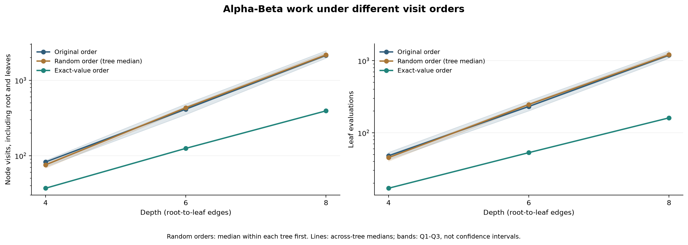
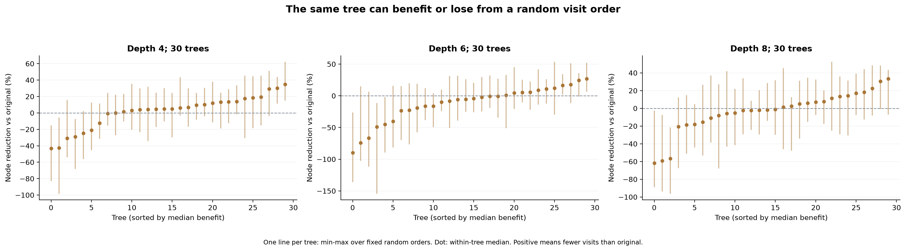
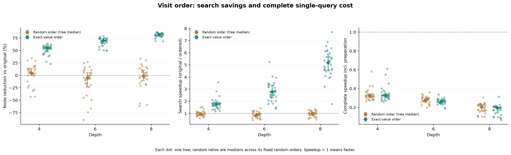
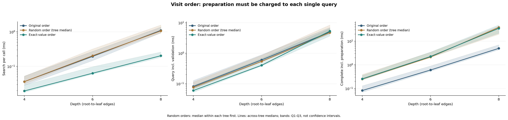
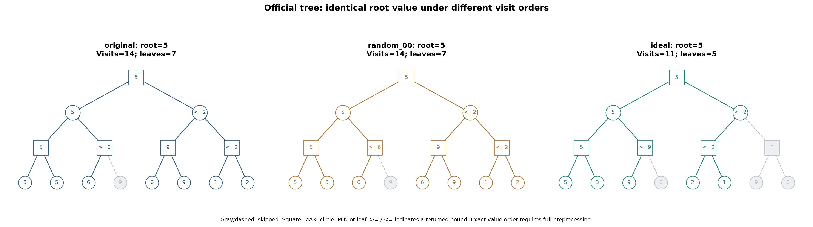

# 题三：访问顺序对照分析

本轮复用基础轮的 90 棵随机树和官方树，比较原顺序、10 个固定随机顺序，以及按精确子树值排序的理想顺序。**全部 1,092 个树与顺序组合的根值正确。**

随机重排没有稳定的工作量收益：深度 4/6/8 相对原顺序的节点节省率中位数为 **4.80%、−5.10%、−1.43%**。理想排序显著减少访问，节省率为 **55.15%、69.77%、81.64%**，搜索加速比为 **1.758、2.776、5.188**。但在本轮每次保护原树、重新复制和排序的完整单次流程下，所有随机与理想顺序都比原顺序更慢。

这里的基准是**原顺序 Alpha-Beta**；节点节省率不再以无剪枝 Minimax 为分母。

## 1. 输入与对照设置

输入原字节复制自基础轮的 `results/problem3_minimax_alpha_beta/dataset/`：

| 设置 | 本轮取值 |
|---|---|
| 随机树 | 三叉满树，深度 4/6/8 各 30 棵，共 90 棵 |
| 深度 | 根为 0，按根到叶子的边数计 |
| 叶值 | 基础轮已保存的 [-50,50] 整数 |
| 玩家 | 根为 MAX，逐层交替 |
| 官方树 | 15 个节点、8 个叶子，单独统计 |
| 总输入 | 91 棵原树，合计 331,665 个节点 |
| 每树顺序 | 原顺序 1 个、随机 10 个、理想 1 个，共 12 个 |
| 正式算法 | Alpha-Beta，规则仍为 alpha>=beta 且存在未访问兄弟时截断 |
| 正确性参考 | 各顺序完整 Minimax，以及独立的字典树自底向上计算 |
| 核心代码 | 沿用原 `src/game_tree.py`，未修改 |

[实际输入清单](dataset/manifest.json)的 SHA-256 与基础轮完全一致。原顺序的根值与四项确定性计数在全部 91 棵树上也与基础轮一致；所有性能数据均在本轮重新采集，没有混用上一轮耗时。

### 三类顺序如何产生

**原顺序**直接使用已经构建的只读树，不做复制或排序。

**随机顺序**使用种子 0–9。每次调用先复制整树，再用 `Random(order_seed)` 按原树从左到右的前序顺序，为每个内部节点生成孩子排列。所有排列在搜索前确定，搜索过程中不抽随机数；相同树、相同种子可重建相同顺序。每个种子在所有树上使用相同的随机规则，结果只代表这 10 个固定重排。

**理想顺序**每次先复制整树，重新计算全部节点的精确子树值，再将 MAX 的孩子按值降序、MIN 的孩子按值升序排列；同值保持原索引顺序。预计算不跨调用缓存。它用于研究准确子树信息引导的剪枝效果，不声称已经证明全域最少访问，更不是免费可得的实用启发。

计算全部子树精确值时已经包含了根答案的信息，因此不能为了“加速”先完整算出答案，再忽略这部分成本。

## 2. 实际排列怎样保存和核对

[recipes.jsonl.gz](recipes.jsonl.gz)保存每棵树、每个顺序的实际排列：按**源树前序的内部节点**逐一记录孩子原索引，例如 `[2,0,1]`。每条配方都有紧凑 JSON 的 SHA-256，与原始数据和证明记录关联。

重建时先根据未重排的源布局建立完整副本，再按原节点对应关系应用所有排列。不能先重排父节点，再按新遍历次序消费后续配方，否则会将配方用错节点。

计时前对每个顺序核查：

1. 排列是合法的孩子索引置换，树结构规模和叶值不变；
2. 随机排列符合对应种子，理想排列符合逐层 MAX/MIN 的真值方向；
3. 独立参考、完整 Minimax 和 Alpha-Beta 根值一致；
4. Minimax 的访问和叶评次数等于全树规模；
5. Alpha-Beta 四项计数作为正式批次的确定性验收值。

证据保存在 [proof.csv](proof.csv)。另用一份未导入实验模块的字典递归程序，重放了全部 1,092 条配方并独立计算 Alpha-Beta 的根值、访问数、叶评数、截断事件和跳过直接兄弟数，全部一致。

## 3. 正式流程与计时范围

先用基础轮的 10 个试跑输入（每深度 3 棵随机树加官方树）完成全部 12 种顺序的流程检查，输出在相邻的 `problem3_visit_order_pilot/`。之后使用完整 91 棵输入，每变体预热 2 次、校准 2 次、正式测 5 批。

同一棵树上 12 个变体使用相同批内调用次数。按最快变体约 25 ms 的批时软目标校准，受最慢变体估计批时约 200 ms、最多 128 次调用限制。实际范围为：

| 输入 | 每批调用次数 |
|---|---:|
| 深度 4 随机树 | 63–128 |
| 深度 6 随机树 | 11–61 |
| 深度 8 随机树 | 1–7 |
| 官方树 | 128 |

软目标不保证每批都达到 25 ms，校准也不能保证实际批时从不超出估计值。使用正常解释器垃圾回收，保留全部正式批次，没有按耗时筛选或替换记录。

### 时间分成哪些部分

| 字段 | 范围 |
|---|---|
| copy | 遍历、复制整树、建立原节点与副本的对应 |
| oracle | 理想顺序完整计算全部节点的精确值；其他顺序为零 |
| order | 生成和应用随机排列，或按真值排序 |
| prepare | 完整准备调用，含以上阶段、封装与临时映射释放 |
| search | 原求值器内部搜索时间，包含计数和路径元组维护 |
| query | 当次准备完成后的完整求值接口，含全树校验和搜索 |
| total | 从重新准备到求值返回的完整批时/次数，另含复制树释放、循环与结果收集 |

原顺序的 prepare 为零。随机和理想顺序为保护基准而复制输入，这项成本计入 total；因此 total 比较的是**本实验完整单次处理流程**，不能将复制开销全部解释为剪枝算法本身的成本。copy/oracle/order 是 prepare 的组成部分，但 prepare 还包含其他准备开销。

query 是当次准备之后的阶段计时。复制与预计算会改变内存布局和缓存状态，不能把它当作已经测得“预排序树长期复用”的时间。API 仍会完整验证全部节点，不能因少访问搜索节点就假定 query 等比例减少。

输入加载、JSON 转换、独立参考、排列记录和哈希、证明核验、轨迹与绘图均在正式时间之外；正式调用关闭 trace。每次理想排序的 `oracle_node_evals` 都等于整树节点数，随机和原顺序为零。

### 算法先后顺序如何控制

12 个变体采用 Williams 顺序设计。首行的变体索引为：

```text
0, 1, 11, 2, 10, 3, 9, 4, 8, 5, 7, 6
```

其余行将索引整体加 1 后模 12。完整 12 行中，每个变体在每个位置出现一次，132 种组内有向相邻对各出现一次。每深度 150 组的行次数为 12/13；通过深度偏移 0、6、0，全部随机树 450 组中各行次数为 37/38。实际位置与组内相邻次数已从原始 CSV 独立重建，和配置一致。

均衡范围限于组内，跨组、跨树边界不保证均衡。官方 5 组另列。正式数据共 **5,460 行批次、1,092 个树与顺序组合、296,400 次调用**。试跑、预热、校准和证明检查不计入正式调用数。

## 4. 如何汇总，避免把 30 棵树算成 300 棵

原始记录采用三级汇总：

1. 每棵树、每个具体顺序：先对 5 批的每次调用均值取中位数。
2. 对随机家族的原量（节点数、各时间）：先在同树的 10 个顺序之间取中位数，再跨 30 棵树汇总。
3. 对配对比率：先将每个具体随机顺序与同树原顺序比较，再将 10 个比率在树内取中位数，最后跨 30 棵树汇总。

```text
节点节省率 = 1 - 当前顺序访问数 / 同树原顺序访问数
搜索加速比 = 同树原顺序 search / 当前顺序 search
查询加速比 = 同树原顺序 query / 当前顺序 query
完整加速比 = 同树原顺序 total / 当前顺序 total
时间节省率 = 1 - 当前顺序时间 / 同树原顺序时间
```

加速比大于 1 才表示更快，节点节省率为负表示更多访问。随机 10 个顺序是树内嵌套重复，每深度仍然只有 30 棵独立输入。900 个随机顺序比较用于描述本批固定排列的胜负，不是 900 棵独立树。

各列中位数、各阶段时间和比率分别汇总，不能将表中阶段中位数相加或相除来重建配对结果。Q1–Q3 表示树间分散程度，不是置信区间。

## 5. 工作量结果

### 5.1 节点与叶子

| 深度 | 原顺序节点 | 随机顺序节点 | 理想顺序节点 | 原顺序叶评 | 随机顺序叶评 | 理想顺序叶评 |
|---|---:|---:|---:|---:|---:|---:|
| 4 | 82.5 | 75.5 | 37 | 48 | 45.25 | 17 |
| 6 | 413.5 | 432 | 125 | 231.5 | 246.75 | 53 |
| 8 | 2,142 | 2,172.5 | 393 | 1,191.5 | 1,211.75 | 161 |

上表是跨树中位数，随机列已先做树内 10 顺序中位数。小数来自偶数样本汇总，不表示单次搜索访问了半个节点。

| 深度 | 随机节点节省率 | 随机更少/更多节点的树数 | 理想节点节省率 | 理想更少节点的树数 |
|---|---:|---:|---:|---:|
| 4 | 4.80% | 21 / 9 | 55.15% | 30 |
| 6 | −5.10% | 11 / 19 | 69.77% | 30 |
| 8 | −1.43% | 14 / 16 | 81.64% | 30 |

随机家族节点节省率 Q1–Q3 为 −0.47%–13.45%、−21.87%–5.44%、−10.28%–10.38%，均跨过零。理想顺序对应区间为 48.07%–57.35%、64.36%–74.24%、79.98%–84.09%。



理想顺序在这批满树上分别访问 37、125、393 个节点，但这里只报告观察到的结果，不将其当作对所有博弈结构全域最少访问的证明。

### 5.2 同一棵树上随机顺序的波动

| 深度 | 300 个随机比较中更少/相同/更多访问 | 每树 10 顺序最少访问数的中位数 | 每树最多访问数的中位数 |
|---|---:|---:|---:|
| 4 | 176 / 5 / 119 | 57 | 95 |
| 6 | 125 / 1 / 174 | 300 | 557 |
| 8 | 147 / 0 / 153 | 1,571 | 2,846 |

“最少”和“最多”是看过 10 个结果之后得到的描述，不能当作事先可用的选序算法；两列也可能来自不同树，不代表某一棵实际树的完整区间。



有利顺序更早建立有效上下界，不利顺序则延后；随机重排不知道哪个孩子更有利。数据支持“访问顺序会影响剪枝”，不支持“随机打乱能稳定优化剪枝”。

## 6. 搜索更省，完整处理是否更快

### 6.1 逐树配对的加速比

| 深度 | 顺序家族 | 搜索加速比 | 含校验查询加速比 | 完整单次加速比 |
|---|---|---:|---:|---:|
| 4 | 随机 | 0.944 | 1.059 | 0.322 |
| 4 | 理想 | 1.758 | 1.389 | 0.327 |
| 6 | 随机 | 0.881 | 1.089 | 0.279 |
| 6 | 理想 | 2.776 | 1.432 | 0.262 |
| 8 | 随机 | 0.968 | 0.961 | 0.204 |
| 8 | 理想 | 5.188 | 1.178 | 0.196 |

随机家族的搜索加速中位数均小于 1；理想顺序在全部 90 棵随机树上搜索更快，深度 4/6/8 的搜索加速比 Q1–Q3 为 1.569–1.864、2.307–3.305、4.558–5.893。完整成本则在每个具体随机和理想顺序上都增加。

将同树时间倍数直接汇总，随机家族完整耗时典型为原顺序的 **3.11、3.59、4.91 倍**，理想顺序为 **3.06、3.82、5.11 倍**。这些倍数由逐树、逐顺序比率汇总得到，不是两组绝对耗时中位数相除。



### 6.2 各阶段绝对时间

下表单位为 ms，各列独立按前述层次取中位数：

| 深度 | 顺序 | prepare | search | query | total |
|---|---|---:|---:|---:|---:|
| 4 | 原顺序 | 0 | 0.036434 | 0.081613 | 0.082801 |
| 4 | 随机 | 0.172852 | 0.036474 | 0.076437 | 0.250875 |
| 4 | 理想 | 0.192586 | 0.019532 | 0.059954 | 0.256991 |
| 6 | 原顺序 | 0 | 0.194852 | 0.603681 | 0.605757 |
| 6 | 随机 | 1.538216 | 0.203746 | 0.541426 | 2.123280 |
| 6 | 理想 | 1.805264 | 0.063567 | 0.401914 | 2.255967 |
| 8 | 原顺序 | 0 | 1.101250 | 4.945283 | 4.949650 |
| 8 | 随机 | 26.052350 | 1.063123 | 4.782408 | 38.111875 |
| 8 | 理想 | 26.038600 | 0.203560 | 5.301500 | 34.679300 |



prepare 包含的成本可进一步查看：

| 深度 | 顺序 | copy/ms | oracle/ms | order/ms |
|---|---|---:|---:|---:|
| 4 | 随机 | 0.115949 | 0 | 0.052587 |
| 4 | 理想 | 0.115895 | 0.026341 | 0.045826 |
| 6 | 随机 | 1.201663 | 0 | 0.318928 |
| 6 | 理想 | 1.192026 | 0.275888 | 0.313529 |
| 8 | 随机 | 21.169725 | 0 | 2.770856 |
| 8 | 理想 | 18.267250 | 2.365450 | 2.831125 |

复制是本实现中一项显著成本，理想排序还要遍历整树计算真值并排序。即使搜索减少，完整流程仍要支付准备成本和全树输入校验。以上数据不能证明“任何实现的排序必然更慢”，只能说明本轮完整处理方式没有净时间收益。

### 6.3 为什么深度 8 的 query 两种统计看起来相反

深度 8 的原顺序 query 组中位数为 4.945283 ms，理想顺序为 5.301500 ms；但逐树配对后，有 **26/30 棵树更快**，查询加速比中位数为 **1.177616**。这不是公式错误：组中位数会重新排序并丢失配对关系，四个变慢样本改变了排名。

例如 `tree_d008_022` 的 query 批次中位数从 4.468414 ms 增至 25.835129 ms，`tree_d008_014` 从 4.847117 ms 增至 6.502200 ms；另两个变慢样本为编号 010、005。记录全部保留。当前记录本身不足以将这些波动唯一归因于垃圾回收、缓存或系统负载，因此没有替换异常值，也没有将未测量的原因当作定论。

理想 query 更快的树数按深度为 30、29、26；原顺序和副本的内存状态及准备阶段也不同。判断单次完整收益仍应使用 total，而该结论在全部具体排序上均为变慢。

## 7. 官方树：排序具体剪掉哪里

所有顺序的根值都为 5：

| 顺序 | 访问次数 | 叶子评估 |
|---|---:|---:|
| 原顺序 | 14 | 7 |
| 随机种子 0 | 14 | 7 |
| 随机 10 顺序的中位数 | 13.5 | 6.5 |
| 理想顺序 | 11 | 5 |

随机 10 顺序中，5 个比原顺序访问更少、4 个相同、1 个更多，访问数范围为 11–15。这里的中位数不是某一次实际运行的整数计数。

理想顺序先访问左侧值为 5 的 MIN 分支。在该 MIN 已有 beta=5 后，第二个 MAX 先看到 9，可以立即跳过 6。右侧 MIN 则先访问值为 2 的 MAX 分支，得到不超过根已有 alpha=5 的值，便可跳过其余值为 9 的整个 MAX 子树。根值仍为 5。



图中灰色虚线表示没有被访问的部分，>=/<= 是搜索窗口产生的界标识。没有读取的内部子树用问号标示，不能将截断回传都视作已经知道的精确子树值。即使官方树理想搜索减少到 11 次访问，其完整时间仍包含准备：原顺序约 0.012726 ms，理想约 0.041827 ms，小样例时间只作流程说明。

## 8. 文件、复现和完整性

| 文件 | 内容 |
|---|---|
| [config.json](config.json) | 参数、顺序设计、范围、环境、版本和完成状态 |
| [dataset/manifest.json](dataset/manifest.json) | 与基础轮相同的 91 个实际输入及哈希 |
| [recipes.jsonl.gz](recipes.jsonl.gz) | 1,092 个实际排列，可直接重建 |
| [proof.csv](proof.csv) | 根值、Minimax 完整计数、Alpha-Beta 审计 |
| [raw.csv](raw.csv) | 5,460 行正式批次 |
| [calibration.csv](calibration.csv) | 每变体校准估计和同树共同调用次数 |
| [instances.csv](instances.csv) | 每具体顺序跨 5 批的时间汇总 |
| [paired.csv](paired.csv) | 相对原顺序的逐变体配对比率 |
| [tree_summary.csv](tree_summary.csv) | 随机顺序先在树内汇总，含范围和胜负次数 |
| [summary.json](summary.json)、[summary.csv](summary.csv) | 按来源、深度与顺序家族分组 |
| [official_trace.json](official_trace.json) | 官方原顺序、种子 0、理想顺序轨迹 |
| [verification.json](verification.json) | 独立重建、计数复算、统计、顺序和旧文件完整性 |
| [figures/](figures/) | 5 组 PNG/SVG |
| [source_measurement.zip](source_measurement.zip) | 测量时的 60 个源码、测试、用例和依赖文件 |
| [source_baseline.zip](source_baseline.zip) | 含一处图层修正的当前复绘源码 |

全部 **124 项测试通过**，覆盖源树保护、深层与不规则树、实际排列重建、负值与同值、理想排序方向、成本范围、完整批次和嵌套比率。旧文件的 539 个哈希中，537 个不变，仅两个 README 增加本轮说明；10 个核心源码和 481 个既有结果文件均保留原字节。

运行 ID 为 `p3_order_20261022T075206_208005Z`，Windows 11、Python 3.13.9、Matplotlib 3.11.2。配置开始时间为 2026-10-22 07:52:06 UTC，完成时间为 08:01:35 UTC，区间包含计时外审计、预热校准、正式测量和保存，并不等于纯搜索总时长。

图表视觉检查后，仅为官方图连线添加 `zorder=0`，使连线位于父节点和标签之后。保留测量时原源码，并在配置中记录两个版本的哈希和这项分析修订；没有修改统计公式、时间或搜索逻辑，只重新分析和绘图。使用当前 `source_baseline.zip` 可按当前配置复绘，测量时归档用于原运行审计，不能直接与当前分析源码哈希混用。

```text
dataset/manifest.json SHA-256
9eadb32a60ef6386b2711ccb234e864df00abef3ffa73680a2b033eafb2fc66d

raw.csv SHA-256
c554555dd60825ff48b3200846093448de3e24b08089b3884b9d002e693e60b2

source_measurement.zip SHA-256
f0e0370ac02423cfa4dd2aae887321195abb4dea4567b6f24ef21de57ddac125

source_baseline.zip SHA-256（仅修正官方图连线层级）
27dcdd268d069c453c4be813477d6d7c12af8d928b1428e0b079abd7de7615f0
```

在项目根目录复现：

```powershell
# 同一批原树，结果写入新的空目录
python -m experiments.exp3_visit_order --dataset results/problem3_minimax_alpha_beta/dataset --out results/problem3_visit_order_repeat

# 仅核验并复绘，不重新计时
python -m experiments.analyze_visit_order --results results/problem3_visit_order

# 全部基础解和实验测试
python -B -m unittest discover -s tests -v
```

## 9. 这轮结论与后续安排

本轮确认：在根值和原树内容不变的情况下，访问顺序足以改变 Alpha-Beta 的搜索量。随机重排没有稳定收益；知道精确子树值后可以显著减少搜索，但获得该信息、复制和排序的成本必须计入，不能用更少节点直接宣布算法完成了实际加速。

结论受限于三叉满树、离散叶值、这 10 个固定随机重排和当前保护原树的实现。未测试原地排序、预排序长期复用、昂贵叶子评价或更大游戏状态空间；这些都需要各自明确成本边界的新实验。

题三的基础对照与访问顺序对照已经形成闭环。下一步适合进入题四深度 H=1/2/3/4 的对照，分析首步、最终收益和搜索量，再比较可直接计算的即时收益排序。准确子树值排序可以继续作为参照，但不能替代实际可获得的排序信息。
