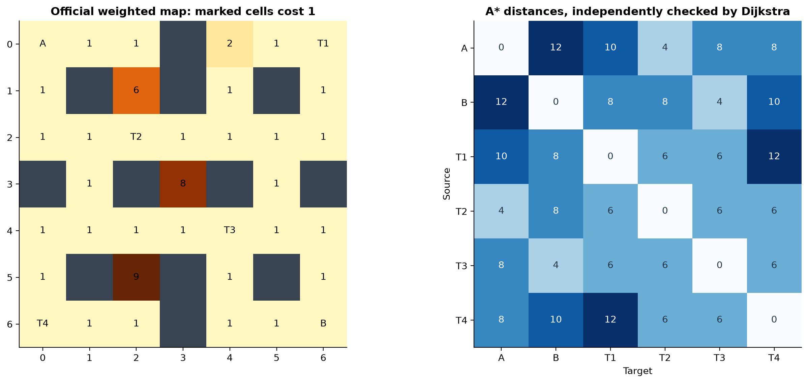
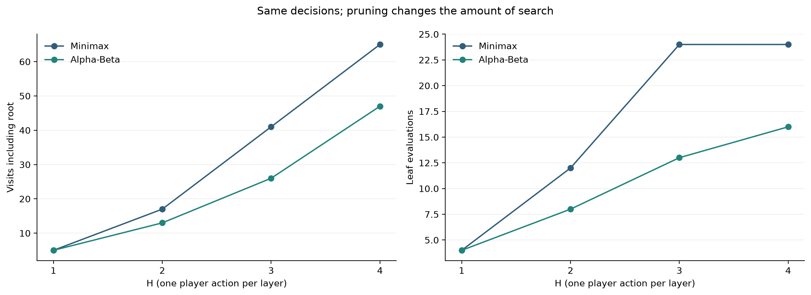
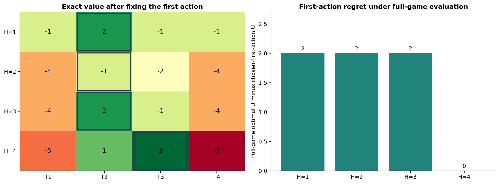
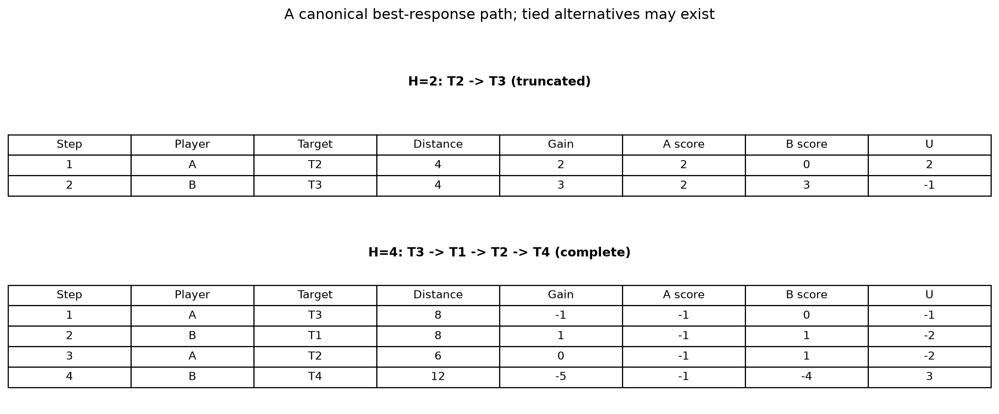
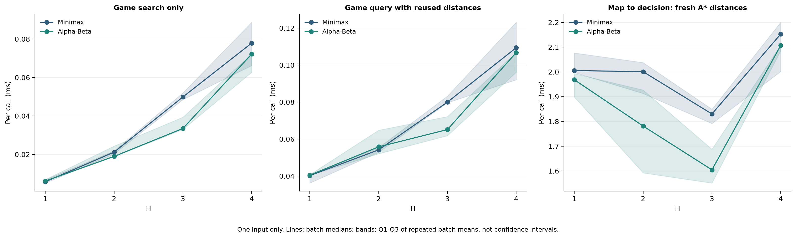

# 题四：距离验证与 H=1～4 深度对照分析

本轮已完成官方地图的全部 **36 项距离核对、30 条非对角线 A* 路径审计**，以及 H=1/2/3/4 的 Minimax 与 Alpha-Beta 对照。两种算法的首步和根值均正确：H=1～3 选择 T2，H=4 选择 T3。

完整博弈下，首选 T2 的最优响应收益差为 1，首选 T3 为 3。因此前三种浅层选择的**首步遗憾为 2**，完整搜索为 0。H=4 时 Alpha-Beta 将访问数由 65 减至 47，但本轮复用矩阵的完整博弈查询仅观察到约 2.42% 的耗时节省，不能仅凭节点减少认定稳定加速。

## 1. 本轮范围和实现

本轮只做前两项：距离验证与深度基础对照。访问优先级、即时收益排序和缓存留到后续实验。

输入来自 `cases/problem4.json`，原字节副本保存在 [input/problem4.json](input/problem4.json)。地图为 7×7，37 个可通行格、12 个障碍格，位置为：

| 标签 | 坐标（行、列） | 宝藏价值 |
|---|---|---:|
| A | (0,0) | — |
| B | (6,6) | — |
| T1 | (0,6) | 9 |
| T2 | (2,2) | 6 |
| T3 | (4,4) | 7 |
| T4 | (6,0) | 7 |

本题沿用进入格计费：初始位置不收费，随后进入数字格按数字权重计费，进入 A/B/T 格均为 **1**，包含目标格。经过未选择宝藏不自动收集；已取宝藏仍可通行，另一玩家不挡路。负 Gain 仍须作为合法行动处理，没有跳过回合。

状态包含双方位置、剩余宝藏、双方累计收益和当前行动者。每次选择一个宝藏：

```text
Gain = 宝藏价值 - 从行动者当前位置到宝藏的最小移动代价
U = Score_A - Score_B
```

A 最大化 U，B 最小化 U。一次玩家行动计一层，因此 H=2 是 A→B，H=4 是 A→B→A→B。到深度上限或宝藏取完时，按当前累计 U 评价。

核心 `src/` 保留原实现；新增三个实验模块：

- `experiments/treasure_reference.py`：独立 Dijkstra、路径累计、排列分组参考和逐行动回放。
- `experiments/exp4_depths.py`：输入审计、两算法与两种时间范围的批量测量。
- `experiments/analyze_treasure_depths.py`：保存数据核验、统计与绘图。

## 2. 第1项：距离矩阵与最短路径验证

现有 A* 对六个位置的所有有序非对角线位置对独立查询，共 30 次；六个对角线为零。独立 Dijkstra 使用自己的格子解析、四邻接和松弛逻辑，不导入待测 A* 的建图或代价函数。

原边 u→v 的权为进入 v 的代价 w(v)，终点也收费。全部 36 个矩阵元素一致：

| 起点/终点 | A | B | T1 | T2 | T3 | T4 |
|---|---:|---:|---:|---:|---:|---:|
| A | 0 | 12 | 10 | 4 | 8 | 8 |
| B | 12 | 0 | 8 | 8 | 4 | 10 |
| T1 | 10 | 8 | 0 | 6 | 6 | 12 |
| T2 | 4 | 8 | 6 | 0 | 6 | 6 |
| T3 | 8 | 4 | 6 | 6 | 0 | 6 |
| T4 | 8 | 10 | 12 | 6 | 6 | 0 |

本例六个端点的进入代价相同，矩阵呈对称；实现仍独立计算每个方向，没有将对称性强加于一般进入代价模型。测试另覆盖普通权重端点的非对称距离，避免误把有向进入代价当成无向边统一权重。

每条保存路径都检查端点、四邻接、障碍及累计进入代价，并逐格写入 [path_steps.csv](path_steps.csv)。所有非对角线路径最后进入目标的代价均为 1；初始格为 0。多条等价最短路径都可接受，不要求路径坐标必须唯一。



此外，在不导入任何实验或 src 模块的独立复核中，对 37 个顶点、84 条有向邻接边执行了 Bellman-Ford，再次确认全部距离。独立验证的时间不计入性能数据。

## 3. 第2项：深度对照的正确性

### 3.1 深度、首步和搜索量

正式搜索固定 T1、T2、T3、T4 的访问顺序，无排序、无缓存。Alpha-Beta 在同一次整根搜索中持续复用根 alpha，不对每个首步重置窗口。

| H | 两算法最优首步 | 两算法根值 U | Minimax 访问 | Alpha-Beta 访问 | Minimax 叶评 | Alpha-Beta 叶评 |
|---|---|---:|---:|---:|---:|---:|
| 1 | T2 | 2 | 5 | 5 | 4 | 4 |
| 2 | T2 | −1 | 17 | 13 | 12 | 8 |
| 3 | T2 | 2 | 41 | 26 | 24 | 13 |
| 4 | T3 | 3 | 65 | 47 | 24 | 16 |

访问数包含根和叶子。Minimax 完整树规模是根加上所有合法行动前缀：H=4 为 `1+4+12+24+24=65`，叶子为 24。H=3 同样有 24 个叶子，但终止在第三次行动后，不等于已经完成四回合博弈。

Alpha-Beta 的节点节省率按 H=1～4 为 **0%、23.53%、36.59%、27.69%**，叶子节省率为 **0%、33.33%、45.83%、33.33%**。节省率没有随深度严格递增。



### 3.2 四种首步的精确值

独立参考先枚举所有给定长度的行动排列，计算终止 U，再按 MAX/MIN 逐层分组回传。它不使用待测状态类或 Alpha-Beta。每个固定首步还另用无剪枝 Minimax 交叉核对：

| 深度 | 首选 T1 | 首选 T2 | 首选 T3 | 首选 T4 |
|---|---:|---:|---:|---:|
| H=1 | −1 | **2** | −1 | −1 |
| H=2 | −4 | **−1** | −2 | −4 |
| H=3 | −4 | **2** | −1 | −4 |
| H=4 | −5 | 1 | **3** | −7 |

16 项首步真值保存在 [action_values.csv](action_values.csv)。这些单首步诊断查询在计时外运行，不与整根剪枝的访问计数混合；也没有把有限窗口下的内部回传界冒充为精确子树值。

### 3.3 用同一个完整博弈标准评价首步

不同 H 的截断值 2、−1、2、3，评价时点不同，部分变化来自双方已行动次数不同。不能只根据这些数值断言某个深度的完整决策质量。

本轮将浅层选出的首步固定，再用 H=4 的完整最优响应评价：

| 搜索深度 | 选出的首步 | 该首步完整值 | 完整最优值 | 首步遗憾 |
|---|---|---:|---:|---:|
| 1 | T2 | 1 | 3 | 2 |
| 2 | T2 | 1 | 3 | 2 |
| 3 | T2 | 1 | 3 | 2 |
| 4 | T3 | 3 | 3 | 0 |

`首步遗憾 = 完整最优值 - 已选首步的完整值`。这里评价的是**初始首步**，后续按完整最优响应继续；不是双方整局反复采用浅层搜索的滚动对局结果。



## 4. 为什么 H=2 选 T2，H=4 却选 T3

H=2 仅看两次行动。首选 T2 时，A 获得 `6-4=2`；B 选择 T3 获得 `7-4=3`，截断 U=−1，是该深度四种首步中最大的值。

H=4 则看到后续位置和剩余宝藏的影响。按默认平局规则，一条完整最优响应路径为 T3→T1→T2→T4：

| 回合 | 玩家行动 | 距离 | 价值 | Gain | A累计 | B累计 | U |
|---|---|---:|---:|---:|---:|---:|---:|
| 1 | A→T3 | 8 | 7 | −1 | −1 | 0 | −1 |
| 2 | B→T1 | 8 | 9 | 1 | −1 | 1 | −2 |
| 3 | T3→T2（A） | 6 | 6 | 0 | −1 | 1 | −2 |
| 4 | T1→T4（B） | 12 | 7 | −5 | −1 | −4 | **3** |

如果固定首选 T2，完整响应路径为 T2→T3→T1→T4，最终 A=5、B=4、U=1。首选 T3 虽然即时 Gain 为 −1，最终收益差却更好。本题优化的是双方分数差，不能只看 A 自己的最终分数是否更高。

T3→T2→T1→T4 也是等值的最优响应示例，最终 A=2、B=−1、U=3。因此表中路径用于解释计算过程，最优性证据来自全部首步比较和完整回传，而不是仅展示一条顺序。



所有截断最优路径和固定首步后的完整路径都保存在 [principal_variations.json](principal_variations.json)、[action_ledger.csv](action_ledger.csv)。分析时逐行动重新核算位置、距离、Gain、累计分数与剩余集合，并核对轨迹中声明剪掉的分支确实未被访问。

## 5. 正式测量怎样进行

每种配置预热 2 次、校准 2 次，正式测 5 批。同一深度、同一计时范围的两算法使用相同调用次数。深度次序按固定参数种子 20261026 打乱，本轮为 H=2、3、4、1。

两种范围为：

| 范围 | 每次执行 |
|---|---|
| precomputed | 复用同一份已核对距离矩阵，执行博弈校验与搜索 |
| end_to_end | 从内存中的官方地图重新执行 30 次有向 A* 查询，再校验和搜索博弈 |

每批轮换两算法先后次序，并轮换两个范围的先后。每个范围共 20 对批次中，Minimax 先运行和 Alpha-Beta 先运行各 10 对。每个单独深度 5 批为 3/2 或 2/3，不能声称各深度都完全等次数。

实际循环数为：

| H | precomputed 每批次数 | end_to_end 每批次数 |
|---|---:|---:|
| 1 | 128 | 11 |
| 2 | 128 | 17 |
| 3 | 128 | 10 |
| 4 | 128 | 16 |

较快者每批约 25 ms 是软目标，受慢者估计批时约 200 ms 和最多 128 次限制；小查询达到次数上限后可以低于目标。计时正常启用垃圾回收，不复用搜索结果，正式调用关闭 trace。

时间字段：

- distance：完整模式下重新构建距离矩阵的时间，复用模式为零。
- search：原求值器内部博弈搜索和计数，排除输入校验。
- query：博弈输入校验、矩阵与价值数据复制以及搜索。
- total：实际外部批总时间/调用数，包含对应范围全部阶段及封装、循环、释放和收集。

文件读取、JSON 解析、独立参考、正确性检查、固定首步分析、轨迹与绘图在正式时间之外。end_to_end 指从**已在内存中的地图**开始，不含磁盘读取。

共保存 **80 行批次、5,660 次博弈求解调用**，其中复用矩阵 5,120 次、完整求解 540 次；完整求解中实际包含 **16,200 次 A* 查询**。试跑和预热、校准、审计的额外调用不计入这些数字。

## 6. 耗时结果及解释边界

### 6.1 复用距离矩阵

下表为 5 批每次调用均值的中位数，单位 ms。查询列采用外部 total，包含完整博弈调用与循环封装：

| H | Minimax search | Alpha-Beta search | 搜索加速比 | Minimax 查询 | Alpha-Beta 查询 | 查询加速比 |
|---|---:|---:|---:|---:|---:|---:|
| 1 | 0.005751 | 0.006147 | 0.936 | 0.040215 | 0.040455 | 0.994 |
| 2 | 0.021188 | 0.018959 | 1.118 | 0.054131 | 0.055764 | 0.971 |
| 3 | 0.049874 | 0.033480 | 1.490 | 0.079955 | 0.065126 | 1.228 |
| 4 | 0.077916 | 0.072220 | 1.079 | 0.109414 | 0.106767 | 1.025 |

加速比是同配置两算法时间中位数之比 `Minimax/Alpha-Beta`，大于 1 才表示更快。

H=1 没有少访问节点，Alpha-Beta 在本轮略慢；H=2 虽然搜索较快，加入输入校验和封装后查询略慢。Alpha-Beta 每个访问节点还要维护上下界，查询也包含完整矩阵校验和复制，因此减少节点不意味着等比例减少时间。H=3 的查询节省约 18.55%，H=4 约 2.42%。H=4 的查询 Q1–Q3 为 Minimax **0.092075–0.123210 ms**、Alpha-Beta **0.096123–0.106872 ms**，范围重叠，当前小样例不足以证明稳定的实际耗时优势。

### 6.2 从地图开始的完整求解

| H | Minimax 完整/ms | Alpha-Beta 完整/ms | 完整加速比 |
|---|---:|---:|---:|
| 1 | 2.005527 | 1.968536 | 1.019 |
| 2 | 2.000965 | 1.781371 | 1.123 |
| 3 | 1.830140 | 1.604380 | 1.141 |
| 4 | 2.153013 | 2.107275 | 1.022 |

H=4 的矩阵构建中位数分别为 2.020269、1.991938 ms，博弈接口中位数为 0.131675、0.114419 ms，可见该完整流程主要花在寻路和矩阵构建上。各列独立汇总，不能通过中位数相加来重建总时间；完整总时间是直接外部测量所得。

**Alpha-Beta 不会减少这 30 次 A* 查询。** 两算法的距离阶段执行相同输入和相同代码，所以距离阶段时间差异不能解释成剪枝优化了寻路。例如 H=2、H=3 的完整倍率还受到距离阶段运行波动影响，不能全部归因于博弈搜索的改进。完整时间随 H 也没有严格单调关系。



本轮只有一个官方输入。5 批计时表示对同一输入的重复测量，不是 5 张独立地图。图中的 Q1/Q3 是重复批时的分散，不是置信区间，也没有进行跨地图的统计显著性检验。时间结果用于记录当前实现和成本分布，决策正确性和确定性计数的证据更直接。

## 7. 验证与已保存文件

全部 **133 项测试通过**，其中本轮新增 9 项，覆盖非免费目标、有向进入代价、零权与不可达、负收益与同值、随机非对称博弈、深度边界、原输入保护、完整配对、时间范围和错误证据拒绝。

另使用未导入生产或实验模块的程序，以 Bellman-Ford 和另一份带/不带剪枝状态递归独立重算了所有距离、8 个深度与算法结果、16 项首步值、80 行计数与时间汇总。输入、源码归档和实际运行顺序均核对通过。

| 文件 | 用途 |
|---|---|
| [input/problem4.json](input/problem4.json) | 官方输入原字节副本 |
| [distance_matrix.json](distance_matrix.json)、[dijkstra_reference.json](dijkstra_reference.json) | A* 与独立参考矩阵 |
| [distance_audit.csv](distance_audit.csv) | 全部 36 项矩阵核验 |
| [paths.json](paths.json)、[path_steps.csv](path_steps.csv) | 30 条最短路径与逐格计费 |
| [proof.csv](proof.csv) | 8 个深度与算法组合的决策、计数 |
| [action_values.csv](action_values.csv) | 16 项固定首步精确值 |
| [decisions.csv](decisions.csv) | 深度、首步、完整评价与 regret |
| [action_ledger.csv](action_ledger.csv)、[principal_variations.json](principal_variations.json) | 主变化路径及逐行动收益 |
| [search_traces.json](search_traces.json) | 全部深度两算法的轨迹 |
| [raw.csv](raw.csv)、[calibration.csv](calibration.csv) | 正式原始批次与校准记录 |
| [summary.csv](summary.csv)、[paired_summary.csv](paired_summary.csv)、[summary.json](summary.json) | 配置时间分布与算法对照 |
| [config.json](config.json) | 环境、输入哈希、计时范围和完成状态 |
| [source_baseline.zip](source_baseline.zip) | 66 个运行时源码、测试、用例与依赖文件 |
| [verification.json](verification.json) | 独立复算、顺序、哈希、旧文件和视觉核验 |
| [figures/](figures/) | 5 组 PNG/SVG |

原有 680 个文件中，678 个哈希保持不变，仅两个 README 增补本轮说明；10 个核心源码和 616 个既有结果文件均保留原字节。源码在正式测量前冻结，之后没有修改代码或测量数据。

运行标识为 `p4_depths_20261026T023830_178868Z`。Windows 11、Python 3.13.9、Matplotlib 3.11.2。配置记录的开始与采集完成时刻为 2026-10-26 02:38:30.178958–02:38:31.771539 UTC，包含审计、预热、校准、测量和保存；之后的图表和本报告整理不包含在该区间。

```text
input/problem4.json SHA-256
5086ac2e3d848f434a41140b34e02fbaa6961ff84e0bd97a116b469b639d1890

raw.csv SHA-256
19cccac76431603d1822517ae3025027d8e11be4ff63d1c6ec076a05aac79b5d

source_baseline.zip SHA-256
43a0fe6c13aed174f5b88e695fcb2ca62b480cf93065dfe6bf37508890418097
```

## 8. 怎样复现

在项目根目录执行，输出必须选择新的空目录：

```powershell
# 默认官方输入、四种深度、两算法、双范围、正式5批
python -m experiments.exp4_depths --out results/problem4_depths_new

# 使用本轮保存的输入重新测量
python -m experiments.exp4_depths --input results/problem4_depths/input/problem4.json --out results/problem4_depths_repeat

# 仅核验、重新汇总和绘图
python -m experiments.analyze_treasure_depths --results results/problem4_depths

# 全套测试
python -B -m unittest discover -s tests -v
```

重复运行应保持距离、首步、根值和确定性计数一致，耗时会受系统状态影响。如果后续源码改变，分析器会提示版本不符，可在新目录解压本轮源码归档并配合保存的结果复现。

本轮已完成距离和深度基础实验。下一步可固定 H=4，做 24 种全局访问优先级对照，再测试按行动者即时 Gain 排序；两者另建结果目录，保持当前基线可复查。
